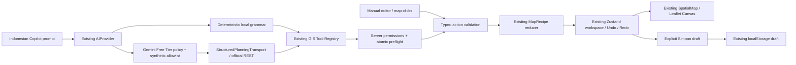

# Phase 13 — Free AI Map Creator & Vector Geometry Editor

Date: **17 October 2026 (Asia/Jakarta)**. Branch: `feat/phase13-free-ai-map-creator`.
Draft PR: [#9](https://github.com/HannR002/p4i-webgis/pull/9) → `security/phase12-gee-dependency-isolation`. Implementation commit: `dca2d74988fabc0c653f27d9b9002d44c4a03b59`.

Base: `security/phase12-gee-dependency-isolation` at `3762e34b4a58c93cee0177fca542641cf6c8b6ed` (PR #8, verified open/draft/unmerged before branching). Phase 12 is included by ancestry; no cherry-picking, history rewrite, dependency updates, migrations, deployment or GEE activation.

## Delivered and live status

**IMPLEMENTED_AND_TESTED locally:** editable GeoJSON points and polygons in the existing Map Workspace; layer management; Indonesian deterministic planning through the existing GIS registry; atomic map actions; Undo/Redo; explicit local draft save/load; GeoJSON, PNG and PDF export.

**IMPLEMENTED_DEMO_ONLY:** the deterministic Indonesian planner is a closed grammar, not an LLM. Existing DEMO datasets remain synthetic. User-entered coordinates are retained, not claimed to be measurements or official boundaries.

**LIVE_INTEGRATION_PENDING:** the Gemini REST adapter is integrated with `AIProvider` and `StructuredPlanningTransport`, tested using injected HTTP mocks only. No Gemini key/project billing attestation was supplied or used. No real inference request was made. The application never automatically claims `LIVE_VERIFIED` based on environment settings or mocked success.

The existing Phase 12 production blockers and security review remain applicable. Zero production npm audit findings does not constitute a security certification or deployment approval.

## Architecture and routes



- `/spatial/viewer`: Layer tab contains **Editor vektor lokal**, alongside existing raster, analysis and export controls.
- `/spatial/ai`: same workspace and Copilot, not another editor.
- `POST /api/gis/copilot`: existing planning/execution endpoint, extended with validated vector actions and optional bounded `selectedVectorIds`.
- `GET /api/gis/copilot`: safe provider/pending-status DTO, no credentials, project identifiers or operator references.
- Existing portal, catalog, help, Pixel Inspector, AHP/WLC, Flood, controlled compute, consulting and export routes remain.

`MapRecipe.schemaVersion` stays 1. Optional `sketchLayers` is backward compatible with older drafts. Local sketches are separate from catalog dataset identities inside the same recipe/reducer; they cannot impersonate an authorized dataset or production project. No second map renderer, provider framework, analysis engine or persistence repository was introduced.

## Geometry and action contracts

`lib/gis/vectorEditing.ts` defines `SketchLayer`, `SketchFeature`, `SketchProperties`, `SketchStyle`, `LonLat` and `VectorAction`.

Each layer stores a real GeoJSON `FeatureCollection<Point | Polygon>`, visibility, opacity, name and default style. Feature properties contain a name, description, bounded scalar attributes and an optional style override. Only consumed, validated fields survive recipe parsing.

| Contract | Enforcement |
| --- | --- |
| Coordinate semantics | WGS84/EPSG:4326 GeoJSON `[longitude, latitude]`; viewport remains existing `[latitude, longitude]` |
| Bounds | Finite longitude −180…180, latitude −90…90; exactly two components |
| Polygon | One exterior ring; automatic closure; 3–128 distinct vertices; duplicates, degenerate turns, self-intersections/touches and ambiguous antimeridian edges rejected |
| Precision | Intersection/degeneracy tolerance `1e-12` in coordinate-space cross products; this is an editing guard, not a survey accuracy claim |
| Complexity | ≤8 local layers; ≤100 total features; ≤50 points in one batch; ≤64 KiB sketch payload |
| Attributes | ≤12 keys; safe ASCII names ≤32 characters; scalar boolean, finite bounded number, or string ≤200 characters; prototype keys rejected |
| Text/style | Name ≤80; description ≤500; HEX colors; stroke 0–10; fill opacity 0–1; point radius 2–20 |
| Identity | Reducer generates deterministic `local-vector-N` / `local-feature-N` session IDs; creation payloads cannot assign IDs or project/role fields |
| Persistence | Existing whole-draft 64 KiB ceiling is checked before save and on load/import; large configurations plus vectors may need reduction |

Local tools are `createVectorLayer`, `updateVectorLayer`, `createPoint`, `createMultiplePoints`, `createPolygon`, `createPolygonFromSelectedPoints`, `updateFeatureGeometry`, `updateFeatureProperties`, `styleFeature`, and `deleteFeature`. Existing `createMap`, `setMapTitle`, `setBasemap`, and `setViewport` are reused. `updateVectorLayer` handles rename, visibility, opacity, default style, ordering and removal.

Renaming points/polygons uses `updateFeatureProperties`; editing coordinates/vertices uses `updateFeatureGeometry`. Point-to-polygon type changes are rejected. Selected-point construction resolves actual existing Point IDs in explicit order; unknown, repeated or non-Point IDs fail. Name-based planning requires unambiguous existing names.

A complete AI plan is preflighted before execution and committed to the existing store once. A failed last action cannot partially commit earlier edits. Manual actions also run through the same parser/reducer. Existing stale-response checks and server-side dataset entitlement checks remain in effect. Local sketch editing does not grant access to restricted catalog data or persistence.

## Supported Indonesian instructions

These examples run locally with `GIS_DEMO_MODE=true`, `AI_PROVIDER=demo` in development:

```text
Buatkan peta baru bernama Survei Lapangan dan gunakan OpenStreetMap.
Buat layer vektor bernama Survei
Tambahkan titik A pada longitude 103.61 dan latitude -1.61, warna merah.
Tambahkan titik B [103.62, -1.61]; C [103.62, -1.62]; D [103.61, -1.62]
Buat poligon dari titik A, B, C, dan D. Beri warna hijau dengan transparansi 40%.
Buat poligon dari titik terpilih
Buat poligon Area [103.61,-1.61] [103.62,-1.61] [103.62,-1.62]
Ubah titik A menjadi Z
Ubah titik Z longitude 103.60 dan latitude -1.60
Ubah titik Z warna biru
Edit poligon Area [103.60,-1.60] [103.63,-1.60] [103.63,-1.63]
Hapus titik Z
Ubah layer vektor "Survei" menjadi "Survei revisi"
Sembunyikan layer vektor "Survei revisi"
```

For multiple local layers, specify `pada layer "nama unik"`. Use quoted names for names containing spaces. Supported named colors: merah, hijau, biru, kuning, hitam; HEX colors are also accepted. Polygon transparency 40% means fill opacity 60%. Existing catalog/planning/analysis prompts still use the previous grammar.

Missing coordinates produce `needs-input`, with no replacement location. Ambiguous point names request clarification. Invalid geometry is rejected. This deterministic grammar does not claim arbitrary natural-language understanding. `Simpan peta` asks the user to click **Simpan draft**; it never persists automatically. Existing preview mode shows exact tool parameters before application.

## Manual workflow

1. Open Map Workspace → Layer → Editor vektor lokal; add/select a named vector layer.
2. Use **Tambah titik dengan klik**, or the keyboard-accessible longitude/latitude form. Coordinates use decimal points, not decimal commas.
3. Use **Gambar poligon**, click vertices (existing points can be used as vertices), then **Selesaikan poligon**. Remove the last unfinished vertex or cancel through **Selesai edit**.
4. Alternatively select actual points using the ordered checkbox list and click **Poligon dari titik pilihan**. Invalid crossing order is rejected.
5. Select a feature from the map or list. Edit its name/description, GeoJSON coordinates, color and fill opacity; delete if required. Polygon vertex editing uses a validated coordinate textarea, not draggable vertex handles.
6. Change layer visibility, opacity, ordering or style. Feature styles override layer defaults.
7. Use existing Undo/Redo; click **Simpan draft** to authorize browser-local persistence and **Buka** to reload. Downloads are explicit user actions: local-layer GeoJSON, existing recipe JSON, PNG and PDF.

Switching to Pixel Inspector, measurement or pan cancels the active drawing mode so existing GIS tools remain usable. Draft vertices are not persisted until the polygon is completed. Local sketches render in their own Leaflet panes above catalog layers, with local-vector legend entries; exports use the same map. PDF provenance includes local layer/object names, geometry types and the absence of official-boundary/measurement claims.

## Gemini Free Tier preparation and privacy

Official documentation retrieved on 17 October 2026 lists **stable `gemini-2.5-flash-lite`**, structured outputs support, and free-of-charge standard input/output for eligible Free Tier accounts:

- [Model capabilities](https://ai.google.dev/gemini-api/docs/models/gemini-2.5-flash-lite)
- [Structured outputs](https://ai.google.dev/gemini-api/docs/structured-output)
- [GenerateContent API](https://ai.google.dev/api/generate-content)
- [Pricing](https://ai.google.dev/gemini-api/docs/pricing)
- [Gemini API terms](https://ai.google.dev/gemini-api/terms)

Documentation excerpts are retained in `docs/evidence/phase-13/google-*.json`. Public documentation GET requests are not model inference. Model documentation does **not** verify this user's account, region, billing state, quota or API access.

The adapter uses the official `v1beta/models/gemini-2.5-flash-lite:generateContent` REST endpoint with `generationConfig.responseMimeType=application/json` and `responseJsonSchema`, then converts the bounded response to an existing `GISExecutionPlan`. These GenerationConfig fields remain documented; Google now also documents newer response-format configuration. Exact live response compatibility remains to be tested only after authorized Free Tier verification. No Google SDK or new npm dependency was added.

### Default and conditional configuration

Live calls are disabled by default. Selecting `AI_PROVIDER=gemini-free` does not suffice; the adapter checks all of these **server-only** settings for every request:

| Setting | Required meaning |
| --- | --- |
| `GEMINI_FREE_ENABLED` | Explicit `true` for a supervised development-only trial |
| `GEMINI_MODEL` | Exactly `gemini-2.5-flash-lite` |
| `GEMINI_BILLING_STATUS` | `verified-free`, confirmed by operator in Google AI Studio for the key's project |
| `GEMINI_PROJECT_ID` | Operator-verified project identity; not sent in planner context |
| `GEMINI_OPERATOR_REFERENCE` | Reference to the operator's verification/authorization record |
| `GEMINI_VERIFIED_AT` | ISO timestamp, not in future and at most one hour old |
| `GEMINI_API_KEY` | Server environment secret; never a `NEXT_PUBLIC_*` value |
| `GEMINI_VERIFIED_KEY_SHA256` | SHA-256 binding to the exact key inspected by the operator; changing the key invalidates the attestation |
| `GEMINI_PUBLIC_SYNTHETIC_APPROVED` | Explicit `true` after approval of the fixed public synthetic scenario and Google's data terms |

**An API key is not proof of Free Tier.** An application setting is an operator attestation, not a Google billing API verification. The application cannot discover a silent out-of-band billing change. The operator must verify project/key, no paid billing attachment/upgrade, current model eligibility, region/terms and remaining quota before a supervised trial, and immediately disable the adapter if any condition changes or becomes uncertain. The one-hour ceiling is not proof that billing remains unchanged during that interval. Do not enable this configuration when such assurance cannot be established. Production is explicitly refused regardless of settings, pending durable governance and further review.

The policy never enables billing, provisions a resource, attaches Google tools, performs grounding, calls GEE, retries a request, changes models/providers, or falls back to DEMO after a real-provider error.

### Data allowlist, not regex filtering

The first live trial accepts **only the server-owned `SYNTHETIC_GEMINI_PROMPT` and the exact empty canonical recipe**. It rejects other prompt text, edited map title/description/viewport, nonempty geometry, private/catalog context, configurations and selected features. The server derives catalog permissions; the client cannot mark private data public. After matching, the adapter reconstructs a new fixed payload and discards caller context, including catalog/AOI metadata. The approved coordinates are `[0,0]`, `[0.01,0]`, `[0.01,0.01]`; provider-generated geometry outside this sample is rejected.

When this provider is selected, **Siapkan sampel publik Gemini** explicitly prepares the empty workspace and fixed sample prompt; a separate send action is still required. This does not bypass missing billing confirmation or credentials. Free-form requests and private maps remain blocked from Gemini in this phase; use the local deterministic planner/manual editor. Future public-data expansion needs a server-owned classification/authorization design and separate review, not a browser checkbox declaring data public.

Google's Unpaid Services terms describe use of submitted/generated content to improve products and possible human review, with applicable regional terms. Do not submit sensitive, confidential or personal information. No client data, precise sensitive AOIs, service-role tokens, internal documents or database contents were sent in this work.

### Limits and failure behavior

- Existing prompt 2,000 characters, 16 plan actions, HTTP request 64 KiB and plan/result limits remain.
- Gemini request body ≤16 KiB; generated output ≤1,024 tokens, thinking budget zero; HTTP response read is stopped above 32 KiB before JSON parsing; single candidate with completed `STOP` required.
- Existing planner deadline 5 seconds, execution deadline 10 seconds; no automatic retries.
- At most one attempt per minute and five attempts per provider instance lifetime, including failures. These are deliberately restrictive development limits, **not durable account quotas**; development restarts/HMR or separate workers can reset/isolate this state. Production stays disabled.
- Metadata-only bounded usage log: provider/model, outcome, elapsed time and token counts. Cost stays `UNKNOWN`; token counts do not prove a zero bill. No prompt, coordinates, key or provider error body is logged.
- Safe errors distinguish unverified tier, missing key, private context, unavailable model and exhausted quota; invalid output/network failure/timeout fails without applying changes or switching provider. Manual editing remains available.

## Verification evidence

[Machine-readable summary](evidence/phase-13/verification-summary.json), logs, API results, browser results and synthetic export metadata are committed under `docs/evidence/phase-13/`.

| Verification | Result |
| --- | --- |
| Node / npm | 22.23.3 / 10.9.9 |
| `npm ci` | Passed; package manifests and lockfile unchanged |
| `npm run lint` | Passed |
| `npm run typecheck` | Passed |
| `npm test` | **314 passed in 42 files**, preserving 269 Phase 12 tests and adding 45 cases |
| `npm run build` | Passed, Next.js 16.3.8 |
| Existing browser suites | All nine passed: phases 01 smoke/regression, 02 smoke/accessibility, 03 raster, 04 configuration, 05 Copilot, 06 compute, 07 deliverables |
| New browser suite | Indonesian map/points/polygon; actual Canvas rendering; manual edits; click drawing; save/load; Undo/Redo; GeoJSON/PNG/PDF downloads |
| New responsive/Axe checks | 320, 390, 768, 1480 px: no horizontal overflow; zero scoped WCAG A/AA violations; zero page errors |
| Production-mode local API checks | 12 passed; fixtures/unauthorized operations remain refused |
| Local image checks | 3 passed |
| Phase 12 dependency/build isolation | Passed; Earth Engine SDK/auth chain remains absent |
| Fresh production npm audit | 0 affected packages; this is not a penetration test |
| External inference / migrations | None |

Tests cover strict vector contracts, invalid coordinates, self-intersection, complexity, deterministic IDs, attributes, selected points, styling, vertex changes, deletion/Undo/Redo, serialization, atomic failures, permissions, selected-ID tampering, structured response validation, privacy refusal, absent/expired/changed-key attestation, paid status/model refusal, no fallback, quota, provider error redaction, oversized output and timeout. All Gemini HTTP tests inject mocks; default tests never call the model.

Initial verification found and fixed a readonly test assignment, heading-order violation and an unstable textarea accessible name containing coordinate text. The new QA harness was corrected to use the actual `/spatial/viewer` route, existing **Buka** label, cleared-prompt submit behavior and the existing **Canvas** renderer (not SVG). Final new-editor and raster checks were repeated after tool-mode fixes. `browser-exits.txt` retains the initial heading failure and its successful recheck rather than hiding it.

The PostGIS/PostgREST rehearsal was not repeated: this phase changes no database objects/adapters. Earlier rehearsal evidence remains in Phase 12; no external database was touched. Screenshots are actual browser output, not design mockups:

- [Desktop editor](evidence/phase-13/editor-1480.png)
- [Mobile editor](evidence/phase-13/editor-390.png)
- [Download synthetic exported map PNG](evidence/phase-13/synthetic-map-export.png)
- [Download synthetic GeoJSON](evidence/phase-13/synthetic-vector.geojson)

PDF download was generated and verified by the browser suite; file size/hash are in `exports.json`. The large PDF binary is not checked into Git.

## Limitations and next integration requirements

- Gemini live access is pending; no real-LLM or billing-zero success is claimed. A reviewed, authorized synthetic trial is required before recording `LIVE_VERIFIED` evidence.
- The local grammar is intentionally limited; free-form real LLM map editing is not yet enabled. Complex names/phrasing may require clarification or the manual editor.
- Local geometry supports Point and single-ring Polygon only; no holes, MultiPolygon editing, topology repair, snapping tolerance, projected editing, antimeridian polygons or survey-grade validity certification. Leaflet's Web Mercator display can clip extreme latitudes although stored WGS84 coordinates remain unchanged.
- The local style/geometry schema is not a new raster or GIS compute engine. User-created sketches are not silently treated as catalog analysis datasets or official administrative boundaries.
- Current persistence is browser-local; local drafts may contain user-sensitive data and are not a multi-user security boundary. No synchronization, publication or production table was added. AI session edits do not authorize persistence or client publication.
- Quotas, usage and approval state remain process-local where previously documented. Production also remains blocked on real-data rights, database foundation/security integration, durable governance, commercial GEE/LLM decisions, multipart containment, hosting verification and human UAT.
- Phase 12's unresolved development-toolchain `braces` advisory remains subject to maintainer security review. This phase does not waive or remediate it; runtime dependencies are unchanged.
- Scientific methodology validation/ranking remains out of scope. No approvals, real-world measurements, cadastral claims or scientific accuracy findings were fabricated.

The exact cumulative file inventory relative to Phase 12 is in [changed-files.txt](evidence/phase-13/changed-files.txt).

Review this child PR against Phase 12 first. Keep PRs #1–#8 intact; incorporate changes through the approved stacked review workflow. Nothing was merged, deployed or applied to an external database.
