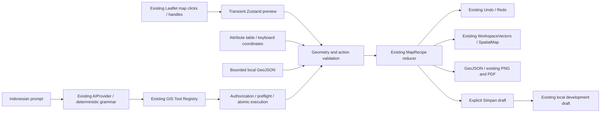
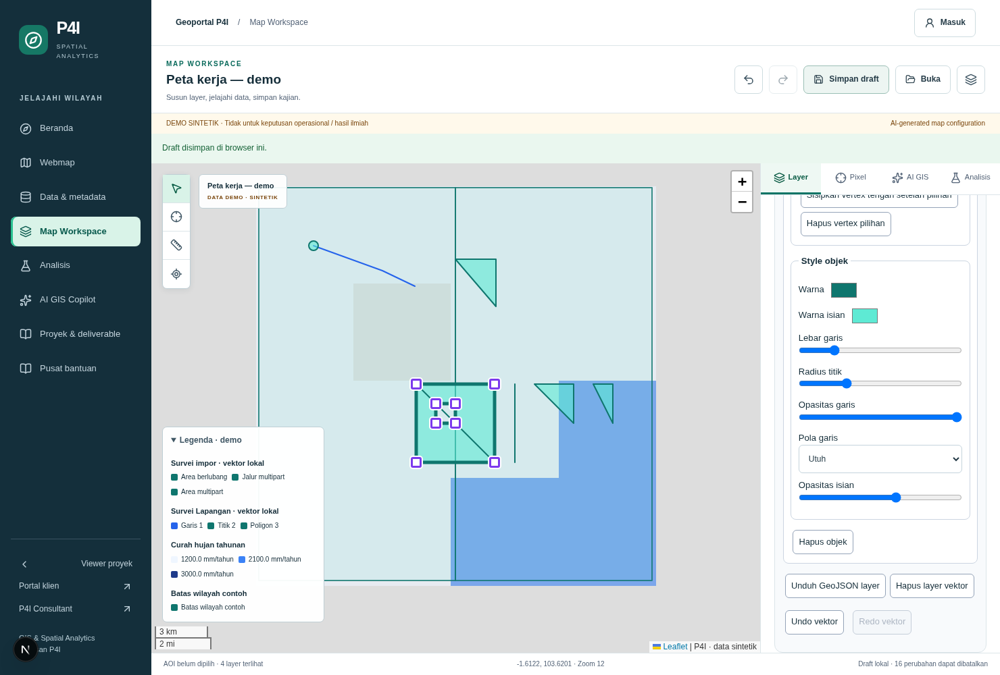

# Phase 14 — Advanced Vector Digitizing

Date: 18 October 2026 (Asia/Jakarta; execution started 17 October UTC).
Branch: `feat/phase14-advanced-vector-editor`.
Base: Phase 13 `64d667856d37509a0355a7806c587112ccd0e54e`, verified head of draft PR #9 targeting `security/phase12-gee-dependency-isolation`.
Delivery: [Draft PR #10](https://github.com/HannR002/p4i-webgis/pull/10) → `feat/phase13-free-ai-map-creator`. Implementation commit: `32b9119156e7f2c98e28f019cea460bdd60fb25d`. No merge or deployment.

## Outcome and scope

P4I's existing workspace is extended as a **vector-first GIS workspace**, retaining its raster engine, Pixel Inspector, AHP/WLC, Flood foundation, controlled Copilot, consulting workflows and exports. No separate map renderer, persistence system, AI framework, database table, deployment or scientific methodology validation was added.

| Capability | Status | Actual implementation |
| --- | --- | --- |
| Point, LineString, Polygon drawing | IMPLEMENTED_AND_TESTED | Actual Leaflet map clicks, transient previews, explicit Finish, Escape/cancel, coordinate readout |
| Vertex editing | IMPLEMENTED_AND_TESTED | Draggable handles, one commit/history entry per completed drag, invalid-final-position refusal, keyboard move/insert/remove |
| MultiLineString, MultiPolygon and holes | IMPLEMENTED_AND_TESTED within bounded subset | Import, validation, rendering, vertex editing of every part/ring, serialization and export |
| Advanced topology / multipart creation UX | PARTIALLY_IMPLEMENTED | No dedicated hole/part drawing, union/split/repair, shared-edge propagation, survey precision, or antimeridian editor; create multipart through validated import |
| Screen-space snapping | IMPLEMENTED_AND_TESTED | Visible local layers, vertex/segment switches, 2–30 CSS pixel tolerance, active Leaflet projection, target indicator |
| Attribute table and layer explorer | IMPLEMENTED_AND_TESTED | Filter/select/edit, typed scalar fields, zoom, count, style, visibility, order, opacity and confirmed removal |
| Indonesian natural-language editing | DEMO_ONLY | Functional deterministic closed grammar through the existing trusted registry/executor; not a connected LLM |
| Gemini real inference | BLOCKED / LIVE_INTEGRATION_PENDING | Default disabled, synthetic-only Phase 13 allowlist frozen; Phase 14 tools explicitly excluded from the real adapter |
| Production persistence / PostGIS topology | BLOCKED / EXTERNAL_INTEGRATION_PENDING | Existing development draft storage only; no external database actions |

No actual client geometry, external inference, paid service, GEE operation or confidential dataset was used. Test geometry is synthetic or user-authored session data, never an authoritative government boundary.

## Architecture and file inventory

No routes were added. `/spatial/viewer` and `/spatial/ai` share the existing workspace. `/api/gis/copilot` remains the server planning/execution boundary. The Layer tab exposes the manual editor; Copilot can also open the same attribute-table component.

Source changes:

- `lib/gis/vectorEditing.ts`: compatible geometry/style contracts; bounded lines, rings, holes and multipart validation; vertex operations; import validation; five typed registry actions; deterministic reducer behavior.
- `lib/gis/vectorSnapping.ts`: pure screen-space snapping against validated local layers only.
- `store/useWorkspaceStore.ts`: transient drag state, edit epoch, cancel/finish, atomic commit, selection reconciliation and existing history integration.
- `components/gis/WorkspaceVectors.tsx`: same Leaflet panes/Canvas renderer, all five geometry types, previews, snapping indicator, draggable vertex handles.
- `components/gis/VectorEditorPanel.tsx`: drawing/edit tools, metadata/count, style controls, confirmed layer removal and advanced editor composition.
- `components/gis/VectorGeometryControls.tsx`: keyboard vertex controls, snap settings and bounded local file input.
- `components/gis/VectorAttributeTable.tsx`: shared table with safe scalar editing, filtering, selection, layer fields and zoom.
- `components/gis/MapWorkspace.tsx`: unfinished-edit save guard and uniquely labeled recipe import.
- `components/gis/CopilotPanel.tsx`: new Indonesian suggestions, edit-epoch stale-response guard, layer-removal confirmation and actual attribute-table result.
- `lib/server/ai/providers/advancedVectorPlanner.ts`: closed Indonesian grammar resolving existing IDs/coordinates.
- `lib/server/ai/providers/vectorPlanner.ts`: dispatch into the extended planner using existing architecture.
- `lib/server/ai/providers/geminiFree.ts`: freeze the Phase 13 external tool allowlist; reject newly supported geometry outside that allowlist.
- `app/spatial/gis.css`: handles, table overflow, readable controls, active tool styling and responsive layout.
- `tests/advancedVector.test.ts`: new geometry, import, snapping, history, authorization and planner regression coverage.
- `tests/geminiFree.test.ts`: mocked rejection of Phase 14 tools by the real adapter.
- `scripts/qa/phase-14-vector-digitizing.mjs`: actual Chromium interactions and responsive/accessibility checks.
- `scripts/qa/phase-01-regression.mjs`, `scripts/qa/phase-02-smoke.mjs`: target the uniquely labeled MapRecipe file input now that a second, separate GeoJSON input exists; original assertions preserved.
- This report, `docs/implementation-report.md` addendum, Phase 13 report addendum, and `docs/evidence/phase-14/*` record delivery and executed evidence. No dependency manifest or lockfile change.

## Geometry contracts and limits

`SketchFeature.geometry` now accepts `Point | LineString | Polygon | MultiLineString | MultiPolygon`. `MapRecipe.schemaVersion` remains 1; `sketchLayers` remains optional. Existing Phase 13 Point/Polygon drafts load through the same parser.

| Constraint | Behavior |
| --- | --- |
| Coordinates | Exactly two finite values: longitude −180…180, latitude −90…90. Leaflet and existing viewport conversion explicitly use latitude, longitude. No silent reprojection. |
| LineString | 2–128 positions; no consecutive duplicate or ambiguous >180° longitude segment. Self-crossing lines are permitted GeoJSON lines, not certified network topology. |
| Rings | 3–128 distinct vertices plus closure; no zero area, backtracking, repeated vertex, self-intersection or nonadjacent touching. Straight intermediate vertices are allowed for insertion. |
| Holes | ≤8 rings per polygon; holes strictly inside exterior, without touching/crossing/nesting/overlapping another hole. |
| Multipart | ≤8 parts; ≤512 total positions per feature, including ring closures. MultiPolygon exterior components must be disjoint and non-touching. Islands inside another component's hole are conservatively rejected. |
| Global local caps | ≤8 layers, ≤100 total features, ≤64 KiB sketch payload; existing full-draft 64 KiB save limit retained. Oversize changes fail atomically, never truncate. |
| Properties | Name ≤80 characters; description ≤500; ≤12 scalar attributes per feature; safe ASCII field names ≤32; string ≤200, finite numeric magnitude ≤1e12, boolean. Prototype keys rejected. |
| Style | HEX colors, stroke width 0–10, radius 2–20, fill/stroke opacity 0–1, dash enum solid/dash/dot. New style fields optional for old drafts. |
| Identity | Server/reducer generates local session IDs deterministically. Actions cannot assign trusted IDs. Imported source IDs are validated for safe shape and uniqueness, then replaced by fresh local IDs. |

Planar orientation/intersection guards use a `1e-12` coordinate-space cross-product tolerance. These are conservative editing guards, **not survey-grade topology or a scientific accuracy claim**. No ellipsoidal area/distance measurement was added. Polar/antimeridian topology, large geometry, automatic repair, polygon Boolean operations, and cross-feature topology remain future work. Winding is preserved; export does not claim orientation canonicalization. Legacy single-ring draft/coordinate edits retain Phase 13 closure normalization; GeoJSON imports must already contain closed rings.

## Manual workflow

1. Open Layer → Editor vektor lokal. Create or choose an editing layer. Metadata states EPSG:4326, feature count and local/user-created provenance.
2. Choose **Tambah titik dengan klik**, **Gambar garis**, or **Gambar poligon**. Click on the actual map. Preview and numbered vertex coordinates remain transient. Use **Selesaikan garis/poligon**. Double-click zoom is disabled in drawing/edit modes; explicit Finish is the supported completion mechanism.
3. **Batalkan gambar / edit (Esc)** discards unfinished geometry and preview. Switching tool/layer/panel cancels transient editing. Saving refuses an unfinished draw/drag; recipe/GeoJSON export contains committed geometry only.
4. Select via map, list or table. Choose **Edit vertex** to reveal violet handles for all selected parts/rings. Drag a handle; only the completed valid drag enters Undo. An invalid final position restores the original, rather than silently committing the last valid intermediate preview.
5. Keyboard alternative: choose part/ring and vertex number; enter explicit longitude and latitude; move, insert a segment midpoint, or remove. Midpoints are interpolation of an existing segment, not new measured coordinates. Ring closure is preserved.
6. Open **Tabel atribut**. Filter rows, select objects, edit the name or typed cell on blur, add a field across the layer, remove a field with confirmation, or zoom to selection. New fields receive explicit typed empty/zero/false defaults. Existing imported sparse fields remain sparse until edited; imported mixed-type columns are not represented as a strict database schema.
7. Set layer/feature stroke, fill, radius, opacity and dash. Layer style controls are collapsible. Selection uses heavier stroke; handles and snap target remain distinct. Reordering updates actual Leaflet pane order; catalog/raster panes are preserved.
8. Delete a layer only after the confirmation dialog. Copilot removal/replacement of existing layers also asks before applying locally. Undo restores the prior recipe.
9. Save through **Simpan draft**. This is browser development storage, not a server project. Export a layer through **Unduh GeoJSON layer**; existing PNG/PDF export captures the same map. Finish editing first for a clean image without editing overlays.

## Snapping semantics

Snapping defaults to enabled, with vertex and segment targets and a 12 pixel tolerance configurable from 2 to 30. Leaflet `latLngToContainerPoint` / `containerPointToLatLng` use the current projection and zoom. Segment projection occurs in screen space; no constant-degree distance is represented as a constant screen tolerance.

Visible, positive-opacity local sketch layers are candidates. Catalog/provider geometry is never queried or copied for snapping. The feature being dragged is excluded entirely, preventing unintended self/topological propagation. Vertex targets take priority within tolerance; nearest segment is used when no eligible vertex exists. Only the edited coordinate is committed; neighbors are never moved. A red target indicator identifies vertex/segment snapping. Snapping does not confer survey precision or shared-node topology.

## Local GeoJSON import/export

The file input checks byte size before reading, then validates parsed FeatureCollection, feature count, geometry, bounded scalar properties and duplicate/unsafe source IDs. The operator must explicitly confirm WGS84 longitude/latitude input. Foreign `crs`, external metadata members, unsupported geometries, nested arbitrary properties, unclosed imported rings and incompatible structures are rejected. The application cannot infer whether plausible numeric coordinates were incorrectly declared WGS84; source CRS verification remains the operator's responsibility.

An import is one atomic reducer action and one Undo entry. It creates a new local layer with freshly generated session IDs. No file upload, remote storage, SQL, expression evaluation or HTML injection occurs. Property strings render as React text/input values. Export uses actual validated GeoJSON, preserving supported geometry, names, descriptions, attributes and optional style. Source IDs are intentionally not retained as trusted identities.

## AI/tool integration and security

The existing tool registry automatically includes the extended `VectorAction` union: `createFeature`, `importVectorLayer`, `editLayerField`, `inspectVectorTable`, `zoomVectorFeatures`, alongside Phase 13 tools. The latter two validate local identities; table inspection is a recipe no-op interpreted as a UI result after successful execution. No persistent tool or role/entitlement mutation was added.

Supported deterministic examples:

- `Buat layer garis bernama Jalur Survei.`
- `Buat garis dari titik A ke titik B.` (with multiple layers: append `pada layer "Jalur Survei"`)
- `Tambahkan satu vertex di antara titik kedua dan ketiga.` (one selected LineString with ≥3 vertices)
- `Ubah warna garis menjadi biru.` (one selected line, or an explicit unique quoted name)
- `Buat poligon dari titik-titik yang saya pilih.` (existing Point IDs in selection order)
- `Tampilkan tabel atribut layer survei.`
- `Zoom ke objek yang saya pilih.` (selection within one local layer)

Missing/ambiguous names and unavailable coordinates produce clarification. No land ownership, authoritative boundary or inferred measurement is invented. Generated actions pass existing server validation, access checks and preflight, then client response/reducer validation before atomic application. Restricted catalog datasets still require existing entitlement; local geometry cannot impersonate them.

An edit epoch supplements existing recipe/permission signatures, so beginning/cancelling a drag or changing selection during an AI request invalidates its response. The store refuses recipe replacement during an active drag. No automatic write to Supabase or PostGIS occurs.

Gemini's allowed tools are now explicitly frozen instead of inheriting every new local vector tool. The external adapter still accepts only the Phase 13 public synthetic input under its existing operator attestation/policy gates; new local geometry types/tools are rejected there. Tests use injected mock HTTP only. No live model availability, billing tier, privacy consent or successful inference is claimed.

## Verification evidence

Final results: **351 tests / 43 files**, lint, typecheck and build passed. All **11 browser suites** passed: nine existing Phase 01–07 suites, Phase 13 vector editor, and Phase 14 digitizing. The new suite exercises real drawing, dragging, one-step Undo/Redo, Escape cancellation, vertex insertion/removal, typed table edits, screen-space snapping, Copilot table/style actions, holes/multipart import, layer reorder, cancelled deletion, GeoJSON export and explicit save. At widths **1480, 768, 390 and 320**, the new suite found zero document overflow, zero scoped Axe violations and zero page errors.

The local production-mode server passed **12 API isolation/rate checks**, **three image-optimizer checks**, and Phase 12 dependency/build isolation (541 installed packages, 686 output files, 43 traces; no GEE chain). Final production npm audit: **0 affected packages**. Full graph: **5 High affected package entries** from the existing single braces advisory/tooling chain; no new dependency was introduced.

Evidence: [structured summary](evidence/phase-14/verification-summary.json), [full tests](evidence/phase-14/tests.log), [build](evidence/phase-14/build.log), [11-suite summary](evidence/phase-14/browser-summary.json), [new browser flows](evidence/phase-14/phase-14-vector-digitizing-results.json), [production checks](evidence/phase-14/phase-09-readiness-production-isolation.json), [production audit](evidence/phase-14/npm-audit-production.json), [full audit](evidence/phase-14/npm-audit.json).

Screenshots from actual Chromium execution, using synthetic local geometry:

[Tablet screenshot](evidence/phase-14/digitizing-768.png) · [Mobile screenshot](evidence/phase-14/digitizing-390.png) · [320px screenshot](evidence/phase-14/digitizing-320.png) · [Download actual exported synthetic GeoJSON](evidence/phase-14/synthetic-multipart.geojson).
 Baseline before changes: `npm ci` succeeded and all **314 tests / 42 files** passed on Node **22.23.3**, npm **10.9.9**.

The first browser regression pass exposed two selectors matching both the old recipe file input and the new GeoJSON input. Those selectors now target the explicitly labeled recipe input, preserving the invalid-import assertions. A concurrent development hot reload detached an element during the Phase 05 screenshot helper; rerun against settled code is recorded separately. Initial failures are retained in evidence rather than described as passed.

No external database rehearsal was run: Phase 14 changes no schema or database adapter. Prior PostGIS evidence remains historical, not a newly executed claim. Browser emulation is not human UAT or physical touch-device certification. Axe results are scoped automated checks, not a full accessibility certification or penetration test.

## Remaining risks and production requirements

- Runtime dependency audit remains separate from application security review. The inherited development-only **braces / GHSA-vfj7-8cjw-p6xm / CVE-2026-93687** advisory and its transitive tooling chain remain for explicit reviewer disposition. This phase grants no waiver and changes no dependency versions.
- Production remains **NO-GO** pending the existing real-data/database foundation, private project integration, durable jobs/approvals, multipart upload containment, deployment verification, commercial GEE/AI authorization where relevant, and human UAT.
- Local drafts are bounded browser storage and not confidential multi-user persistence. Opening/importing local text does not authorize sending it to Gemini.
- Future PostGIS integration needs explicitly reviewed persistence contracts, trusted server IDs and tenant/project ownership, RLS and entitlement tests, optimistic version/concurrency handling, transactional feature edits, CRS/provenance metadata, server-side `ST_IsValid`/appropriate projected operations, index/query budgets, auditable exports and staged migrations. None was deployed here.
- No survey-grade topology, automatic repairs, nationwide loading, offline basemap cache, automatic report generation, scientific method ranking or approval system is claimed.

Phase 14 is a reviewable local feature candidate, not authorization to merge the stack or deploy. Preserve PRs #1–#9 and the existing explicit security review requirements.
