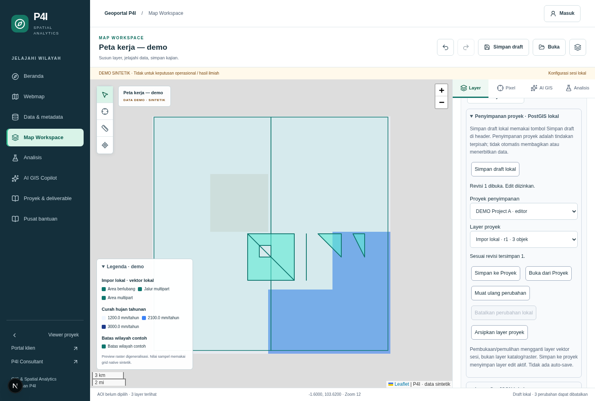

# Phase 15 — Vector PostGIS Persistence and Secure Project Storage

Date: **18 October 2026 (Asia/Jakarta)**. Branch: `feat/phase15-vector-postgis-persistence`.
Base: verified Phase 14 / draft PR #10 head `4bae236ee65b72e967b8342777498a5487ef0cda`. Draft delivery PR: pending final verification.

## 1. Outcome and architecture

The existing vector editor now has real transactional layer/feature persistence through an isolated local PostgreSQL/PostGIS + PostgREST backend. This does not simulate server success with browser storage. No external database was contacted or mutated, and no production-compatible foundation is claimed.

| Capability | Status | Evidence boundary |
| --- | --- | --- |
| Create/read/edit/delete features, save/archive layers | IMPLEMENTED_AND_TESTED_LOCAL | Actual PostGIS SQL through authenticated PostgREST, domain repository and Next route |
| Versioning, conflicts, retries, transaction rollback | IMPLEMENTED_AND_TESTED_LOCAL | Expected layer revision, stable DB IDs, feature revisions, immutable evidence and idempotency |
| Five geometry types, holes and multipart | IMPLEMENTED_AND_TESTED_LOCAL | GeoJSON → validation → PostGIS → GeoJSON; conservative browser validation retained |
| Existing workspace integration | IMPLEMENTED_AND_TESTED_LOCAL | Explicit save/open/reload/cancel, retained rejected edits, same Leaflet/MapRecipe editor |
| Provider-neutral repository | INTERFACE_READY | Domain contract and injected RPC transport; concrete local PostgREST adapter implemented |
| Supabase production/staging editable-vector adapter | STAGING_VERIFICATION_PENDING | Existing Supabase adapter preserved; vector activation intentionally unavailable |
| Real Supabase Auth/GoTrue verification | STAGING_VERIFICATION_PENDING | Local signed synthetic JWT/PostgREST is tested, not actual GoTrue signup/session issuance |
| External migration / live schema compatibility | BLOCKED | Missing verified foundational DDL and external authorization; local proposal cannot be applied normally externally |

Manual editing, raster/Pixel Inspector, AHP/WLC, Flood, Copilot, controlled compute, consulting and existing exports remain on the same engine. No scientific methodology scoring, report publication or paid computation was added. Gemini and GEE remain disabled.

The route `/api/gis/vector-storage` uses `VectorRepository` in the existing database contracts. Its concrete development transport accepts **only** explicit acknowledged HTTP `127.0.0.1:<port>` endpoints; production and external URLs fail closed. It forwards the caller's access token to PostgREST, never a service-role credential. The UI uses domain DTOs and this route, not Supabase SQL/query APIs.

## 2. Actual foundation inventory and design decision

The repository still lacks verified live foundational DDL for `user_profiles`, `spatial_projects`, `vector_layers`, enum/ownership/default grants, auth trigger binding, and historical materialized-view dependencies. Phase 08's synthetic foundation is a test fixture, not a recovered schema. Historical migrations **006, 007 and 008 are unchanged**; the migration planner continues to report `foundationStatus.verified=false` and external replay unavailable.

Existing `ProjectRepository` contracts provide project identity, access tier and imported layer geometry rows. Existing `NewVectorLayer` and Supabase `createWithLayers` treat each imported geometry as one legacy `vector_layers` row. There is no verified editable FeatureCollection/layer-revision model or project-owner column. Reinterpreting those rows or adding speculative ownership to live projects would be unsafe.

The local proposal therefore references **existing `spatial_projects.id`**, with no duplicate project table/identity. It adds editable collection/feature tables in the private `p4i_vector` namespace, plus an explicit project owner/editor ACL sidecar. This keeps legacy `vector_layers` intact. Mapping/import of legacy rows and trusted owner assignment remain prerequisites for any external migration. The new path never calls the legacy compensating project-deletion upload method; that legacy path remains a separate production review item.

## 3. Proposed ERD and entities

[PlantUML ERD source](diagrams/phase15-vector-erd.puml) and [save/edit sequence source](diagrams/phase15-vector-save-sequence.puml) are provided as editable text.

| Entity | Local model |
| --- | --- |
| VectorProject | View of the existing project UUID/title/access tier plus computed edit permission |
| VectorLayer | `p4i_vector.layers`: DB-generated UUID, existing project FK, revision, metadata, archive flag, author/time |
| VectorFeature | `p4i_vector.features`: DB UUID, layer FK, browser-local ID mapping, revision, PostGIS geometry, JSONB properties, order, author/time |
| FeatureGeometry / FeatureProperties | Existing `SketchGeometry` and `SketchProperties`, not a competing GIS engine |
| FeatureRevision | Current revision/identity token references append-only SQL evidence containing original input GeoJSON/properties or a deletion tombstone with trusted actor/time |
| LayerRevision | Append-only committed layer snapshot and actor/time |
| Project owner/editor | Explicit ACL sidecar; no invented live owner-column assumption |
| Request receipt | Actor/request UUID key, normalized JSONB SHA-256 fingerprint, original committed response |

Feature deletion preserves revision/tombstone evidence. Layer removal is archival, not destructive project deletion. Existing-project deletion must respect retention/FK dependencies; no cascading purge is provided. Database identifiers are not accepted from imported source IDs. Local feature keys map only within the named layer, while returned DB UUIDs stay in a separate workspace binding, outside MapRecipe/GeoJSON.

## 4. PostGIS and bounded data handling

Supported geometries are **Point, LineString, Polygon, MultiLineString and MultiPolygon**, including holes. `geometry(Geometry,4326)` enforces SRID; SQL checks dimensionality, non-empty geometry, point budget and `ST_IsValid`. GeoJSON objects cannot supply a CRS override; recursive position validation rejects non-numeric, non-finite/unbounded/out-of-range or 3D coordinates. The SQL parser never calls `ST_MakeValid`, silently reprojects, or replaces invalid geometry.

The existing browser validator remains a stricter editing subset (for example, conservative multipart separation and antimeridian refusal). PostGIS independently validates actual storage, including requests made directly to RPC. GeoJSON output uses `ST_AsGeoJSON(geom,15)`: numeric coordinates are serialized to up to 15 decimal places; JSON object key ordering is not preserved by JSONB. A canonical fingerprint prevents key order alone from marking a saved layer dirty. Input geometry/properties are retained in feature revision evidence. No metric measurement in EPSG:4326 degrees or survey-grade topology claim is made.

Caps remain conservative: ≤8 active layers, ≤100 active features and ≤64 KiB of JSONB-text layer snapshots **per project**. JSONB whitespace counting may reject slightly earlier than compact browser JSON. Each feature has ≤512 positions; line/ring/part bounds and safe scalar attributes are independently checked. Names/descriptions/style fields reuse existing limits. A GiST geometry index supports future bounded spatial queries; current reads load only the bounded active layer, not national datasets or an unbounded spatial table. There is no new large-dataset upload path.

Application request bodies are streamed with the existing 64 KiB cap; upstream responses are streamed with a 256 KiB cap and a five-second fetch timeout. Transport redirects are refused. SQL/provider messages and credentials are redacted. No arbitrary SQL, JavaScript, HTML evaluation or trusted ownership flags are accepted.

## 5. Authorization matrix

PostgREST verifies the synthetic JWT; SQL obtains its subject through the existing `auth.uid()` seam, then checks **current `user_profiles.role` and `is_disabled`**, not JWT role metadata. Profiles and entitlements are re-read per operation. All mutable tables have RLS enabled and no direct browser grants/policies; only the bounded security-definer RPC is executable. Private helper functions and tables are inaccessible to anon/authenticated/service_role. SECURITY DEFINER functions use a fixed search path; local fixture setup revokes untrusted CREATE on public. These exact grants/owners must be reverified externally.

| Actor | Public read | Restricted read | Edit/save/archive |
| --- | --- | --- | --- |
| Guest | Yes | No | No |
| Active B2B client | Yes | Current own entitlement required | No, even with stale editor-sidecar membership |
| Active managerial analyst | Yes | Explicit owner/editor assignment | Only assigned project |
| Active super admin | Yes | Yes | Yes, through checked RPC |
| Disabled or missing authenticated profile | No | No | No |

Read permission never implies editing permission. Cross-project layer IDs are checked against the requested project. Revoked client entitlements deny further private reads, including when a stale ACL row exists. Removed/disabled editor identities cannot write or replay an earlier receipt. A service-role bypass is not used as authorization: the local adapter accepts a user session; direct service-role RPC execution is not granted.

POST additionally requires same-origin human-action context, a token, strict body validation, and explicit UI confirmation identifying public/restricted target. Persisting is not a Copilot tool. Existing AI can propose reversible changes to the authorized loaded working copy through `VectorAction`; it cannot save, approve, publish or execute SQL. A read-only working copy can be locally explored/edited, but cannot be committed to its project. Private data still fails Gemini's synthetic-only boundary.

## 6. Transactions, revisions and concurrency

One `saveLayer` operation carries the project UUID, optional existing layer UUID, expected layer revision, request UUID, validated snapshot and archive flag. A new layer requires expected revision 0. An existing layer requires the current revision; this is the concurrency token covering **every feature mutation in that layer**. Feature revisions additionally identify changed feature evidence.

Within one PostgreSQL transaction the RPC authorizes the actor, locks the project/layer, checks the idempotency key and expected revision, validates geometry/properties, changes features/metadata, records deletions/revisions and commits the receipt. Any failure rolls back **all** dependent writes. The test suite injects a failure during the second feature update after the first update to prove rollback, rather than testing only preflight rejection.

Same actor/request UUID plus the same normalized payload returns the original response with no duplicate layer or revision. Reusing that key for a different payload returns 409. Two concurrent saves against one revision produce one winner and one conflict. A conflict never overwrites the winner. The UI reuses a failed attempt's key while that save attempt remains mounted; after browser/session loss, reopen/inspect the project before repeating an uncertain new-layer save. No claim of durable client-side retry queues is made.

Revision tables reject UPDATE/DELETE and retain immutable snapshots/tombstones. No automatic pruning, project purge or production retention policy is introduced. A deliberate later save of an earlier working copy creates a new revision; **local Undo never reverses an already committed server revision**.

## 7. Workspace workflow

1. **Simpan draft lokal** in the storage panel and existing **Simpan draft** in the header share one bounded draft helper and save only the explicit local development draft. It never reports a server save.
2. **Penyimpanan proyek** checks actual backend capability. When unavailable/unauthorized, project controls are absent and manual editing stays available. Production always refuses the local backend.
3. Choose an authorized existing project. **Simpan ke Proyek** confirms target visibility and saves the active editable layer; name/style/visibility/opacity/geometry/attributes and feature order survive.
4. **Buka dari Proyek** explicitly confirms replacement of the session's local vector layers, then loads validated real geometry into the existing MapRecipe/Leaflet renderer. Catalog/raster layers remain. Trusted binding metadata is separate from the recipe.
5. **Muat ulang perubahan** is explicit. Conflicting/failed/offline saves retain local data, allowing local draft or GeoJSON recovery before reload.
6. **Batalkan perubahan lokal** restores the active layer's last loaded/committed snapshot and leaves other local layers intact; it does not mutate the server.
7. **Arsipkan layer proyek** requires confirmation and a revision token. It hides the stored layer from active reads without deleting its evidence.

Opening a local draft/import or creating a new map detaches stale persisted identity. Saving updates the committed binding only when the submitted working set is still current. A delayed response never attaches an old project identity to a replaced/new map; newer local edits remain recoverable and the UI asks for draft/export and explicit reopen before another save. Existing recipe/permission/edit-epoch checks still guard stale AI responses. Selection, drawing, Undo/Redo and old Point/Polygon drafts remain supported.

This phase persists vector layers/features, **not an entire project MapRecipe/catalog/analysis configuration bundle or global layer ordering**. Full map documents remain the existing explicit local draft capability. Opening one server layer replaces the vector working set after confirmation; multi-layer project composition/merging is future work. Local limits remain enforced rather than silently truncating.

## 8. Local infrastructure and reproducibility

The runner uses existing pinned PostgreSQL 16/PostGIS 3.5 and PostgREST 12.2.12 image digests on the local Unix Docker socket. It starts uniquely named resources, no database port, an internal database network and a random loopback HTTP port. Its owned database volume survives process/container restart until explicit fixture cleanup. Synthetic actors and projects are disposable; no real client or national data is used.

```sh
mkdir -p /workspace/artifacts/phase-15
node scripts/database/vector-local.mjs start
P4I_VECTOR_TEST_STATE=/workspace/artifacts/phase-15/local-state.json npm test -- tests/vectorPostgis.integration.test.ts
node scripts/database/vector-local.mjs stop
```

The runner creates the clearly marked existing synthetic foundation, supplies only its local dependencies and safe fixture grants, then applies the guarded proposal. It does not claim to reconstruct external foundation or silently execute historical migrations. No historical applied migration is edited. The state file contains ephemeral synthetic sessions, has mode 0600, lives outside Git and must not be printed or committed. Tests do not run against an arbitrary DATABASE_URL.

To run the UI fixture, start `next dev` with dummy local Supabase bindings, `GIS_DEMO_MODE=true`, `AI_PROVIDER=demo`, Gemini/GEE disabled, `VECTOR_STORAGE_MODE=local-postgis`, `VECTOR_STORAGE_LOCAL_ACK=synthetic-only`, and the runner's loopback endpoint as `VECTOR_STORAGE_LOCAL_URL`. Synthetic user cookies are set by the test driver, not by an application auth bypass route. Run `scripts/qa/phase-15-vector-persistence.mjs` with the existing Playwright/Chromium/Axe setup. Do not reuse fixture identity issuance or trust authentication in staging.

## 9. Verification results

Final fresh `npm ci`, lint, typecheck and production build passed on Node **22.23.3** / npm **10.9.9**. The default application run passed **383 tests / 45 files**, with **14 opt-in database cases explicitly skipped** there. A separate real PostgreSQL/PostGIS run passed **all 14 cases** on a fresh isolated fixture: **397 distinct executed tests** across the two runs.

All **12 browser suites** passed: the nine existing Phase 01–07 suites, Phase 13, Phase 14 and the new Phase 15 persistence suite. Phase 03 was rerun successfully after an initial hot-reload timeout. The latest Phase 15 run also proves that a delayed committed save cannot attach stale project identity to newer local edits. The new suite checks widths **1480, 768, 390 and 320**, with no document overflow, scoped Axe violations, page errors, GEE or Gemini requests.

The current local production build passed **12 existing API isolation/rate checks**, **seven new vector production-boundary checks** and **three image checks**. Build/dependency isolation passed: 541 installed packages, 697 output files and 44 dependency traces, with no GEE SDK chain. Production npm audit has **0 affected packages**; the full graph retains **5 High affected package entries** from the inherited development braces chain. No dependency manifest/lockfile or historical migration changed.

Evidence: [structured verification](evidence/phase-15/verification-summary.json), [application tests](evidence/phase-15/verified-tests.log), [real PostGIS tests](evidence/phase-15/verified-postgis.log), [database inventory checks](evidence/phase-15/database-verification.json), [build](evidence/phase-15/verified-build.log), [12 browser suites](evidence/phase-15/browser-summary.json), [new end-to-end flows](evidence/phase-15/phase-15-vector-persistence-results.json), [production boundary checks](evidence/phase-15/phase-15-production-boundary-results.json), [initial issues](evidence/phase-15/initial-issues.md), [production audit](evidence/phase-15/npm-audit-production.json), [full audit](evidence/phase-15/npm-audit.json).

Actual browser screenshots with synthetic project geometry:



[Tablet](evidence/phase-15/persistence-768.png) · [Mobile](evidence/phase-15/persistence-390.png) · [320px](evidence/phase-15/persistence-320.png). The Phase 14 baseline of **351 tests / 43 files** and fresh `npm ci` were verified before implementation. The normal suite explicitly skips opt-in integration tests when no local fixture path is supplied; skipped tests are never described as executed.

PostGIS cases cover CRUD/archival, five-type roundtrip, holes/MultiPolygon, independent feature revisions, duplicate submissions, concurrent conflict, rollback after partial work, direct malformed geometry/attributes, cross-project isolation, read-only denial, revoked entitlements, disabled users, direct-table/service-role denial, immutable evidence, proposal gate and restart persistence. Local signed-JWT behavior is distinct from real Supabase Auth.

Browser cases exercise actual UI → Next → PostgREST → PostGIS save/reopen, two-session conflict/reload, local Undo versus server revision, cancel-local recovery, multipart/hole roundtrip and direct read-only/other-client API refusal. Automated responsive/Axe checks supplement existing regression suites; they are not human UAT or a full penetration test.

Implementation review and tests led to corrections for SQL alias ambiguity, anon denial's 401 expectation, an ambiguous same-project refresh state, a null-operation dispatch guard and optional-JSON null validation. Initial failures are retained separately from final passing evidence. These were isolated synthetic development runs, not disclosed production exposure.

## 10. Proposed migration and external prerequisites

`database/proposals/009_vector_persistence.LOCAL_ONLY.sql` is a **local executable proposal**, outside `supabase_migrations` and the ordered migration plan. A database-name plus fixture-setting gate prevents ordinary external application. It creates additive objects only and contains no DROP/CASCADE. Rerunning it without the local gate is explicitly tested to fail.

Before any future staging application, obtain and review:

1. Verified schema-only foundation DDL, enum labels, PK/FK types, owners, extension schemas and defaults for projects/users/legacy layers.
2. Verified Supabase auth trigger binding, GoTrue session issuance/expiry, trusted-role assignment and disabled-user behavior.
3. Complete RLS/policy/grant/function/default-ACL and materialized-view inventory; no inherited public CREATE or unexpected RPC execution.
4. Explicit mapping from existing project ownership/editor policy to the sidecar, and legacy geometry rows to editable layers without data loss or duplicate projects.
5. A separately reviewed additive migration and explicit staging authorization, safe backup/restore and retention/rollback plan.
6. Real PostgREST/Supabase user-token integration tests, project/client isolation and concurrency rehearsal in authorized staging.

The current server adapter **cannot target external staging** and cannot be enabled in production. Its auth seam (`auth.uid()`), PostgREST context and role names are portability assumptions, not a vendor-neutral identity standard. Future Supabase/Neon/Nhost transports must retain the same domain contract and transactional authorization semantics; no provider migration was attempted.

After evidence capture the runner removed only its owned containers/network/volume and ephemeral session-state file. This cleanup is recorded in `docs/evidence/phase-15/cleanup.log`; rerun the documented commands to recreate the fixture. Local rollback is disposal of this runner's exact owned containers/network/volume. No destructive external rollback is proposed. Future rollback must disable new writes, preserve revision evidence and use verified backups/forward repair under review, rather than dropping historical objects.

## 11. Remaining limitations and release decision

- **STAGING_VERIFICATION_PENDING / BLOCKED:** verified external foundation, live ownership mapping, actual Supabase/GoTrue, server transport activation and authorized staging rehearsal.
- Browser topology remains the Phase 14 conservative subset. No automatic repair, antimeridian editor, shared-edge propagation or metric operations in degrees.
- Persisted layer documents are bounded; full MapRecipe storage, multi-layer project composition, history browsing/restoration UX, user management/ACL assignment UI and production retention are not added.
- The local retry attempt is not a durable client outbox. Saving uncertain requests after a browser restart requires reopening/inspection, not a promise of automatic recovery.
- Existing legacy upload compensation, multipart containment, durable compute/approvals, deployment/runtime verification and human UAT remain prior production review items.
- The inherited development-only **braces / GHSA-vfj7-8cjw-p6xm** advisory remains for reviewer disposition; this phase grants no waiver and adds no dependency.
- No paid LLM/GEE, actual client publication, external database mutation or production deployment occurred.

**Local feature implementation is reviewable; production remains NO-GO.** Local PostgreSQL/PostGIS success is not production persistence approval or a verified Supabase schema.
