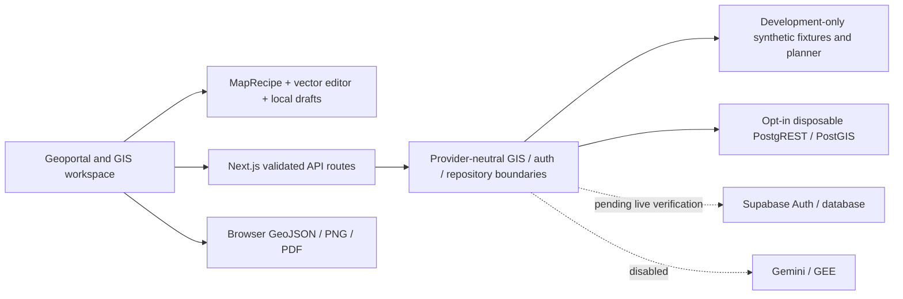
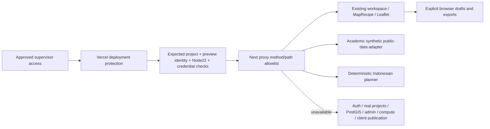

# R7 — Academic Preview Deployment Readiness

Date: **30 October 2026, Asia/Jakarta**. Branch: `feat/r7-academic-preview-deployment-readiness`. Verified base: Draft [PR #17](https://github.com/HannR002/p4i-webgis/pull/17), `8adbe5498dbea1f2946df94e96ca3bef52b0d6ad`. This is a child PR; earlier history remains unmerged.

## 1. Executive result and release decision

**Academic Preview deployment: NO-GO pending independent review, target/account preflight and explicit deployment authorization. Production: NO-GO. Cumulative merge: NO-GO.** No online deployment, URL, database migration or hosted CI PASS is claimed.

A narrow production-mode Academic Demo Adapter now supports the existing geoportal/Leaflet workspace using bounded public synthetic fixtures. The existing development DEMO flag still refuses normal production activation. Academic mode is a separate explicitly validated deployment identity with a fail-closed off switch. The existing MapRecipe, vector editor, Undo/Redo, import/export, raster contracts and deterministic planner are reused. No second GIS engine or live LLM is introduced.

Functional production-mode local browser acceptance demonstrated Indonesian map/point/polygon creation, manual geometry/attribute/style edits, local drafts, GeoJSON/PNG/PDF downloads, synthetic raster sampling/NoData, catalog navigation and desktop/mobile layout. Real auth, projects, PostGIS, compute jobs, consulting release, admin and external providers remain unavailable in this preview.

## 2. Actual infrastructure inventory and access

| Resource | Observed / supplied state | Evidence boundary |
| --- | --- | --- |
| GitHub | Public repository; PR #17 open Draft, exact supplied SHA still current; inspected stack ancestors present | Live Git/PR reads; no merge/rebase/reset |
| Runtime | Managed environment revision 24; Node 22.23.3 used explicitly; Next 16.4.3, React 19.2.8 | Local commands and installed package versions |
| Vercel target | User supplied `p4i-webgis`, team `farhan-dd58`, project `prj_h1FFQnXyMpUL2qg0Hw77PBWSp3Hb` | **Account/project metadata UNVERIFIED**; no connector, CLI, VERCEL_TOKEN or VERCEL_ACCESS_TOKEN available |
| Vercel Node/Git/deployments/protection | Historical Node 24.x, no Git linkage or successful deployment reported by owner | **Not reverified**; no account changes attempted |
| Corporate Hub | Separate, expressly excluded | No account request, configuration, deployment or source merge involving that project |
| Supabase target | Configured URL hostname matches `adrbrvnoejqxemrdwuwr.supabase.co` | Host match only; no credential values printed |
| Supabase metadata | Two bounded anon OpenAPI-only attempts returned **HTTP 401** (standard apikey, then apikey + same anon bearer) | No row query, RPC, auth user or storage object request; response error bodies not published |
| Supabase management | No connector, CLI, psql or SUPABASE_ACCESS_TOKEN | **Full metadata audit/advisors NOT PERFORMED**; service-role not used as escalation |
| Supabase status/region/PostGIS | Owner reported ACTIVE_HEALTHY, ap-northeast-1, PostGIS 3.3.7 | **Current state UNVERIFIED**; not inferred from local PostGIS |
| Docker | No fixture created, restarted, stopped or removed | Earlier R6 fixture permission not reused |
| Hostinger account/plan | Not supplied or inspected | No credentials requested, changes or deployment |

Runtime readiness of a secret binding does not establish service authorization. HTTP 401 does not prove that RLS is secure or that no data is exposed through other roles. Inherited external bindings were overridden with dummy/empty values for all local builds, servers and tests.

## 3. AS-IS system architecture

R6 verified 37 real local PostGIS assertions and Phase 15/16 database browser workflows on the earlier R5 SHA. R6.1 fixed JSON deadlines/abort handling and complete database evidence validation on PR #17. Neither report certifies the current external Supabase schema or this R7 patch's real database integration. Local fixture SQL is not a live-schema inventory.

## 4. TO-BE academic architecture and security boundary

`P4I_ACADEMIC_PREVIEW=true` requires the expected project ID, fixed preview ID, Vercel identity, `VERCEL_ENV=preview`, valid `.vercel.app` deployment hostname, runtime Node >=22.23.3 <23, academic-demo planner, disabled vector backend and disabled external providers. Any live database/Gemini/GEE binding checked by the policy invalidates the preview. `false`/unset disables the adapter; malformed flag values fail closed. An intentionally configured real provider never silently falls back to academic fixtures.

Configuration matching is an operator-controlled allowlist, **not independent attestation of Vercel account ownership**. That remains a deployment gate. Local tests emulate these identity fields and do not claim to run on Vercel.

The proxy allows only the reviewed public GIS methods/routes, redirects private/legacy pages to a clear limitations page, blocks all other API requests before expensive ingestion/provider access, and sets no-store/noindex on allowed requests. This is supplemented by server-side database factory refusal and guest-only identity resolution even when an attacker supplies cookies/tokens. The synthetic adapter itself refuses non-allowlisted/private dataset IDs. Database, privileged keys, arbitrary SQL/filesystem, admin mutations, external AI, jobs and official deliverable publication are not part of the adapter.

## 5. Vercel versus Hostinger

Official sources were fetched on 30 October 2026 (Asia/Jakarta):

- [Vercel supported Node versions](https://vercel.com/docs/functions/runtimes/node-js/node-js-versions): supports **22.x**; current documentation lists 26.x as default and 24.x as another option. The exact project default was not read. Minor/patch versions roll automatically; verify actual build AND function runtime. Existing package engines and an explicit build/runtime guard reject 24.x/26.x and Node below 22.23.3.
- [Vercel deployment protection](https://vercel.com/docs/deployment-protection): use supported authentication/protection; verify the selected plan's mechanism before inviting the supervisor. Do not disable protection to share a URL.
- [Vercel Hobby](https://vercel.com/docs/plans/hobby): non-commercial personal-use restriction. P4I's commercial direction requires owner review of eligibility/plan; no Hobby waiver, paid upgrade or price claim is made.
- [Git deployment control](https://vercel.com/docs/project-configuration/git-configuration): `git.deploymentEnabled=false` prevents automatic Git deployments for this candidate. It stays false; preparing/pushing a Draft PR must not authorize a preview release.
- [System identity variables](https://vercel.com/docs/projects/environment-variables/system-environment-variables): project ID is available at build/runtime. Confirm Vercel exposes the required system variables rather than substituting unverified client input.

Requests to Hostinger's official Node article, Node product URLs, Cloud and VPS product pages failed with HTTP errors in this environment. Consequently **current Hostinger plan capabilities, resource limits, prices, rollback, GitHub integration and exact Node versions could not be verified**. Historical “Business cannot run Node” assumptions are not used. No owner plan is assumed. The following is an engineering comparison with vendor details explicitly pending:

| Requirement | Vercel assessment | Hostinger Business / Cloud | Hostinger VPS |
| --- | --- | --- | --- |
| Next.js server / Node22 | Documented Node22 support; actual project must be set to 22.x | Current supported runtime/plan must be confirmed officially | Requires confirmed OS/root rights and supported Node installation; not account-verified |
| Git / env variables | Supported platform workflow; this candidate disables automatic deployments | Verify plan-specific GitHub deploy and server-side env controls | Operator designs Git checkout/release, secrets and process supervision |
| Persistent processes / workers | Serverless lifecycle; durable jobs need external design | Verify process lifecycle, worker allowance and restart policy | Operator manages workers/system service if plan grants control |
| CPU / memory / logging | Plan/function limits apply; unverified for this account | Verify actual quotas and log retention | Verify purchased vCPU/RAM/disk; operator manages observability |
| PostGIS hosting | External verified database needed; not embedded in functions | Do not assume PostgreSQL extension/root access | Self-managed PostGIS is an option only after capacity/backup/security review |
| Rollback / HTTPS / domain | Verify protection, immutable deployment access and approved rollback target | Verify supported mechanisms and backup scope | Operator manages TLS, releases, backups and rollback |
| Costs | No deployment executed; plan/budget approval pending | No verified prices or purchased plan | Infrastructure plus operational/security maintenance; no invented price |

Recommendation: prepare Vercel first for this bounded academic preview, subject to actual target/plan/protection checks. Revisit Hostinger only with current official plan documentation. Neither option makes the real commercial platform production-ready without durable state, database authorization and operational verification.

## 6. Supabase schema inventory and drift status

**UNVERIFIED / metadata audit blocked by access.** No management SQL was executed and no confidential row was retrieved. Historical object names (`user_profiles`, `spatial_projects`, `vector_layers`, `analysis_reports`, `smce_criteria_weights`, `b2b_entitlements`, `download_history`, `audit_logs`, `sales_leads`, boundaries/flood objects) remain inventory candidates, not confirmed live tables.

[metadata-inventory.sql](sql/r7/metadata-inventory.sql) is executable READ ONLY, bounded by statement timeout and ROLLBACK. It inventories schemas, relations, columns/types, constraints/indexes, RLS/policies, role grants including explicit PUBLIC ACLs, view/materialized-view options, extensions/PostGIS, SECURITY DEFINER ownership/EXECUTE/search_path metadata, source fingerprints and auth/storage trigger references. It does not select application/auth/storage rows or publish function bodies that could contain literals/secrets. Migration history, view dependencies and function bodies need scoped follow-up review against an approved metadata snapshot; management security advisors need the authenticated management tool. Storage bucket/public configuration and actual ownership semantics are not inferred from policy names.

Remaining exact blockers: verified foundational DDL/migration drift; owner/client relationship and role-authority semantics; all alternative permissive policies; current grants/force-RLS; trusted schema CREATE/search_path; auth signup/profile role trigger; storage/public bucket policy; advisors; real Auth/GoTrue and direct PostgREST negative tests. Do not connect this backend to the preview until these are verified.

## 7. Supabase reported security findings (priority zero)

Owner-provided historical findings: unrestricted public SELECT policies named `Izinkan Publik Membaca Proyek`, `Izinkan Publik Membaca Peta`, `Izinkan Publik Membaca Laporan` on `public.spatial_projects`, `public.vector_layers`, `public.analysis_reports`, with SELECT granted to anon/authenticated. **REPORTED_SECURITY_BLOCKER / current state not independently confirmed.** If the policies still have a TRUE predicate, the grant + permissive policy can expose restricted records regardless of client UI filtering. A signed-in user is not inherently entitled to every project/report.

No actual contents were tested for exposure. Do not classify these policies as remediated based on an academic preview that avoids the database, an HTTP 401 OpenAPI attempt or passing local synthetic tests. Future authorization must use current trusted `user_profiles.role`, current entitlements/ownership and disabled/revoked state, not editable user_metadata. Views and SECURITY DEFINER functions require separate bypass analysis; write policies need correct ownership/WITH CHECK semantics established from live metadata.

## 8. Proposed corrections, impact, verification and rollback

[quarantine-public-select.PROPOSED_ONLY.sql](sql/r7/quarantine-public-select.PROPOSED_ONLY.sql) supplies a narrowly scoped **temporary containment rehearsal**, not a speculative tenant schema or complete final authorization model. Preconditions demand enabled RLS, exactly the reported SELECT/PERMISSIVE/PUBLIC/TRUE policy signature and no additional read policy; drift aborts the transaction. A separate exact target/impact approval GUC is required. It changes only those three policy predicates to false and deliberately **ROLLS BACK** by default. No table/user/data/owner is dropped, deleted, recreated or reset.

Impact if separately converted to an approved apply migration: ordinary public/client/analyst RLS-bound reads may all fail until reviewed allow policies exist. Service-role bypass is not fixed by this containment. Existing writes are not broadened. Because actual users/ownership and compatibility are unknown, **no correction has been applied or authorized for execution**.

[verify-containment.sql](sql/r7/verify-containment.sql) checks RLS, policy predicates and grants without selecting confidential rows. The final permanent plan must define intentionally public records, ownership/current entitlement conditions, protected report/download links, trusted roles, write checks, fixed trusted search paths and minimal EXECUTE/view grants against verified DDL. Exact permanent predicates cannot safely be invented before that inventory.

Rollback: rehearsal rolls back automatically. For an eventual approved change, capture reviewed pre-change metadata first and use transactional verification before COMMIT. If authorization fails afterward, disconnect the live adapter and roll forward to reviewed restrictive policies; do not automatically restore unrestricted TRUE policies. Any restoration of prior exposure requires explicit owner/security review. Data backups/restore and schema rollback are separate operational gates; no user data is altered by this proposal.

## 9. Feature availability matrix

Evidence shorthand: **H** = prior Phase/R6/R6.1 local evidence, **R7** = current actual production-mode local acceptance. None means external Supabase was verified.

| Feature / route | Implementation and evidence | Dependency / restriction | Academic demonstration / missing integration / action |
| --- | --- | --- | --- |
| Public landing `/` | Existing corporate-style page, H | Normal app landing | Preview redirects to `/spatial/home`; Corporate Hub project untouched |
| Geoportal `/spatial/home` | Implemented, R7 | Public synthetic catalog | Demonstrable; label academic/synthetic |
| Webmap `/spatial/webmap` | Implemented, R7 navigation + H cards | Existing templates/MapRecipe | Demonstrable public synthetic templates; no official map claim |
| Data `/spatial/data` | Implemented, R7 | Public filtered catalog | Demonstrable metadata; real data/provenance pending |
| Workspace `/spatial/viewer` | Implemented, R7 | Same Leaflet/MapRecipe | Demonstrable; no second engine |
| Layer explorer | Implemented, H/R7 | Session state and public catalog | Styling/order/opacity/visibility remain local |
| Vector digitizing | Implemented, R7 | Bounded local GeoJSON | Points/polygons/map clicks; no survey/ownership claim |
| Attribute editing | Implemented, R7 | Existing validated scalar fields | Rename/style/coordinates demonstrated |
| Undo/Redo | Implemented, R7 | Existing reducer | Demonstrable; persistence unchanged |
| GeoJSON import/export | Implemented, H/R7 | Explicit WGS84, geometry budgets | Export demonstrated; existing client import retained; server ZIP still disabled |
| PNG/PDF | Implemented, R7 real downloads | Browser renderer/jsPDF | Synthetic draft output; no approval/publication claim |
| Raster visualization | Implemented DEMO, R7 | Bounded synthetic grids/tiles | Demonstrable; official CHIRPS/DEM/soil unavailable |
| Pixel Inspector | Implemented DEMO, R7 | Actual fixture provider values/NoData | Synthetic physical units/provenance; never official measurements |
| AHP/WLC configuration | Implemented local/H | Client settings/weights + existing contracts | Can configure/save browser drafts; job-based execution unavailable; provisional rules experimental |
| AI GIS Copilot | Implemented deterministic, R7 | Closed Indonesian grammar/trusted registry | Demonstrated map/point/polygon edits; **not a live LLM**; backend operations refused |
| GIS compute workflows | Development-only/H | In-memory jobs/approval state | Unavailable in academic preview; durable worker/job backend pending |
| Consulting workflows | Development-only/H | Local persona/review sessions | Unavailable; no impersonated reviewer or real release |
| Authentication/roles | Interfaces + existing Supabase adapter/H | GoTrue + trusted profile + entitlements | Guest-only preview; no real login/admin entitlement |
| Project storage | Legacy Supabase boundaries/H | Current schema/Auth/RLS required | Unavailable; no project write or service role |
| Phase 15 persistence | Tested real LOCAL PostGIS/H | Disposable authenticated PostgREST | Unavailable externally/preview; verified staging adapter/foundation pending |
| Phase 16 analysis | Tested real LOCAL PostGIS/H | Stored layers + bounded SQL | Unavailable preview; no fake buffer/PostGIS success |
| Administrative dashboard | Existing authenticated UI/H | Trusted roles + private DB | Blocked preview; do not demonstrate with fake super_admin |
| Help/limitations | Implemented, R7 | No backend | Demonstrable walkthrough and explicit unavailable states |

## 10. Route and environment inventory

[route-inventory.json](r7/route-inventory.json) enumerates all 27 API routes, methods, source paths and preview availability. The safe academic API surface is GET catalog/status/auth-status/public fixture vector/tiles, POST actions/pixel/process, and GET/POST deterministic Copilot. Every other API is denied before provider access. Page allowlist: home/webmap/data/viewer/analysis/ai/help/limitations; private/consulting/login/legacy pages redirect to limitations.

[environment-names.json](r7/environment-names.json) records 35 names from direct references, policy checks and operator audit tooling. Credential values are never included.

| Names | Purpose / required preview policy |
| --- | --- |
| P4I_ACADEMIC_PREVIEW, P4I_PREVIEW_ID | Explicit academic switch and fixed identity |
| VERCEL, VERCEL_ENV, VERCEL_PROJECT_ID, VERCEL_URL | Expected WebGIS project, preview target, system deployment identity |
| VERCEL_GIT_COMMIT_SHA | Public source revision metadata for post-deploy verification |
| NODE_ENV | Normal Next production runtime; no development override |
| AI_PROVIDER | Academic deterministic provider selection |
| GIS_DEMO_MODE | Remains off for production; not used as a blanket bypass |
| VECTOR_STORAGE_MODE | Disabled; LOCAL_URL/LOCAL_ACK empty |
| GEMINI_FREE_ENABLED | False |
| NEXT_PUBLIC_SUPABASE_URL, NEXT_PUBLIC_SUPABASE_ANON_KEY | Empty or the documented nonfunctional local placeholders only |
| SUPABASE_SERVICE_ROLE_KEY, DATABASE_URL, SUPABASE_DB_URL | Must be absent/empty; no privileged DB or connection secret |
| GEMINI_API_KEY, GEE_PROJECT_ID, GEE_SOIL_ASSET_ID, GEE_SERVICE_ACCOUNT_JSON, GEE_SERVICE_ACCOUNT_JSON_BASE64 | Absent/empty in academic deployment |
| VERCEL_TOKEN, SUPABASE_ACCESS_TOKEN | Optional operator audit tooling only; never copy to the demo's runtime environment |

## 11. Deployment configuration and validation

`vercel.json` selects Next.js, reproducible npm ci, a preflight followed by npm run build, and **disables Git-triggered deployments**. It does not change any remote Vercel project or GitHub Actions. Existing engine declaration stays `>=22.23.3 <23`; operator must set the actual Vercel project to **22.x**, verify patch compatibility and keep deployment protection enabled.

`scripts/deployment/academic-preflight.mjs` only validates runtime/identity/provider policy and emits fixed messages. It never deploys or prints bindings. Its shared TypeScript policy is loaded using Node 22's built-in TypeScript support. Production target, wrong project, forbidden credentials and invalid runtime are rejected. A preflight PASS is not a release GO or evidence of account ownership/protection.

## 12. Academic walkthrough for the supervisor

1. Owner grants supported protected-preview access; open the eventual approved URL (none exists from this task).
2. Read the academic/synthetic banner and limitations. Open Webmap/Data to inspect provenance.
3. Open Map Workspace. Ask: `Buatkan peta baru bernama Survei Lapangan dan gunakan OpenStreetMap.` Explain that this is a deterministic grammar. Use no basemap if demonstrating without third-party tiles.
4. Ask for point A at `[103.61,-1.61]`, then B/C/D with explicit coordinates; create a polygon from those actual points. Missing coordinates request clarification.
5. Edit attributes, coordinates/styles and vertices; show Undo/Redo, explicit local save/reopen and GeoJSON export.
6. Use synthetic climate layer and Pixel Inspector; show units, scale, band, NoData and outside-grid behavior. These are fixture values.
7. Export PNG/PDF as a local synthetic draft. No automatic upload, official review or publication occurs.
8. Show configuration weights/experimental classification assumptions and accurate unavailable status for real PostGIS/jobs/client/admin features.
9. Use only approved public/synthetic inputs. Browser drafts stay on the device; do not enter sensitive AOIs or client data. Public basemap providers can receive tile requests, so disabling the basemap avoids that third-party traffic during a restricted demonstration.

## 13. Tests and evidence

See [verification-summary.json](evidence/r7/verification-summary.json) for final executed commands/counts and the separate external-access limitations. R6.1's deadline/abort tests and database completeness gates remain in the suite. No real PostGIS fixture is started; 37 database cases remain SKIPPED and old R6 passes remain historical.

Final counts: **596 application PASS / 0 FAIL / 37 PostGIS SKIPPED** with `--maxWorkers=2`; **52 CI helper PASS**; **40 academic policy/security assertions** included in application count. npm ci, lint, typecheck, build and full/production audits passed; both audits report **0 affected packages**. Three academic production-local browser suites and 22 academic HTTP checks passed, plus 22 separate normal-production checks. Four deployment-policy cases and actual invalid-identity HTTP 503 passed. The negative cases' expected exit codes are refusals, not failed tests. No hosted CI or real PostGIS PASS is claimed.

Current production-mode browser evidence uses a real local Next start server and the Academic Adapter; no fake successful API response or remote DB is substituted. Existing Phase 13 vector and Phase 03 raster tests run on this compiled preview configuration. Separate production-boundary checks verify the default non-academic app continues to refuse development compute/PostGIS. Invalid preview identity is tested on a separate owned local process and returns 503.

A full parallel regression attempt hit the existing 5-second compute-route test timeout (595 passed, 1 failed, 37 skipped). The raw failure is retained. Focused reproduction of that unchanged test passed. A controlled full run with two workers was then used to reduce scheduling contention; assertions and timeouts were not changed. Concurrency sensitivity is a residual verification concern, not silently reported as an always-green default run. Separately, a one-second invalid-runtime startup probe timed out before receiving HTTP status; its log was preserved and a bounded readiness probe then verified actual HTTP 503. No application assertion or timeout was weakened.

Screenshots, actual PNG/PDF/GeoJSON downloads, browser HTTP observations and full local harness logs are retained at `/workspace/artifacts/r7/`. They demonstrate local functionality only. Automated accessibility scopes and viewport sizes do not replace human UAT.

## 14. Browser screenshots

- [Production-mode desktop workspace](evidence/r7/academic-workspace-desktop.png) and [mobile workspace](evidence/r7/academic-workspace-mobile.png).
- [Synthetic Pixel Inspector](evidence/r7/academic-pixel.png).
- Academic limitations: `/workspace/artifacts/r7/r7-academic-preview/academic-limits-1480.png`, `academic-limits-390.png`.

## 15. Remaining risks

Full Supabase metadata/advisor inventory, actual tenant ownership and the reported unrestricted policies remain unresolved. Real auth/GoTrue, production persistence and direct A/B entitlement testing are pending. Existing fixture lifecycle/volume ownership concerns require an approved guard before any renewed SQL rehearsal. Process-local rate controls are not distributed Vercel quotas; verify platform abuse/budget controls before release. Node patch rollout, protected supervisor access, plan eligibility, runtime secrets, preview identity and Vercel build behavior need actual account verification. Container images/third-party basemaps and scientific model accuracy were not certified. One existing test exhibited parallel scheduling sensitivity as recorded above.

## 16. Release gate checklist — all must pass

- Exact reviewed R7 commit recorded and matches the source used to build/deploy.
- Independent preview security review completed; Draft PR is not approval.
- Existing WebGIS project/team, Git config, 22.x runtime, install/build settings, Preview target, protection and rollback target inspected through authorized access.
- No client/production data, privileged keys, external cloud credentials or paid provider activation.
- Local functional/security evidence accepted; concurrency-sensitive regression reviewed.
- Vercel plan/cost and supervisor access mechanism accepted; no automatic paid upgrade.
- Explicit deployment-specific **GO** recorded and bounded preview release authorized.

**Current decision: NO-GO.** There is no approved URL or successful deployment from this work. Actual RLS must additionally pass before any future live-backend connection; a standalone synthetic preview cannot certify that backend.

## 17. Exact next authorized actions

1. Independently review the focused child PR and retained evidence; preserve the unmerged stack and Actions locks.
2. Provide read-only project-scoped Vercel/Supabase connectors if available, or secrets named VERCEL_TOKEN / SUPABASE_ACCESS_TOKEN through Codex environment settings. Management tokens may have write capabilities: scope/expire them minimally, use only read operations and never put them in chat/repo/demo runtime. CLI installation alone does not authorize access.
3. Reverify target metadata, deployment protection/Node/project identity and obtain the approved metadata-only Supabase inventory/advisors. Do not select client rows. Review reported TRUE-policy exposure and define a separately approved containment/permanent plan with verified ownership semantics.
4. If real PostGIS verification is needed, submit a fresh bounded fixture plan and obtain new permission. No previous fixture authorization carries forward.
5. After all preview gates pass, record the exact SHA and explicit preview GO. Only then authorize the first manual **Preview** deployment to the existing WebGIS project; keep Corporate Hub and production excluded. Git auto-deploy remains disabled unless separately reviewed.
6. Verify returned immutable deployment URL, actual runtime/source status, auth/protection, route failures, synthetic labels, browser flows and supervisor access. No success claim until these checks run.

## 18. Development and rollback after an eventual preview

Continue in reviewed child branches; do not merge the whole stack merely to obtain a demo URL. Store browser-only drafts/exported files explicitly; serverless memory is not durable storage. Test each subsequent change locally and on a newly authorized protected preview. Keep secrets and paid providers absent.

Before releasing, establish who may deactivate/remove the academic preview and which prior verified protected deployment can receive an alias. Because no successful deployment is currently verified, rollback for a first failed attempt is to keep it unpromoted, disable academic mode/retire the preview through an approved operation and preserve logs; there is no invented known-good production target. Never restore unrestricted DB policies as an automatic rollback. Real backend releases require backup/restore drills, transaction/migration plans, durable jobs and human UAT independently of this academic track.
