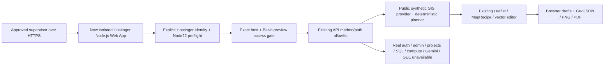
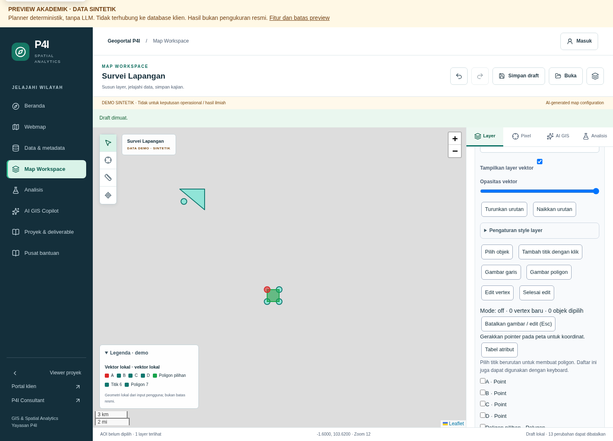
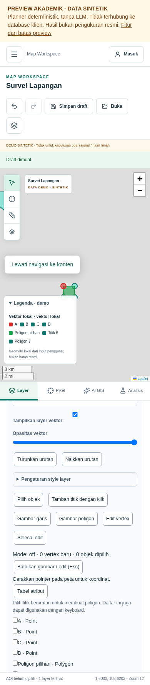

# R8 — Hostinger deployment implementation and acceptance

Date: **1 November 2026 (Asia/Jakarta)**. Repository: `HannR002/p4i-webgis`. Parent: Draft PR #20, `fix/r7-2-dependency-release-gate`, verified **`120d0e09cc6e75bf224ae853f35e74b0a2292d3c`**. R7/R7.1/R7.2 and the local R7.3 decision informed this implementation. The stacked history is preserved and unmerged.

**Implementation and local acceptance: complete. External release: BLOCKED at the owner-controlled hPanel setup/approval gate.** No authenticated Hostinger management connection is available here, and the owner explicitly states that no temporary hostname is assigned or approved. The full audit risk has not been accepted. No website, hostname, DNS record, deployment or live URL was created. **Academic live release: NO-GO until that gate closes. Production: NO-GO separately.**

## 1. Exact delivery candidate

| Item | Value |
| --- | --- |
| Exact tested application/source SHA | **`1571ebb549656a9b21d8c0161c7d520475fb1970`** |
| Controlled candidate branch | **`release/r8-hostinger-academic-1571ebb`**, pinned to that source; do not advance it automatically |
| Review branch | `feat/r8-hostinger-academic-preview`; later documentation commits are separate from the pinned application SHA |
| Flat source ZIP prepared locally | `p4i-webgis-r8-1571ebb.zip`, **9,267,365 bytes**, 1,195 entries |
| ZIP SHA-256 | **`7b731913bdf929d4f37b3155558c5bb6efbab72a7eda8fe0cb42b7037ce19328`** |
| Lockfile | Unchanged; SHA-256 `aca2e837d530006d5946692111e4e7200b2b0262fc03714540550a770a4c2a20` |
| Actual Hostinger URL/build/runtime | **NOT RUN / none** |

The archive contains tracked source at the exact SHA, including the blank environment template, without `.git`, `.next`, `node_modules`, local credentials or `.env.local`. Its [manifest](evidence/r8/source-package.json) is retained. The local package is under `/workspace/work/r8/package/`. Recreate the same flat source ZIP from the pinned checkout with:

```bash
git archive --format=zip --output=p4i-webgis-r8-1571ebb.zip 1571ebb549656a9b21d8c0161c7d520475fb1970
```

A GitHub-generated archive may have different ZIP bytes/root prefix; the checksum above applies to this flat `git archive` package. Verify source provenance and project-root selection rather than pretending those two formats have the same digest. The release branch is a delivery source, **not approval to deploy**.

## 2. Implemented changes and architecture

The existing Next.js/Leaflet/MapRecipe application is reused. No vector engine, raster feature, database schema, compute worker, dependency or alternate UI was added.



Executable/configuration changes:

| File | Purpose |
| --- | --- |
| `lib/academicPreview.ts` | Separate explicit Hostinger identity contract; original Vercel contract remains the default; shared Node/provider/credential policy retained |
| `lib/server/hostingerPreviewAccess.ts` | Exact configured Host check plus bounded canonical Basic authorization parsing and constant-time SHA-256 verifier comparisons |
| `proxy.ts` | Hostinger protects **all** requests including JS/CSS/images/favicon before the unchanged method/path allowlist; original active Vercel asset/cache bypass retained |
| `app/api/academic/status/route.ts` | Nonsecret provider and source-revision status; Hostinger uses its own revision variable |
| `scripts/deployment/hostinger-preflight.mjs` | Build/start refusal on invalid Hostinger policy; compares declared source with `git rev-parse HEAD` when `.git` exists |
| `scripts/deployment/academic-preflight.mjs` | Explicitly remains Vercel-only; cannot be used to pass a Hostinger build with forged Vercel identity |
| `scripts/deployment/hash-hostinger-password.mjs` | Owner-local stdin/private-file password hash helper; no password argument or repository secret |
| `package.json` | Adds `build:hostinger` and `start:hostinger`; normal `build`/`start` preserved |
| `.env.example` | Blank Hostinger settings and operator instructions; no assigned hostname or real credential defaults |
| `scripts/qa/r8-hostinger-preview.mjs` | Reproducible local protected HTTP/security/asset checks; reserved fixture only |
| `tests/hostingerPreview.test.ts` | 47 Hostinger configuration/access/provider/refusal cases |
| `tests/academicPreview.test.ts` | Additional regression preserving original Vercel asset handling |

The shared API method/path allowlist is unchanged. Provider selection uses server configuration, never request headers. The Host header is an additional exact-match restriction, not deployment attestation. Matching request headers without valid server configuration cannot activate the preview. Hostinger requires a fixed app identity, academic-only environment, valid source revision and access verifier; mixed Vercel identity is rejected. Missing/off/malformed academic settings with declared Hostinger intent fail closed instead of falling back to the normal application.

`p4ijournal.org`, `journal.p4ijournal.org` and `publisher.p4ijournal.org` are explicitly refused as Hostinger preview hostnames. No broad `*.hostingersite.com` trust is used. No approved hostname is built in. Reserved `.test` names occur only in local fixtures and are **not real deployment assignments**.

## 3. hPanel configuration — do not execute before approval

Hostinger's current [Next.js 16 guidance](https://www.hostinger.com/support/how-to-fix-next-js-16-turbopack-build-errors-on-hostinger/) states that 16.3.3+ Turbopack builds require a newer glibc than its build servers provide and recommends **`next build --webpack`**. This implementation follows that path using Next's bundled webpack.

The native Next backend runtime was tested, without a custom entry file, standalone conversion or static export. Next's supported output is **`.next`**, served by **`next start`**. CSS/Tailwind and API routes are retained. [Safe non-deployable settings template](r8/hostinger-settings.example.json) has null hostname/access fields deliberately.

| hPanel field | Exact intended setting |
| --- | --- |
| Action/target | **Create a new website → Web App / Node.js App**, within the owner's Business plan; never select Manage/Redeploy on an existing journal/publisher website |
| Framework | **Next.js backend**, project root `.`; do not choose static/frontend export or invent an “Other” server entry |
| Git source, if approved | `HannR002/p4i-webgis`, branch `release/r8-hostinger-academic-1571ebb`; independently verify its head equals the pinned SHA |
| Manual source alternative | Upload the verified flat source ZIP into the **new** Node.js App; no Git linkage/automatic PR builds |
| Node | **22.x**, actual build and runtime both **>=22.23.3 <23**; patch remains to be observed on Hostinger |
| Install | **`npm ci --include=dev`** |
| Build | **`npm run build:hostinger`** → preflight → `next build --webpack` |
| Start | **`npm run start:hostinger`** → preflight → `next start --hostname 0.0.0.0` |
| Port | Use Hostinger's supplied `PORT`; Next reads it. Local acceptance proved `PORT=3100` without a command-line port argument. Do not allocate an unrelated site's port. |
| Output | `.next`, framework-managed; no custom entry file. Do not replace any `public_html` manually. |
| Hostname | **Unassigned. Owner must supply the exact new app temporary hostname.** Do not use any existing site or change DNS/email. |

**Install detail:** `NODE_ENV=production` makes plain `npm ci` omit dev dependencies, including `@tailwindcss/postcss`. This was reproduced and corrected by the explicit `--include=dev` installation setting. A fresh full install/cache then passed the unchanged normal Turbopack build too. No dependency or security check was removed to achieve the build.

Set these server values in the **new app only**, at both build and runtime:

| Variable | Value / handling |
| --- | --- |
| `NODE_ENV` | `production` |
| `P4I_ACADEMIC_PREVIEW` | `true` |
| `P4I_PREVIEW_ID` | `p4i-webgis-academic-v1` |
| `P4I_PREVIEW_PROVIDER` | `hostinger` |
| `P4I_HOSTINGER_APP_ID` | `p4i-webgis-academic-hostinger-v1` |
| `P4I_HOSTINGER_ENV` | `academic-preview` — exact `production` is rejected here |
| `P4I_HOSTINGER_HOSTNAME` | **Owner-approved new hostname only**, lowercase hostname without scheme/path/port; currently unset |
| `P4I_SOURCE_REVISION` | `1571ebb549656a9b21d8c0161c7d520475fb1970` |
| `P4I_HOSTINGER_ACCESS_USER` | New owner-chosen preview username, separate from Hostinger/real application accounts |
| `P4I_HOSTINGER_PASSWORD_SHA256` | Confidential verifier of an owner-generated high-entropy password, 24–256 printable ASCII characters; no default/demo password |
| `GIS_DEMO_MODE` | `false` |
| `AI_PROVIDER` | `academic-demo` |
| `VECTOR_STORAGE_MODE` | `disabled` |
| `GEMINI_FREE_ENABLED` | `false` |

Generate the verifier **on the owner's trusted machine**, using a protected password file outside the checkout:

```bash
node scripts/deployment/hash-hostinger-password.mjs < /private/path/preview-password.txt
```

Store the verifier in hPanel only. Do not paste the password/verifier into chat, source, PRs, shell arguments or reports. Use a unique password-manager-generated secret; do not reuse an account password. The test credentials in unit/QA fixtures must never become deployment values.

No `VERCEL`, `VERCEL_ENV`, `VERCEL_PROJECT_ID`, `VERCEL_URL` or other forged Vercel values are needed. Keep live Supabase public settings, service role, database URLs, Gemini key, all GEE account/project/asset settings, and vector local URL/ack absent. No privileged backend credential is required. Invalid configuration or mismatched Git SHA exits **before startup**; ZIP provenance is verified by the owner/package digest because `.git` is intentionally absent.

## 4. Deployment isolation and automatic-build controls

The owner's supplied Business plan is 2 CPU cores, 3,072MB RAM, 50GB storage, 600,000 inodes and a 120 process/thread limit. Its existing websites are outside this change. Management tools/Hostinger CLI/configured token bindings were not available; plugin discovery found mail access only, which is unrelated and was not used.

The [current Hostinger deployment guide](https://www.hostinger.com/support/how-to-deploy-a-nodejs-website-in-hostinger/) describes GitHub automatic builds on push. Its [PR-preview guide](https://www.hostinger.com/support/how-to-use-pull-request-previews-for-node-js-websites-in-hostinger/) also describes automatically building PRs in separate folders and posting temporary URLs. **Vercel's `git.deploymentEnabled=false` does not disable Hostinger automation.** No documented PR-preview disable toggle was established here.

Prefer the pinned release branch over main/active Draft branches. Before connecting GitHub, the owner must verify controls for unreviewed/fork PR builds and resource isolation. If unwanted PR builds cannot be prevented, **use the manual ZIP/new-app route without Git linkage**. Do not connect an actively changing public repository merely to obtain a preview. Unknown preview hostnames fail the exact host guard, but that does not prevent their build resource use or unreviewed build scripts; it is not an automation control.

Do not modify the hosting plan, an existing document root, OJS/journal databases, DNS, MX/email, or other websites' environment/settings. Use the new app's own build/deployment/log controls. Do not manually alter Hostinger-managed `hbuilds`, `current` symlinks or global `.htaccess` routing. Preserve the GitHub Actions locks and the Vercel project configuration.

## 5. Preview access protection and supervisor procedure

The application gate is required even if a temporary URL looks obscure. It protects pages, API routes, JS/CSS, images, `_next/image` and favicon requests **that reach Next**. Missing/wrong access credentials produce **401 + Basic challenge**, no-store/noindex headers; a wrong Host or invalid environment produces **503**. Correct preview access still resolves only an unauthenticated application guest, with no entitlements. Forbidden APIs remain **503** after preview authentication. The verifier is server-only; 91 public JS/CSS files were scanned without finding it. Referrer/frame protections are set on Hostinger responses.

Basic access is a shared preview gate, not real user login or RBAC. Require valid **HTTPS** at the new Hostinger URL before entering the secret. It has no individual-session revocation/SSO; rotate the verifier and redeploy/restart the **new app only** after review, or close the preview. Closing all relevant browser/private-session windows clears the review session more reliably than pretending a logout button exists.

No application-level login rate limiter is added. Protection relies on a unique high-entropy secret, confidential verifier, HTTPS and the owner's verified hosting controls; shared credentials do not provide an individual audit trail. This new mechanism still requires the authorized reviewer's acceptance before release.

**Hosted acceptance must test the front server too.** Hostinger may serve some assets outside Next. Anonymous GETs to the actual JS/CSS/public asset URLs must be refused as well as HTML/APIs. If hPanel serves assets directly, require an independently reviewed new-site front protection/route configuration before sharing; do not assume application middleware protects files that bypass it. No such hosted routing/protection result is claimed here.

After explicit owner release approval and configuration: the supervisor opens the exact approved HTTPS URL, supplies only the new preview credentials, sees the synthetic banner and limitations, and uses public/synthetic inputs. Never send real application/hPanel credentials or client AOIs. The owner must separately approve any private communication of the preview secret; no message/invitation was sent from this work.

## 6. Verification and actual evidence

All acceptance runs were local, using Node **22.23.3**, Next **16.4.3**, webpack, React **19.2.8**, Vitest **4.1.12** and Chromium. Live Supabase/GEE environment bindings were excluded. The local browser front forwards loopback HTTP requests to the real Next backend with a reserved test virtual Host and actual Basic credentials; it changes only transport/redirect origin, not successful API responses. It is **test tooling, not an application entry file**. No DNS/hosts change or actual Hostinger hostname was used.

| Check | Outcome |
| --- | --- |
| Clean npm installation / lock | **PASS**, exit 0; unchanged lock; explicit include-dev recipe verified with production Node environment |
| Lint | **PASS**, exit 0, 0 errors; one existing unused `describe` warning |
| Fresh typecheck before build | **PASS**, exit 0, Next typegen + tsc |
| Hostinger production webpack build | **PASS**, exit 0, pinned source; no static export/custom server |
| Original normal build/Vercel preflight | **PASS**, exit 0 in a fresh full install/cache; normal command retained |
| Application cases | **644 PASS, 0 FAIL, 37 PostGIS SKIPPED**; 53 files pass, 2 skip |
| New Hostinger unit cases | **47 PASS**; original Vercel policy cases retained, plus Vercel asset-cache regression |
| CI helper tests | **52 PASS**, exit 0; R6.1 ingestion/evidence rejection protections retained |
| Protected Hostinger HTTP suite | **207 PASS**; guest catalog/session, method/path deny matrix, wrong/absent auth, forwarded/middleware-header spoofing, wrong hosts, malformed/oversized/private inputs, deterministic planner and real static JS/CSS |
| Original Vercel HTTP/config suite | **206 HTTP + 38 configuration/preflight checks PASS** |
| Normal production vector boundaries | **7 PASS**; no live backend enabled |
| Missing/invalid Hostinger runtime probes | **10 PASS**, actual 503s on pages/API/assets despite direct Next startup for the negative test |
| Preflight negative cases | **8 PASS**; missing host/provider/access, false flag, production identity, wrong SHA, dummy forbidden credential and actual Node 24 refusal |
| Vector/attribute/digitizing browser suites | **PASS**; point/line/polygon, actual Leaflet drag handles/snapping, typed attributes/filtering, Undo/Redo, drafts, GeoJSON holes/multipart imports/exports and deterministic planner |
| Actual PNG/PDF/GeoJSON downloads | **PASS**; file signatures/content/provisional labels checked; screenshots visually inspected |
| Visible failure/limitations | **PASS**; aborted local Copilot request preserves recipe and displays failure; login/private features lead to limitations rather than fake real-account/backend success |
| Scoped responsive/accessibility | **PASS**, widths 1480/768/390/320, no overflow/scoped axe violations or uncaught page errors |
| Production audit | **PASS**, exit **0**, 0 findings |
| Full audit / actual dependency gate | **FAILED**, exit **1**, 16 moderate package entries from **one** minimatch advisory |
| Real PostGIS / remote Hostinger acceptance / existing-journal post-release check | **SKIPPED / NOT RUN / NOT RUN**, respectively |

Retained [summary](evidence/r8/verification-summary.json), [Hostinger checks](evidence/r8/release-http.json), [vector result](evidence/r8/release-vector.json), [digitizing result](evidence/r8/release-digitizing.json), [export validation](evidence/r8/export-validation.json), [build log](evidence/r8/webpack-build.log), [audit](evidence/r8/audit-full.json) and [gate output](evidence/r8/dependency-gate.log) support these outcomes. Test-only delivery issues are not hidden: an initial symlinked dependency-tree Turbopack check failed, a duplicate local install exhausted scratch disk, and a production-mode install omitted dev tools. Only disposable generated files were removed; a full physical install and clean cache resolved the normal-build check. The Hostinger webpack path already passed; no type/audit check was weakened.

Core verification commands, from a fresh isolated checkout with Node 22.23.3 and **no inherited live-provider variables or local `.env` secrets**, were:

```bash
npm ci --include=dev
npm run lint
npm run typecheck
npm test
npm run test:ci
npm audit --json
npm audit --omit=dev --json
node scripts/ci/dependency-audit.mjs
```

Run the audit commands separately and retain each exit code; a successful production audit does not turn the full audit into a pass. The Hostinger build/start commands above were then run with the explicit local reserved-host fixture and test verifier. `node scripts/qa/r8-hostinger-preview.mjs` checks that real loopback server on port 3100 and writes its results to `P4I_QA_ARTIFACTS`. Browser regression entry points were `node scripts/qa/phase-13-vector-editor.mjs` and `node scripts/qa/phase-14-vector-digitizing.mjs`, with `P4I_QA_BASE_URL`, `P4I_PLAYWRIGHT_MODULE`, `P4I_AXE_SCRIPT` and the local protected transport described above. The reserved Host and public fixture credentials are deliberately unsuitable for a hosted release. The [test source](../tests/hostingerPreview.test.ts) documents the configuration fixture and refusal cases without any real credentials.

Desktop and mobile screenshots:





## 7. Features, resources and operational acceptance

**Available:** synthetic portal/catalog, Leaflet maps, points/lines/polygons, vertex/attribute/style editing, Undo/Redo, validated GeoJSON import/export, local drafts, actual browser PNG/PDF export and deterministic Indonesian planner. Labels state synthetic/demo/provisional; output is not an official measurement. Existing bounded raster fixtures remain unchanged, with NoData/refusal states; no new raster processing was added.

**Unavailable:** real accounts/roles/projects, privileged admin operations, external Supabase/PostGIS persistence, paid/heavy compute jobs, live Gemini/GEE, official client publication, real scientific-validation guarantees and new GeoTIFF artifacts. A private route's 503 or database SKIPPED result is not success.

Local process-tree measurements, not Hostinger accounting:

| Observation | Measured result |
| --- | --- |
| Cold development webpack build | ~66.5s; peak summed RSS **1,353.55MiB**, 6 processes / 52 threads |
| Pinned final-source webpack build | ~49.5s during parallel local verification; peak summed RSS **941.97MiB**, 6 processes / 52 threads |
| Representative server acceptance window | Peak summed RSS **230.46MiB**, 4 processes / 26 threads including launchers; 15-second observation, not a load test |
| Local dependencies/build output | ~946MB `node_modules`, ~389MB `.next`; ~46,000 dependency files/directories plus generated output; platform pruning/accounting may differ |

The observed peaks fit beneath the owner's supplied limits individually, but RAM/CPU/process/inode quotas are shared and the supplied low-usage snapshot does not reserve headroom. No resource measurement was taken on Hostinger. Builds must be single/constrained, away from journal peaks, with total account CPU/RAM/process/inode charts and app logs watched. Do not run browser suites, load tests or database fixtures on shared hosting. Stop the new release if quota alarms or existing journal availability deteriorate. The new app has no worker/compute daemon; exports run in the browser.

In hPanel, inspect the new app's build and runtime logs for the preflight result, Node patch and source mismatch/refusal before changing anything. Do not dump environment values or authorization headers. Verify CSS, static requests, GET `/api/academic/status`, map interactions and actual downloads at the real URL. Anonymous requests must fail; authenticated status must show the exact source, Node22 minimum, Hostinger provider, synthetic guest, unavailable database and external AI false. Check the existing journal URLs read-only before/after the authorized release; do not redeploy or alter them.

## 8. Explicit dependency-risk decision for owner review

The lock and gate remain unchanged. [GHSA-g3hv-75wg-m249](https://github.com/advisories/GHSA-g3hv-75wg-m249) is still a moderate development-toolchain advisory. R7.2/R7.3 demonstrated that the global minimatch 11 override breaks a real accessibility-rule path; it was **not repeated or adopted**. No audit exclusion, peer suppression, forced update or gate bypass was added. Build-time include-dev installs do retain dev tooling on the build filesystem; a zero production audit is not a claim that every dev file is absent from Hostinger.

A narrowly scoped protected synthetic-preview exception **could be considered** because the reviewed API does not execute lint/glob tooling, the production audit is clean, and regression/source boundaries are maintained. The owner/security reviewer must explicitly accept the named advisory, exact SHA/lock, scope, expiry and stop conditions, and independently review the new access mechanism/platform forwarding. **Status: NOT APPROVED.** The full audit stays FAILED even if such a separate release decision is later made. No production exception is proposed.

## 9. Owner-controlled release gate, rollback and next steps

The outstanding external gate is owner-authorized setup and acceptance of a **new isolated Node.js App**. Before any Deploy action, the owner must approve the exact source and preview-only risk decision, assign/approve its temporary hostname, set independent preview access credentials/HTTPS, choose the safe ZIP or controlled Git mode, and confirm actual patch/resource/routing conditions. The current “not assigned” answer is a release block, not permission to invent an address. No account credential needs to be pasted into chat or a report.

After that approval only: create the separate Node app, select the pinned source/configuration above, build, record the actual URL/runtime/source, verify anonymous and authorized behavior including static routes, run small browser/API/export smoke checks, inspect shared resources, and confirm existing journals still work. Do not modify DNS, mail, any existing website or database. No live release is claimed until those checks execute.

**Rollback:** no previous WebGIS deployment exists. For a failed first attempt, leave the new app unpromoted, retain logs and stop/retire **only that new app** through an authorized operation. Hostinger documents retaining recent successful build versions and leaving the current one intact when a build fails; actual rollback controls must be verified in the new app. For later releases, use its prior verified source/archive and settings via its own deployment controls. Do not manipulate shared document roots/symlinks, revert journal deployments, or restore broad SQL policies. Rotate the preview verifier on exposure/end of review; invalid settings should refuse startup.

**Future backend work is separate:** use a separately reviewed staging project, live schema/grant/RLS/advisor inventory and trusted Auth/ownership model, fresh authorized PostGIS fixtures and negative tenant tests, migrations/recovery rehearsal and durable job design before any real data/provider connection. Do not “integrate” by adding live credentials to this academic contract: it deliberately rejects them. Production remains NO-GO.
