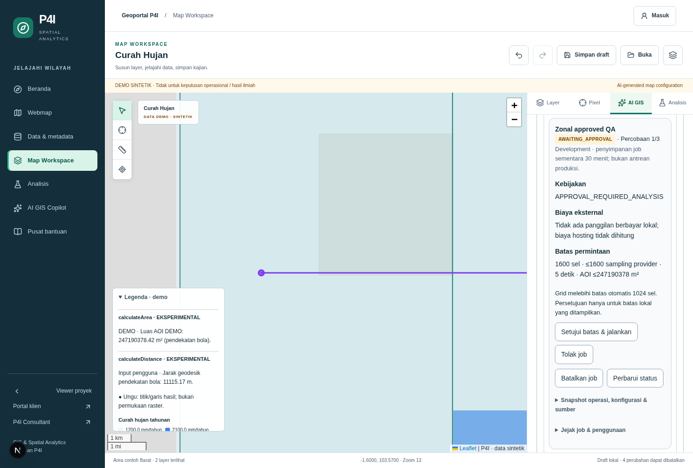
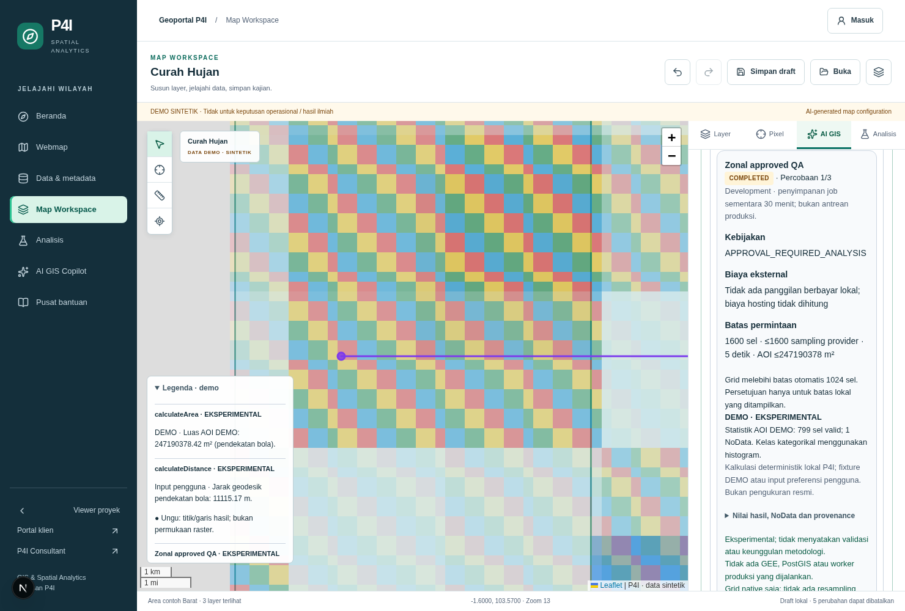
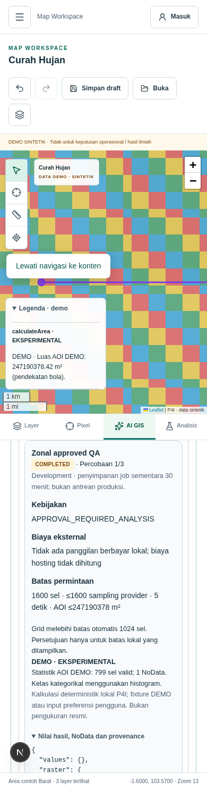

# Controlled AI GIS analysis execution — Phase 06

Phase 06 extends Phase 05 at `989ff92` on `feat/ai-gis-analysis-phase06`. The actual
Phase 05 branch is `feat/ai-gis-copilot-phase05`; its draft PR #1 is not claimed merged.
The existing Leaflet workspace, MapRecipe, Phase 04 configuration model, AHP/WLC math,
raster provider and permission checks remain the engines used here.

**Methodology validation, scientific ranking, expert approval and a mandatory VALIDATED
state are out of scope.** Results/configurations remain experimental. AHP CR is a
numerical consistency measure, not scientific endorsement or an execution gate.

## Working operations

| Entry | Existing computation | Actual output and boundary |
| --- | --- | --- |
| `calculateArea` | `sphericalArea` | Square metres for one authorized, known DEMO AOI; spherical approximation |
| `calculateDistance` | `sphericalDistance` | Metres between exactly two explicit `[longitude, latitude]` EPSG:4326 points; no routing |
| `spatialSelection` | `selectVectorIds` | IDs of DEMO polygons covering a point, including the existing boundary semantics |
| `inspectPixel` | Existing Phase 05 checked raster sampling | Native provider-returned values, NoData and source metadata; remains read-only and bounded to eight samples |
| `runConfiguredAnalysis` → AHP/SMCE | `calculatePreferences` | Existing 3×3 weights and CR; applies preferences through existing configuration application |
| `runConfiguredAnalysis` → WLC | `calculateLegacyWLC` | Existing scenario formula and constraint. Missing scores produce `null`, never zero or an invented map |
| `runConfiguredAnalysis` → raster reclassification | Existing raster `classify` | One configured point with validated half-open classification intervals |
| `runConfiguredAnalysis` → normalization/arithmetic | Existing restricted raster operations | One point; explicit units, native alignment, supported arithmetic only |
| `runConfiguredAnalysis` → zonal statistics | Existing bounded native cell scan | Continuous min/max/mean or categorical histogram, valid/NoData counts and spherical AOI area |
| `runConfiguredAnalysis` → clip/mask | Existing native subset operation | Bounded subset/window/count description, **not a raster file** |
| Result application | `applyComputeJob` + existing store | Source layers/configuration, bounded result annotation and actual point/line overlays; one reversible recipe commit |
| Legend and report | Existing legend/PDF export, result annotations, `draftComputeReport` | Source/class legends remain; result summary and purple point/line key, downloadable Markdown, JSON, PNG and PDF |

These are real calculations over **synthetic fixtures or explicit user parameters**.
No nationwide raster is loaded. No new GIS engine, numerical formula, database schema
or external service is introduced. Grid summaries are not rendered as fabricated
continuous prediction surfaces. Reports distinguish DEMO from user inputs and retain
experimental/provisional limitations.

Flood susceptibility configuration is accepted as a snapshot, but its data/GEE adapter
is unavailable. Its job shows `AWAITING_APPROVAL`, `UNKNOWN` external cost and disabled
execution; approval cannot enable a missing adapter. Buffer, real vector overlay,
real AOI lookup, real remote raster statistics and an automated scenario-comparison
tool are not implemented. Existing WLC scenarios can be run individually and their
actual outputs inspected; no scientific ranking is produced.

## Workspace workflow

Open `/spatial/ai` or the **AI GIS** tab in `/spatial/viewer` in development DEMO mode.
The planner is the existing deterministic grammar, not a connected LLM.

1. `Hitung luas area contoh Barat` calculates and annotates a known fixture AOI.
2. `Hitung jarak [103.55, -1.6] ke [103.65, -1.6]` produces a bounded two-point result.
3. `Seleksi polygon pada titik pusat peta` selects known DEMO polygons.
4. Create/edit a configuration in **Analisis**. For example, choose zonal statistics,
   select Area contoh Barat and a raster, then name/save the local configuration.
5. `Jalankan konfigurasi "Nama konfigurasi"` uses that exact Phase 04 snapshot.
6. Small jobs execute automatically. A 40×40 land-cover grid requires **Setujui batas &
   jalankan**; inspect the operation, source metadata, parameters, hash and resource
   ceiling in the card before approving. Cancel/reject are separate actions.
7. The card displays the job state, actual structured values/NoData, provenance,
   limitations and usage. Download **Unduh laporan draft (.md)** for a real local file.
8. Results update MapRecipe with Undo/Redo. If the map changes during an approved job,
   its late result is not automatically applied: review and use **Terapkan hasil ke peta**.
   Existing explicit local draft save and JSON/PNG/PDF export continue working.

The requested example `Analisis kerawanan banjir Kecamatan X menggunakan konfigurasi
yang tersedia dan tampilkan hasilnya` is explicitly unsupported because the real AOI
and engine are unavailable. It does not substitute an Area contoh or fabricate a flood result.

## Contracts and execution

- `lib/gis/computeContracts.ts`: ComputeRequest, ComputeEstimate, ComputeApproval,
  ComputeJob, ComputeResult, ComputeUsageRecord and asynchronous ComputeExecutionAdapter.
- `lib/gis/computeValidation.ts`: strict operation/result DTOs, state machine, bounded
  map artifacts and deterministic draft reporting. No arbitrary code/eval.
- `lib/server/compute/policy.ts`: configuration/catalog metadata, ACL/project, AOI,
  engine availability and conservative resource estimate validation.
- `lib/server/compute/service.ts`: bounded process-local job repository, immutable
  request hash, idempotency, human approval, execution, cancellation and retry.
- `lib/server/compute/adapter.ts`: dispatch to the existing local GIS utilities/provider.
- `lib/server/compute/access.ts`: trusted auth identity or opaque development-session
  owner; no client-supplied roles, identity or entitlement.
- `POST /api/gis/copilot`: plan/preview or submit a single controlled compute operation.
  The optional `requestId` is a bounded idempotency key. A reviewed plan uses its stable ID.
- `POST /api/gis/compute`: `get`, `approve`, `execute`, `cancel`, `reject`, `retry` for
  an owned job. It accepts no replacement operation/configuration. Approval accepts
  only the exact server-issued hash and ceiling. This route is not an AI approval tool.

Every configured operation reuses `parseAnalysisConfiguration` and
`prepareConfigurationApplication`; dataset IDs, versions/provenance, band, resolution,
CRS, units, temporal period, NoData semantics, weights and parameters retain the Phase
03–04 checks. Geometry measurements use explicit point/AOI arguments rather than
inventing an incompatible configuration type. One compute step per plan prevents
cross-step side effects; the existing general plan limit is 16 steps.

Results retain at most eight bounded `analysisResults` annotations in MapRecipe.
Actual source/class legends remain authoritative; point/line annotations are purple.
AHP/WLC output is a scenario/preference result, not a generated geographic raster.
Imported recipe annotations are user documents, not server attestations. Full job
results live only in the temporary job/card or an explicitly downloaded report.

## Development versus production

The API execution adapter is explicitly disabled under `NODE_ENV=production`, even
with `GIS_DEMO_MODE=true`. Local jobs execute within the request and a five-second
budget. Awaiting approval is resumable only while this one development process lives;
there is no durable queue, background worker, cross-instance lock or production audit.
Restart/TTL expiry loses jobs. Authenticated RBAC is covered by trusted-context/route tests; real Supabase user-role
logins and GEE data access were not exercised. The UI shows the current job; named configurations and
explicit MapRecipe drafts continue using the existing safe browser storage.

A future adapter must implement the async execute contract, support cancellation,
return validated bounded results and enforce server-side windows/quotas. See
[commercial compute governance](commercial-compute-governance.md) for the required
durable worker, authorization, billing and approval boundaries. No Hostinger managed
Node process is assumed to provide reliable long-running workers.

## Verification and review evidence

The repository baseline at Phase 05 passed lint, typecheck, 188 tests/28 files and build.
Phase 06 adds service/route security tests and `scripts/qa/phase-06-compute.mjs`.
Evidence is stored in [evidence/phase-06](evidence/phase-06). The implementation report
records final totals and PR details.

Browser coverage includes automatic geometry, actual report download, existing
JSON/PNG/PDF exports with computed recipe results, explicit grid approval, attempted
approval bypass, session isolation, categorical statistics, cancel/retry, UNKNOWN
cost refusal, real-AOI refusal and responsive keyboard accessibility.

