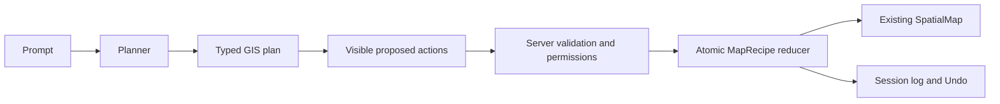

# P4I AI GIS Copilot

Current Copilot is an explicitly labeled deterministic Indonesian demo parser, not an external
LLM. No vendor SDK or key has been added. A server-side OpenAI/Gemini/other planner can implement
`GisPlanner` without exposing provider credentials or manipulating Leaflet directly.

`lib/server/ai/contracts.ts` defines the planner; `providers/demo.ts` translates known keywords.
`tools/registry.ts` declares session, read and unavailable remote tools. Runtime schemas are
hand-written discriminated validators; no extra schema package is required. Tests exercise
malicious payloads, unknown layers and private-project denial.

Session actions: createMap, setMapTitle, setBasemap, setViewport, addLayer, removeLayer, toggleLayer,
reorderLayer, setLayerOpacity, styleVectorLayer, styleRasterLayer, zoomToLayer, selectAOI (known
fixture IDs), generateLegend. Catalog search/list/metadata are available through catalog/UI;
samplePixel uses its authorized endpoint; summarizeCurrentMap does not modify state.

“Buat peta curah hujan dan kemiringan dengan batas kecamatan” proposes known layers and legend.
“Pilih area contoh Barat” chooses a fixture identity. “Jelaskan peta” summarizes context. Arbitrary
district geocoding, flood/buffer/statistics and AI-triggered export are unavailable; no layer IDs
or scientific scores are invented. Use manual analysis/export panels for their existing workflows.

UI shows conversation, prompts, context, proposed actions, sources, errors and activity. The user
clicks Apply after review. A changed recipe invalidates a stale plan. Execution repeats validation
and permission checks server-side; successful plans enter Undo history as one atomic change.

`getGisContext` derives identity from the existing `user_profiles.role` flow and restricted project
access from repositories/entitlements. Request JSON cannot supply a trusted role or entitlement.
Guests access public datasets; B2B needs entitlement; analysts do not gain super-admin privileges.
Current fixtures are public; private-descriptor tests enforce the future adapter boundary. Existing
project APIs, auth and RLS architecture are unchanged.

Read actions may be automatic. Session mutations need visible logs/Undo (this UI additionally uses
Apply). Future expensive/persistent/destructive tools need separate explicit confirmation and
server authorization. They cannot execute now: no arbitrary SQL, JavaScript, shell, database writes,
resource creation, publication or free-form calculator is registered. Remote flood remains in its
separate authorized API, not the fixture planner. Persistent audit logging awaits a verified schema.
Exports say “AI-generated map configuration”, never “scientifically validated result”.
