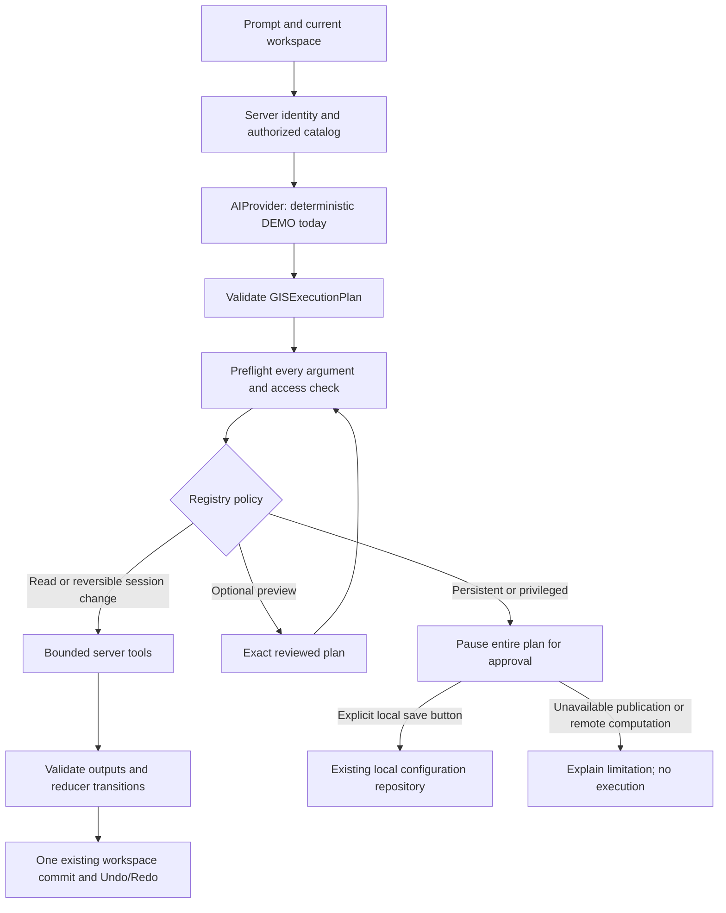

# Phase 05 — Controlled Autonomous GIS Copilot (Option B)

> Phase 09 update (15 October 2026): Explicit AI_PROVIDER=demo is recommended for local DEMO review; real/unknown/disabled selections never fall back. A typed structured transport seam exists but no real provider is selected or connected. See [current integration readiness](real-gis-integration-readiness.md). Earlier descriptions below are historical where superseded.

Verified 14 October 2026 against the actual Phase 04 head `22cf04c` on
`feat/ai-gis-copilot-phase05`. This is working development functionality in the existing Map
Workspace, using its MapRecipe reducer, Leaflet renderer, history, raster provider and Phase 04
configuration model. No second map or analysis engine was created.

The available planner is **DEMO, deterministic and rule based**, not a connected LLM. No authorized
OpenAI/Gemini/Anthropic/Azure model credentials were present (presence checks only). No external
model call, GEE computation, deployment, migration or paid operation was performed.

## Execution path and contracts



`lib/gis/copilotContracts.ts` defines `AIProvider`, `GISIntent`, `GISExecutionPlan`,
`GISToolDefinition`, `GISToolRegistry`, `GISActionResult`, `MapRecipeAction` (an alias of existing
MapAction), `GISExecutionTrace` and response/context DTOs. Runtime discriminated validators in
`copilotValidation.ts` reuse existing recipe, action, raster and configuration validators.
No new schema dependency or vendor SDK is required. Server implementation lives in
`lib/server/ai/execution.ts`, `tools/execute.ts` and `providers/controlledDemo.ts`.
The earlier `GisPlanner` factory remains a compatibility wrapper around this same planner.

`POST /api/gis/copilot` accepts either:

```json
{"prompt":"Tambahkan curah hujan","recipe":"<MapRecipe object>","configurations":[],"execution":"auto"}
```

or `{ "plan": <GISExecutionPlan>, "recipe": <MapRecipe>, "configurations": [...] }` for an exact
reviewed-plan application. The strings above are placeholders; supply actual validated objects.
`execution` defaults to `auto`; `preview` validates but runs no tools. Reviewed plans are revalidated
against the selected provider, current identity, catalog and static registry; they cannot supply
an approval, trusted role, permission, handler or paid-operation flag. Responses are private/no-store.
Current routes remain `/spatial/ai`, `/spatial/viewer`, `/spatial/analysis`, and the existing
catalog/actions/pixel/process APIs. No extra disconnected page or persistence API was introduced.

## Tool policies

| Policy | Connected tools | Actual behavior |
| --- | --- | --- |
| Read | searchDatasetCatalog, listAvailableLayers, getDatasetMetadata, summarizeCurrentMap | Filter authoritative catalog by current permissions; return bounded DTOs. |
| Read | inspectPixel | Query existing native RasterProvider/checkedSample; return actual fixture values, band, units, scale/offset, cell, version, CRS, NoData and provenance. No generated measurements. |
| Map session | createMap, setMapTitle, setBasemap, selectAOI, setViewport, addLayer, removeLayer, reorderLayer, styleLayer, changeLayerOpacity, generateLegend | Use the existing reducer and render in the current workspace. One successful batch is one Undo entry. |
| Map session | toggleLayer, setLayerOpacity, styleVectorLayer, styleRasterLayer, zoomToLayer | Existing typed action aliases are retained; not every alias has a natural-language shortcut. |
| Read/draft | listAnalysisConfigurations, selectAnalysisConfiguration, createAnalysisConfigurationDraft, proposeAnalysisConfigurationChanges | Use Phase 04 validation; selection updates the editor copy. Proposed changes fork a new ID/version-1 draft, leaving stored/shared objects untouched. |
| Read | prepareAnalysis | Return a typed local raster request or AHP/WLC preparation; never call raster execute/GEE. Flood honestly reports its pending adapter. |
| Map session | applyAnalysisConfiguration | Apply existing AHP/WLC preferences only. Other analysis types must use the supported explicit analysis panel. |
| Approval | requestConfigurationSave | Pause all steps; show exact snapshot. Only the explicit local-save button writes the existing browser repository. |
| Approval, unavailable | publishMap, runFloodAnalysis | Explain that authorization and an adapter are required; no executable handler or approval bypass exists. |

The immutable registry owns these levels; planner output cannot alter policy. Approval is a separate
user action, not a methodology validation status. A mixed plan containing an approval tool does
not execute its safe steps early. A local-save approval is bound to map, permission and draft
snapshots, uses repository revision checks, and is consumed once. Cancelling it does nothing.
An external authorization service for future server mutations is **not** implemented by this local UI.

## Supported Indonesian examples

Open AI GIS in `/spatial/viewer?webmap=climate` with `GIS_DEMO_MODE=true` in local development.
The automatic-session checkbox is enabled initially; disable it to inspect a plan before applying.

| Prompt | Result |
| --- | --- |
| Buatkan peta tutupan lahan area contoh Barat, tambahkan batas kecamatan, gunakan basemap OSM dan buatkan legenda | Resolve actual fixture IDs; create map, add two layers, choose fixture AOI and generate legend. |
| Buat peta curah hujan dan kemiringan dengan batas kecamatan | Add available rainfall/slope/boundaries; does not claim a real administrative extent. |
| Ubah judul peta "Kajian DEMO" | Change title in current session. |
| Ubah opacity tutupan lahan menjadi 25% | Set existing matching layer opacity to 0.25. |
| Ubah warna tutupan lahan #008000 #ffff00 #ff0000 | Validate and apply a palette; regenerate current legend. |
| Pindahkan tutupan lahan ke urutan 1 | Resolve existing layer and use a one-based requested position. |
| Hapus layer tutupan lahan | Remove the layer from this session; Undo remains available. |
| Gunakan basemap OSM / Gunakan tanpa basemap | Use OSM or a network-independent blank basemap. |
| Atur viewport -1.6, 103.57 zoom 13 | Validate latitude/longitude and zoom, then update the existing map. |
| Cari hujan / Daftar layer tersedia / Metadata tutupan lahan / Jelaskan peta | Authorized read results with no new Undo entry. |
| Inspeksi pixel tutupan lahan di pusat peta | Native provider sample at current center/selected band, explicitly DEMO. |
| Inspeksi pixel tutupan lahan titik 0, 0 | Actual provider NoData outside coverage, never a fabricated zero. |
| Daftar konfigurasi analisis | List available named configurations with IDs and experimental labels. |
| Buat draft konfigurasi wlc "Skenario Copilot" | Create an unsaved experimental editor draft. |
| Pilih konfigurasi "Skenario Copilot" | Select an existing context configuration by exact name; ambiguous names require an ID. |
| Ubah bobot konfigurasi "Skenario Copilot" menjadi bencana 20%, kesuburan 30%, kepadatan 50% | Validate total/criteria and fork a draft; original stays intact. |
| Siapkan konfigurasi "<actual ID>" | Show a preparation, not a computed result. Use actual ID from the response. |
| Terapkan konfigurasi "<actual ID>" | Apply AHP/WLC preferences to the existing recipe/history. |
| Simpan konfigurasi "<actual ID>" | Ask for explicit local-save approval; prompt alone does not persist. |
| Publikasikan peta / Jalankan analisis banjir | Approval-required/unavailable, with no remote work executed. |

AHP changes use existing pairwise ratio keys, for example `Ubah konfigurasi "AHP" menjadi
bencanaVsKesuburan 3, bencanaVsKepadatan 2, kesuburanVsKepadatan 1`. Existing AHP math and consistency
ratio remain unchanged. Configuration types use Phase 04 supported adapters. Full parameter/rule
editing remains in the typed Analysis panel; the demo grammar mainly supports weights/AHP ratios.
There is **no mandatory scientific methodology approval, grading, validation or ranking**.
Experimental configurations stay labeled experimental and do not become scientifically validated.

The requested real-world example mentioning **Kota Jambi** returns `needs-input` and an unchanged
recipe because no authorized real AOI/dataset identity resolver is connected. It does not silently
replace Kota Jambi, Bandung or unavailable districts with a fixture near Jambi. Explicit fixture
names are required for Barat/Timur. Unknown dataset IDs, unavailable engines, AI exports, arbitrary
buffer/overlay execution and unsupported instructions do not produce invented results.

## Safety and bounded execution

- Server derives identity from existing auth/profile and project entitlements. Request JSON cannot
  override roles/access. Guests receive public data; restricted B2B data requires its actual
  entitled project. Catalog now returns server-derived entitled IDs for consistent client checks;
  client IDs never authorize server operations.
- Only authorized catalog/configuration context reaches the provider. Dataset descriptions, tags
  and notes are data, never instructions. Demo resolution uses a closed alias/ID map rather than
  interpreting arbitrary metadata. React renders strings as text, not HTML/code.
- Strict tool/name/field allowlists reject SQL, JavaScript, Python, shell, eval, role escalation,
  injected handlers and unknown actions. No user-defined code, tool loop or dynamic registry.
- Limits per request: 2,000 prompt characters; 64 KiB HTTP body; 128 KiB planning context; 32 configurations;
  50 catalog results; 16 steps; 8 total pixel dataset queries; 32 KiB plan; 64 KiB per result;
  256 KiB total response. Planning deadline 5 seconds; execution 10 seconds; existing pixel
  provider deadline remains 5 seconds. Abort signals propagate; no retries/recursive planning.
- Whole-plan preflight runs before any query. Each output DTO and exact reducer transition is
  checked; invalid results abort the batch. Only a validated final recipe reaches the workspace.
- In-flight cancellation and late-response/version checks preserve human changes. Comparing
  normalized recipes avoids treating legend property order as a mutation. Programmatic map
  synchronization settles without animation, preventing old moveend events after rapid Undo/Redo.
- Map history remains bounded to 30, session activity to 50; chat keeps 24 entries and AI traces
  20, in memory. Trace shows plan ID, provider, step, policy, status and duration. Errors are
  visible and recorded in conversation. Server-side durable audit/rate limiting is still pending.
- Production refuses both prompt planning and reviewed DEMO plans even if GIS_DEMO_MODE=true.
  Backend exceptions are masked; no keys or credential values enter DTOs/browser bundles.

## UI workflow and evidence

The panel shows current layers/AOI, suggestions, conversation, plan/parameter preview, execution
status, actual read results, provenance, configuration actions, explicit approval, cancellation,
errors and bounded activity history. Map changes use existing Undo/Redo. Draft creation/proposal
has a separate restore-draft action; saving is never automatic. Preparing zonal statistics does
not compute until the user opens Analisis and clicks its existing local execution button.

Chromium QA covers default auto mode, actual loaded Leaflet raster tiles/legend, rapid Undo/Redo,
style/opacity/order, native pixel/NoData, real-AOI refusal, preview/replay, tab persistence,
configuration create/fork/restore/prepare/apply, cancel/approve local save, explicit zonal execution,
request abort, stale-response conflict and malicious instructions. Eight Axe audits across four
states at 1480/390 px report zero violations/overflow; no page/hydration errors. Prior Phase 02
flows cover 320/390/768/1024/1480 px; Phase 03 and 04 regressions preserve raster/configuration/export.

[Auto map desktop](evidence/phase-05/auto-map-desktop.png) ·
[Pixel desktop](evidence/phase-05/pixel-desktop.png) ·
[Approval desktop](evidence/phase-05/approval-desktop.png) ·
[Pixel mobile](evidence/phase-05/pixel-390.png) ·
[Approval mobile](evidence/phase-05/approval-390.png).
These are actual app screenshots; GitHub image pages support viewing/downloading. The cloud
onboarding UI does not expose a public interactive localhost preview. See [local review](local-review.md).

Node 22.23.3: lint, typecheck, **188 tests/28 files** (34 new, previous 154 retained), and build pass.
Evidence logs, browser summary, production isolation and client bundle marker scan are under
[docs/evidence/phase-05](evidence/phase-05). The browser suite made zero GEE calls; its only raster
execute request was explicitly initiated in the existing Analysis panel. Dependency manifests and
lockfile are unchanged. No national rasters/full browser arrays or fabricated scientific results.

## Pending external integration

A future server-only LLM adapter implements AIProvider, returns unknown output for runtime validation,
and receives authorized bounded context. It must verify model structured-output capabilities,
data-sharing authorization and billing limits before real calls; handle metadata as untrusted data;
and pass the same adversarial, provider-failure, permission and atomic-execution tests. The default
client currently expects the DEMO descriptor; enabling a real adapter must supply its trusted
capability/descriptor to client validation without allowing request JSON to select authority.
No environment variable alone silently activates a paid model.

Real AOI/catalog/raster/GEE/PostGIS adapters, authorized remote sampling, shared persistence,
server-bound approvals/idempotency, durable audit, distributed quotas and commercial billing
controls remain pending. Per-request bounds are not distributed rate limiting. Arbitrary-language
understanding and multi-intent conversations are limited by the closed deterministic grammar.
Thumbnails/tiles remain generalized DEMO previews; numeric samples use native synthetic grids.
Real staging login/role happy paths and Supabase boundary/project RPCs were not exercised here.
Existing provider-neutral real-data adapter contract and earlier known limitations still apply.
