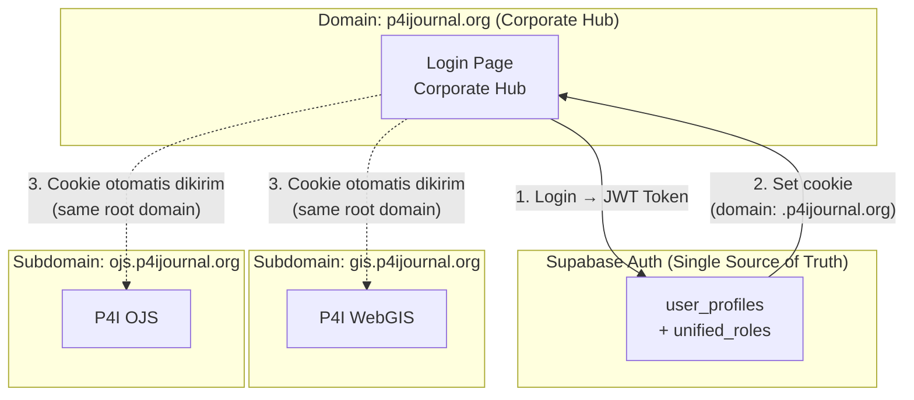

# Analisis Strategis Pengembangan Ekosistem P4I

> Dokumen konsultasi arsitektur — 28 Agustus 2026

---

## 1. Arsitektur SSO (Single Sign-On) Lintas Platform

### Pertanyaan: *Bagaimana user dari Corporate Hub bisa dikenali di WebGIS dan OJS?*

Karena ketiga pilar (Corporate Hub, WebGIS, OJS) sudah menggunakan **Supabase Auth yang sama**, implementasi SSO sangat memungkinkan. Berikut arsitekturnya:



### Kunci Teknis: **Shared Cookie pada Root Domain**

```typescript
// Saat login di Corporate Hub, set cookie di ROOT domain
document.cookie = `sb-access-token=${token}; domain=.p4ijournal.org; path=/; secure; SameSite=Lax`;
```

Dengan cookie di-set pada `.p4ijournal.org` (perhatikan **titik di depan**), maka:
- ✅ `p4ijournal.org` bisa baca cookie
- ✅ `gis.p4ijournal.org` bisa baca cookie
- ✅ `ojs.p4ijournal.org` bisa baca cookie

> [!IMPORTANT]
> Ini hanya bekerja jika **semua subdomain berada di root domain yang sama** dan menggunakan **instance Supabase yang sama**. Jika OJS menggunakan PHP/Laravel terpisah, perlu pendekatan berbeda (token exchange via redirect URL).

---

## 2. Deteksi Role Lintas Platform (GIS Admin, OJS Author/Reviewer)

### Pertanyaan: *Bisa tahu dia admin OJS, author, atau reviewer?*

**Ya, sangat bisa.** Caranya: perluas tabel `user_profiles` dengan kolom role per-platform:

```sql
-- Evolusi skema user_profiles
ALTER TABLE public.user_profiles
ADD COLUMN IF NOT EXISTS gis_role TEXT DEFAULT 'viewer'
    CHECK (gis_role IN ('viewer', 'b2b_client', 'managerial_analyst', 'super_admin')),
ADD COLUMN IF NOT EXISTS ojs_role TEXT DEFAULT 'reader'
    CHECK (ojs_role IN ('reader', 'author', 'reviewer', 'editor', 'admin')),
ADD COLUMN IF NOT EXISTS hub_role TEXT DEFAULT 'visitor'
    CHECK (hub_role IN ('visitor', 'member', 'admin'));
```

### Matriks Akses Hasil Akhir

| User | `gis_role` | `ojs_role` | `hub_role` | Akses |
|------|-----------|-----------|-----------|-------|
| Dosen A | `viewer` | `author` | `member` | Submit jurnal di OJS, lihat peta publik |
| Reviewer B | `viewer` | `reviewer` | `member` | Review jurnal, lihat peta publik |
| Klien B2B | `b2b_client` | `reader` | `member` | Akses peta restricted, baca jurnal |
| Admin P4I | `super_admin` | `admin` | `admin` | Akses penuh ke semua platform |

### Alur di Frontend (tiap platform)

```typescript
// Di middleware atau API route masing-masing platform
const { data: profile } = await supabase
  .from('user_profiles')
  .select('gis_role, ojs_role, hub_role')
  .eq('id', user.id)
  .single();

// Di WebGIS: cek profile.gis_role
// Di OJS: cek profile.ojs_role
// Di Corporate Hub: cek profile.hub_role
```

---

## 3. Fitur Analisis GIS yang Bisa Ditambahkan

### Fitur Prioritas Tinggi (Bernilai Bisnis Tinggi)

| # | Fitur | Deskripsi | Kompleksitas |
|---|-------|-----------|-------------|
| 1 | **Buffer Analysis** | Gambar zona radius X meter dari titik/garis/poligon. Contoh: "Tampilkan area 500m dari sungai" | ⭐⭐ |
| 2 | **Layer Overlay (Tumpang Tindih)** | Gabungkan/potong 2+ layer untuk analisis spasial. Contoh: "Area rawan banjir ∩ Zona permukiman" | ⭐⭐⭐ |
| 3 | **Heatmap Visualization** | Visualisasi kepadatan titik (point density) dengan gradien warna | ⭐ |
| 4 | **Measurement Tools** | Ukur jarak (polyline) dan luas (polygon) langsung di peta | ⭐ |
| 5 | **Land Suitability Report** | Generate laporan kelayakan lahan otomatis berdasarkan skor WLC | ⭐⭐ |
| 6 | **Comparison Mode** | Split-screen 2 proyek untuk perbandingan visual side-by-side | ⭐⭐ |
| 7 | **Temporal Analysis** | Timeline slider untuk melihat perubahan wilayah dari waktu ke waktu | ⭐⭐⭐ |
| 8 | **Custom Basemap** | Pilihan basemap: Satellite, Terrain, Dark Mode, Topographic | ⭐ |
| 9 | **Spatial Statistics** | Hitung otomatis: total luas, perimeter, centroid, distribusi skor | ⭐⭐ |
| 10 | **Collaborative Annotation** | User bisa menambahkan pin/catatan di peta yang bisa dilihat tim | ⭐⭐⭐ |

### Fitur Cepat yang Bisa Ditambahkan Sekarang (< 1 Hari)

- **Custom basemap switcher** (Satellite/Dark/Terrain) — menggunakan tile layer berbeda
- **Measurement tools** — library `leaflet-measure` atau `turf.js`
- **Legend panel** — legenda warna choropleth di sudut peta
- **Fullscreen button** — toggle fullscreen map view

---

## 4. Estimasi Waktu Pengembangan AI Spasial

### Pertanyaan: *Berapa lama membuat AI yang memberikan rekomendasi perencanaan wilayah?*

| Pendekatan | Waktu | Deskripsi | Akurasi |
|-----------|-------|-----------|---------|
| **Level 1: Rule-Based Engine** | 2-3 hari | If-else berdasarkan threshold skor WLC. "Jika skor bencana > 4 dan kesuburan > 3 → Rekomendasikan pertanian" | ⭐⭐ |
| **Level 2: LLM API Integration** | 1-2 minggu | Kirim data skor + metadata wilayah ke **Gemini API / OpenAI API** → dapat rekomendasi naratif | ⭐⭐⭐ |
| **Level 3: RAG + Domain Knowledge** | 3-4 minggu | LLM + database pengetahuan tata ruang Indonesia (RTRW, regulasi, studi kasus) | ⭐⭐⭐⭐ |
| **Level 4: Custom ML Model** | 2-3 bulan | Training model khusus dari data historis perencanaan wilayah | ⭐⭐⭐⭐⭐ |

### Rekomendasi Saya: **Mulai dari Level 2**

Endpoint `/api/ai-recommendation` sudah ada (saat ini mock). Langkah upgrade:

```
Waktu: ~1 minggu
Biaya: Gemini API gratis (free tier) atau OpenAI ~$5-20/bulan

Alur:
1. User pilih poligon di peta
2. Ekstrak properties (skor, luas, koordinat, nama wilayah)
3. Kirim ke Gemini/OpenAI dengan system prompt domain tata ruang
4. Tampilkan rekomendasi di panel samping (markdown rendered)
```

> [!TIP]
> **Gemini 2.0 Flash** punya free tier yang sangat generous dan cukup cerdas untuk analisis tata ruang. Ini pilihan paling cost-effective untuk memulai.

---

## 5. Peningkatan UI — 3D Globe di Landing Page

### Pertanyaan: *Bisa tambah 3D Globe agar terlihat menarik?*

**Absolut bisa dan sangat direkomendasikan.** Berikut opsi teknologi:

| Library | Ukuran | Visual | Interaktivitas | Rekomendasi |
|---------|--------|--------|----------------|-------------|
| **Globe.gl** | ~200KB | ⭐⭐⭐⭐⭐ | Tinggi (rotate, zoom, arcs) | ✅ **Terbaik untuk landing page** |
| **Three.js + React Three Fiber** | ~150KB | ⭐⭐⭐⭐⭐ | Sangat tinggi (custom shader) | Untuk efek sangat custom |
| **CesiumJS** | ~5MB | ⭐⭐⭐⭐⭐ | Sangat tinggi (terrain 3D) | Terlalu berat untuk landing page |
| **Mapbox GL** | ~200KB | ⭐⭐⭐⭐ | Tinggi | Berbayar untuk trafik tinggi |

### Konsep UI yang Saya Rekomendasikan

```
┌────────────────────────────────────────────────┐
│  ┌──────────────────────────────────────────┐  │
│  │                                          │  │
│  │          🌍 3D GLOBE (Globe.gl)          │  │
│  │      Rotasi otomatis, titik-titik        │  │
│  │      proyek menyala di Indonesia         │  │
│  │                                          │  │
│  └──────────────────────────────────────────┘  │
│                                                │
│   P4I SPATIAL ANALYTICS                        │
│   "Platform Analisis Tata Ruang Berbasis AI"   │
│                                                │
│   [Mulai Eksplorasi Peta]  [Jadwalkan Demo]    │
│                                                │
│   ─── Scroll Down ───                          │
│                                                │
│   📊 Statistik    🗺️ Fitur     🤝 Klien       │
│   150+ Proyek    AHP/WLC     B2B/Gov          │
│                                                │
│   ─── Peta 2D Leaflet (fullscreen) ───         │
│                                                │
└────────────────────────────────────────────────┘
```

### Peningkatan UI Lainnya yang Saya Rekomendasikan

| # | Improvement | Dampak Visual |
|---|------------|---------------|
| 1 | **Dark theme untuk peta** (basemap gelap + UI gelap) | Terlihat premium dan modern |
| 2 | **Animated gradient background** pada header/hero | First impression yang kuat |
| 3 | **Glassmorphism panel** yang lebih tebal + shadow | Depth dan dimensi |
| 4 | **Micro-animations** (framer-motion) pada transisi panel | Terasa hidup dan responsif |
| 5 | **Loading skeleton** yang lebih elegan | Pengalaman loading yang mulus |
| 6 | **Color palette upgrade** dari biru generik → indigo/violet gradient | Identitas brand yang kuat |
| 7 | **Legend choropleth** di pojok peta | Peta lebih informatif |
| 8 | **Sidebar collapsible** dengan animasi smooth | UX yang lebih baik di mobile |

---

## 6. Analisis Migrasi: Vercel vs Hostinger

### Pertanyaan: *Bagaimana jika pindah dari Vercel ke Hostinger?*

> [!CAUTION]
> **Tidak direkomendasikan kecuali ada alasan biaya yang mendesak.** Berikut analisis lengkapnya:

### Perbandingan Detail

| Aspek | Vercel (Sekarang) | Hostinger VPS |
|-------|-------------------|---------------|
| **Next.js Support** | ✅ Native (dibuat oleh tim yang sama) | ⚠️ Manual setup (`next build` + `next start` + PM2) |
| **Serverless Functions** | ✅ Otomatis per API route | ❌ Tidak ada — semua jadi Node.js monolith |
| **Edge Network / CDN** | ✅ Global (300+ PoP) | ❌ Single server location |
| **Auto-scaling** | ✅ Otomatis | ❌ Manual (harus upgrade VPS jika trafik naik) |
| **SSL/HTTPS** | ✅ Otomatis | ✅ Let's Encrypt (manual/auto) |
| **Deploy** | ✅ `git push` → auto deploy | ⚠️ Manual SSH + build + restart |
| **Downtime saat deploy** | ✅ Zero downtime | ⚠️ Beberapa detik downtime |
| **Harga** | Free tier generous, Pro $20/bulan | VPS mulai ~$5-10/bulan |
| **Cold Start** | ⚠️ Serverless cold start ~1-3 detik | ✅ Selalu warm (proses Node.js selalu running) |
| **Upload file besar** | ❌ Limit 4.5MB (serverless) | ✅ Bisa lebih besar (tergantung config) |
| **Maintenance** | ✅ Zero DevOps | ❌ Harus kelola server sendiri (update, security, backup) |

### Skenario di Hostinger

```bash
# Yang harus Anda lakukan jika pindah ke Hostinger VPS:
ssh root@your-vps-ip
git clone your-repo
npm install
npm run build              # Harus build production
pm2 start npm -- start     # Jalankan dengan process manager
# Setup Nginx reverse proxy
# Setup SSL certificate
# Setup firewall
# Monitoring manual
# Update manual setiap kali ada perubahan kode
```

### Rekomendasi Saya

| Skenario | Rekomendasi |
|----------|-------------|
| Budget ketat, trafik rendah | Tetap di **Vercel Free Tier** |
| Butuh upload file > 4.5MB | Gunakan **Supabase Storage** (direct upload), tetap di Vercel |
| Trafik tinggi, butuh kontrol penuh | **Vercel Pro** ($20/bulan) atau **Railway/Render** |
| Sudah punya Hostinger dan ingin hemat | Hostinger **hanya untuk Corporate Hub** (static site), WebGIS tetap di Vercel |

> [!TIP]
> **Strategi hybrid terbaik:** Corporate Hub (landing page statis) di Hostinger + WebGIS di Vercel + OJS di Hostinger VPS (karena OJS/PHP memang butuh server tradisional). Ini memaksimalkan kekuatan masing-masing platform.

---

## 7. Roadmap Prioritas Pengembangan

Berdasarkan semua analisis di atas, berikut urutan prioritas yang saya rekomendasikan:

### Fase 1: Quick Wins (1-2 Minggu)
- [ ] **3D Globe landing page** dengan Globe.gl
- [ ] **Dark basemap** + custom basemap switcher
- [ ] **Legend choropleth** di peta
- [ ] **Measurement tools** (jarak & luas)
- [ ] **UI polish**: gradient, animations, dark theme panel

### Fase 2: Core Features (2-4 Minggu)
- [ ] **AI Recommendation Level 2** (Gemini API integration)
- [ ] **Unified user_profiles** (tambah kolom `ojs_role`, `hub_role`)
- [ ] **SSO cookie sharing** lintas subdomain
- [ ] **Spatial statistics panel** (luas total, distribusi skor)
- [ ] **Fix security issues** (auth check di metrics API, delete button hanya admin)

### Fase 3: Advanced (1-2 Bulan)
- [ ] **Buffer & overlay analysis** (turf.js)
- [ ] **Corporate Hub** 7 halaman
- [ ] **OJS integration** dengan role system
- [ ] **Collaborative annotations**
- [ ] **AI Level 3** (RAG + domain knowledge)

### Fase 4: Scale (2-3 Bulan)
- [ ] **Temporal analysis** (timeline slider)
- [ ] **Custom ML model** untuk prediksi tata ruang
- [ ] **Mobile responsive** optimization
- [ ] **Performance audit** & optimization
