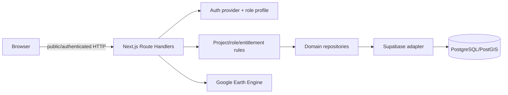

# Backend provider architecture and security review

> Phase 12 (16 October 2026): The dormant Earth Engine SDK/auth chain is removed from
> the application manifest, installation and build. The legacy flood service preserves
> its DTOs behind an unavailable provider; no database/provider is activated. Earlier
> GEE execution diagrams below are historical/future design. See the
> [isolation decision and reactivation requirements](PHASE_12_RESIDUAL_DEPENDENCY_RESOLUTION.md).

## Phase 08 database reproducibility and security — 15 October 2026

The active provider remains Supabase; no Neon/Nhost migration or external database mutation
occurred. Phase 08 starts from Phase 07 commit `20cbf54` on a clean feature branch, with
226 baseline tests plus lint/typecheck/build passing. The earlier audit below is historical;
its “no .git metadata” statement and deployment sequencing are not the current repository state.
For current migration order, evidence and rollback use the
[Phase 08 staging runbook](staging-database-runbook.md).

Domain boundaries remain provider-neutral: `lib/server/database/contracts.ts` exposes projects,
users, entitlements, downloads, leads, audits, metrics, boundaries and flood operations without
Supabase types. `lib/server/consulting/service.ts` exposes the versioned consulting repository;
Phase 04 configuration and Phase 06 jobs continue to use their existing local adapters. No
speculative schema/model was introduced for MapRecipe, raster metadata, jobs or deliverables.

The new executable local rehearsal applies historical SQL plus `008_staging_security.sql` to
PostgreSQL/PostGIS behind a real PostgREST authenticator. It tests exact row isolation and grants
for Guest, both B2B clients, Analyst, Admin and disabled/missing profiles. The minimal auth and
foundation schemas are **synthetic test adapters**, not recovered Supabase DDL. Full external
schema reproduction remains blocked by missing verified foundation/view/auth-trigger metadata.

008 closes inherited PUBLIC grants, protects public schema CREATE and import sequences,
restricts private legacy reports/weights, gates download metadata on current project access,
ignores disabled entitlement identities, hardens future ACL defaults, and uses `auth.uid()` for
modern JWT audit attribution. Existing 006/007 files are unchanged. Direct mutations remain
unavailable to all browser roles, including super-admin; trusted Next.js APIs authorize server
writes. A project entitlement does not imply a legacy report is approved for release.

Remaining vendor assumptions and integration work:

| Boundary | Remaining dependency | Required adaptation |
|---|---|---|
| Identity | Supabase Auth, `auth.users`, `auth.uid()`, PostgREST JWT roles | Neon requires an identity mapping; Nhost requires verified claims mapping; preserve trusted stored role and disabled checks |
| SQL roles | `postgres` owner, `anon`, `authenticated`, `service_role` BYPASSRLS | Map principals deliberately; do not grant an end user owner/service privileges |
| Geometry | historical SQL assumes PostGIS functions/types in `public` | Verify extension schema; do not silently relocate extensions on shared databases |
| Transport | Supabase JS `.from()`/`.rpc()` and nested FK selections confined to adapter | Implement repositories with SQL/transactions or Nhost transport; preserve authorization and DTOs |
| Service writes | Bypass RLS; route is security boundary; audit cannot infer an end user from a service key | Future verified actor propagation/transaction context, never arbitrary browser actor claims |
| Project + layer creation | Existing Supabase adapter compensates a failed layer insert with project deletion | Future transactional repository implementation; compensation is not atomic |
| Legacy reports | DDL and publication mapping absent | Verified schema reconciliation before release-aware adapter; service-only until then |
| Config/jobs/deliverables | Local validated drafts and process-local development repositories | Durable CAS/state/idempotency/revision transactions + explicit reviewer/publisher project grants |
| Files/downloads | No live object-storage repository; Phase 07 generates development PDF/JSON | Add authorized object storage only with real operations/retention requirements |

The database scripts never consume Supabase credentials or external DB URLs. The application
provider factory is unchanged, and unsupported providers still fail closed. Local RLS tests do
not prove real Supabase GoTrue issuance, external service-key handling, or confidential-client
publication. Scientific methodology validation/ranking remain OUT OF SCOPE; professional
client-deliverable review is a distinct explicit authorization workflow.

## Historical provider audit (September 2026)

## GIS workspace extension

The new map workspace preserves database/auth repositories. `lib/server/gis` adds a separate
dataset/vector/pixel provider boundary; `lib/server/ai` contains a vendor-neutral planner. Shared
MapRecipe/raster types contain no Supabase queries or Earth Engine objects. GIS endpoints derive
permissions from the existing server identity and entitlement checks, not request roles or JWT
user-editable metadata. Explicit development fixtures are refused in production. No migrations,
production changes or uploads were performed. See [Copilot architecture](ai-gis-copilot-architecture.md)
and [raster/pixel contracts](raster-pixel-analysis.md) for current capabilities and unavailable adapters.

Review date: 16 September 2026. The database and production environment were not modified. SQL
`007_security_hardening.sql` is a review artifact only and has not been executed.

## Baseline and coupling inventory

The supplied directory has no `.git` metadata, so `git status` cannot establish a clean/dirty
baseline. Before this refactor, lint, TypeScript, all 18 tests, and the production build passed.

Direct Supabase coupling existed in:

- server business routes for projects, project lists, users, entitlements, downloads, onboarding,
  leads, and dashboard metrics;
- flood boundary/cache persistence, the auth helper, and `proxy.ts`;
- browser components for login/profile lookup, project GeoJSON, viewport boundary RPC, audit logs,
  and the legacy map;
- two shared clients (`lib/supabase.ts` and `lib/supabaseAdmin.ts`); and
- the administrative boundary import script.

There was no `.storage` call or object-storage operation. The `file_size_bytes` column is accounting
metadata for PostGIS rows, not Supabase Storage usage.

## Target shape

```text
lib/
  client/auth/
    contracts.ts
    index.ts
    providers/supabaseAuthProvider.ts
  server/
    auth/
      contracts.ts
      identity.ts
      index.ts
      providers/supabase/supabaseAuthProvider.ts
    database/
      contracts.ts
      index.ts
      providers/supabase/
        client.ts
        repositories.ts
    storage/
      README.md
    boundaryViewport.ts
    projectAccess.ts
```

`database/contracts.ts` exposes domain operations rather than generic SQL: projects, users,
entitlements, downloads, leads, audits, dashboard metrics, administrative boundaries, and flood
cache. Route handlers perform input validation and request authorization, then call these contracts.
Only the Supabase adapter knows PostgREST query syntax, table names, RPC names, and the service key.

Auth is a separate boundary. The Supabase auth adapter validates a provider token; application role,
disabled state, and authorization remain in the database/application layer. The browser adapter is
limited to password sign-in and session observation. It cannot query application tables.

Storage has no TypeScript contract yet because there are no runtime operations to model. Add one
only when the application actually needs upload, delete, signed URL, or object metadata operations.

## Provider selection

The static factory is intentionally small:

- `DATABASE_PROVIDER=supabase` (default)
- `AUTH_PROVIDER=supabase` (default)

An unknown value fails closed at startup/use time. No Neon or Nhost package is installed and there
is no non-functional adapter stub. A future provider is added by implementing existing repository or
auth contracts and adding one factory branch.

## Data and authorization flows



- Project metadata: anonymous users see public projects only; B2B lists contain public and entitled
  projects; administrators see all.
- Project geometry: public layers are readable anonymously. Restricted layers require an admin role
  or a matching B2B entitlement. `GET /api/projects/[id]/layers` performs this check before reading
  current base-table GeoJSON returned by a service-role-only RPC.
- Boundaries: `GET /api/boundaries` validates coordinates, level, and simplification tolerance, then
  invokes the bounded RPC server-side. Raw tables and the RPC no longer need browser grants after
  migration 007.
- Audit logs: only `super_admin` can call `GET /api/admin/audit-logs`.
- Flood analysis: authentication and role checks stay in the route; full boundary and numeric cache
  persistence use repositories; compute-heavy raster work remains in Earth Engine.
- `proxy.ts` performs an optimistic navigation check only. Every sensitive API independently
  re-authorizes the request.

## PostgreSQL/PostGIS portability

| Area | Portable as-is | Provider-specific work |
|---|---|---|
| Repository contracts and route logic | Yes | None |
| Core relational tables, UUID/JSONB/timestamps | Mostly | Recreate grants, triggers, and migrations |
| PostGIS geometry and GiST indexes | Yes on PostGIS hosts | Enable PostGIS and load spatial data |
| GeoJSON conversion | PostgreSQL/PostGIS | Recreate the service-only `ST_AsGeoJSON` query/RPC |
| Boundary viewport | Domain contract is portable | Replace Supabase RPC/PostgREST invocation |
| RLS policies using `auth.uid()` | No | Replace provider JWT helpers or enforce entirely in API |
| Supabase Auth token verification | No | Implement another `AuthProvider` |
| Service-role bypass/PostgREST filters | No | Implement SQL/ORM repository adapter |
| Earth Engine | Yes | Independent of database provider |

Moving to Neon would normally use a PostgreSQL driver/ORM in a new adapter while retaining PostGIS.
Nhost can retain PostgreSQL/PostGIS concepts but needs its auth claims, permissions, and GraphQL/SQL
access mapped to the same contracts.

## Security findings

| Severity | Finding | Resolution/status |
|---|---|---|
| Critical | Live `handle_new_user()` cast user-controlled `raw_user_meta_data.role`, allowing signup role self-assignment up to `super_admin`. | Migration 007 replaces it: metadata supplies `full_name` only and role is always `b2b_client`. Direct profile DML is revoked from browser roles. Not yet applied. |
| Critical | Live `get_current_user_role()` trusted editable JWT `user_metadata.role`. | Migration 007 reads only `public.user_profiles.role` by `auth.uid()`, rejects disabled/missing profiles, and returns `NULL` for anonymous. Not yet applied. |
| Critical | `vw_vector_layers_geojson` is a materialized view, so its stored rows do not inherit current `vector_layers` RLS. | Runtime dependency removed. Migration revokes browser access and adds a current-row, service-role-only GeoJSON RPC. No `security_invoker` assumption remains. |
| High | Audit log browser query relied on database policy and exposed a broad joined row shape. | Replaced by minimal `super_admin` API DTO; migration revokes direct reads. |
| High | `audit_trigger_fn` was `SECURITY DEFINER` without a fixed `search_path` and retained default PUBLIC execute. | Migration recreates it with `pg_catalog`, qualified application references, postgres ownership, no dynamic SQL, and revoked browser execute. |
| High | Permissive live policies such as public project/vector/report reads could be OR-combined with secure policies and bypass entitlement semantics. | Migration removes all policies on the project root/children and recreates project-rooted policies. Optional children are fail-closed when their `project_id` is absent. |
| Medium | Public boundary RPC was callable directly and potentially expensive despite bbox/level/limit controls. | API now validates inputs; migration restricts RPC execute to service role. |
| Medium | Database and service-role environment access was spread across server files. | Secrets are read only by provider adapters (plus the explicitly administrative import script). |
| Low | Storage abstraction was implied by a column name although no object storage exists. | Documented explicitly; no speculative provider API added. |

### Final role source and RBAC

`public.user_profiles.role` is the sole application-role source. Supabase Auth establishes identity
only. Neither `raw_user_meta_data`, JWT `user_metadata`, nor `app_metadata` determines an application
role. A missing, disabled, or anonymous profile resolves to `NULL`, not `b2b_client`.

| Actor | Read | Mutations |
|---|---|---|
| Guest | Public projects and their project-linked public children | None |
| B2B client | Public projects plus restricted projects with a matching entitlement row | None directly; scoped application APIs only |
| Managerial analyst | All project-linked analysis data | Project creation/update through permitted server APIs; no delete, user-role, or entitlement administration |
| Super admin | All project data and administrative data | Destructive project, user-role, and entitlement operations through protected server APIs |

The current entitlement schema has no expiry/status column, so existence of the unique
`(client_user_id, project_id)` row is the definition of an active entitlement. Add explicit status or
expiry to the contract before introducing time-bound grants.

Migration 006 already prevents anonymous mutation of boundary, staging, and flood result tables,
limits public boundary output to `is_public`, validates bbox/level/tolerance, and reserves promotion
for the service role. Revised migration 007 additionally:

- replaces both live role functions rather than merely changing their search paths;
- rebuilds policies around `spatial_projects` and `can_access_project(UUID)`;
- gives optional `analysis_reports` and `smce_criteria_weights` the same rules when `project_id`
  exists, otherwise leaves them fail-closed;
- restricts non-project-linked flood-result table reads to analyst/super-admin roles;
- removes runtime use of the materialized view and revokes its browser access; and
- hardens trigger/RPC function search paths and execute grants.

## Secrets and deployment

`SUPABASE_SERVICE_ROLE_KEY`, GEE credentials, and dataset asset identifiers are server-only. The two
`NEXT_PUBLIC_SUPABASE_*` values are intentionally browser-visible and are now used by the browser only
for authentication. Authorization never treats the anon key as a secret.

This architecture is compatible with a persistent Hostinger Node.js 22 process: install with
`npm ci`, build with `npm run build`, and serve with `npm start`. It does not require serverless-only
features. Maintain a request timeout above the flood route's 55-second application timeout. Raster
processing stays in GEE, so the Node process orchestrates rather than performs heavy raster compute.

## Historical migration and rollback plan — superseded by Phase 08 runbook

The sequence below recorded the earlier proposal. It is not authorization or the complete
fresh-setup order; use the current runbook and verified foundation gate above.

1. Back up the Supabase database. Capture the materialized-view ACL/dependencies and inventory any
   scheduler, function, or external job that refreshes it; repository code contains no refresh path.
2. Apply migrations 006 then 007 to an isolated staging database. Migration 007 has not been run by
   this work.
3. Test an anonymous public map, anonymous restricted denial, entitled B2B access, unentitled denial,
   admin access, audit feed, boundary viewport, flood miss/hit, and disabled user rejection.
4. Test PostgREST directly: `spatial_projects`/`vector_layers` must return only public or entitled
   rows; the materialized view, audit logs, mutation tables, promotion RPC, boundary RPC, and internal
   GeoJSON RPC must be denied to browser roles.
5. Apply 007 first, then immediately deploy the application. The previous server can temporarily
   keep using the materialized view through its trusted service role while the new RPC becomes
   available; browsers cannot use the view after 007.
6. Roll application code back by redeploying the prior version. Database rollback should be a
   reviewed forward migration restoring only necessary grants; do not automatically drop tables,
   PostGIS, audit data, or flood results.

## Future migration estimate

For one engineer with staging access and a tested data export:

- Neon database adapter and SQL migration: roughly 5-9 engineer-days, plus 2-5 days for spatial data
  transfer/performance validation and 2-4 days for replacement auth integration.
- Nhost: roughly 6-12 engineer-days because PostgreSQL/PostGIS maps closely, but auth claims,
  permissions, and API access still need explicit mapping.

The estimate excludes production change windows, large dataset transfer time, external identity
migration, penetration testing, and remediation discovered from the live schema audit.
