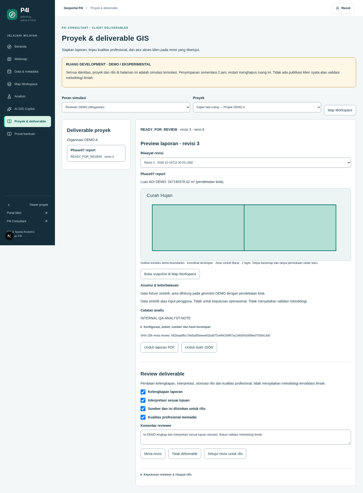
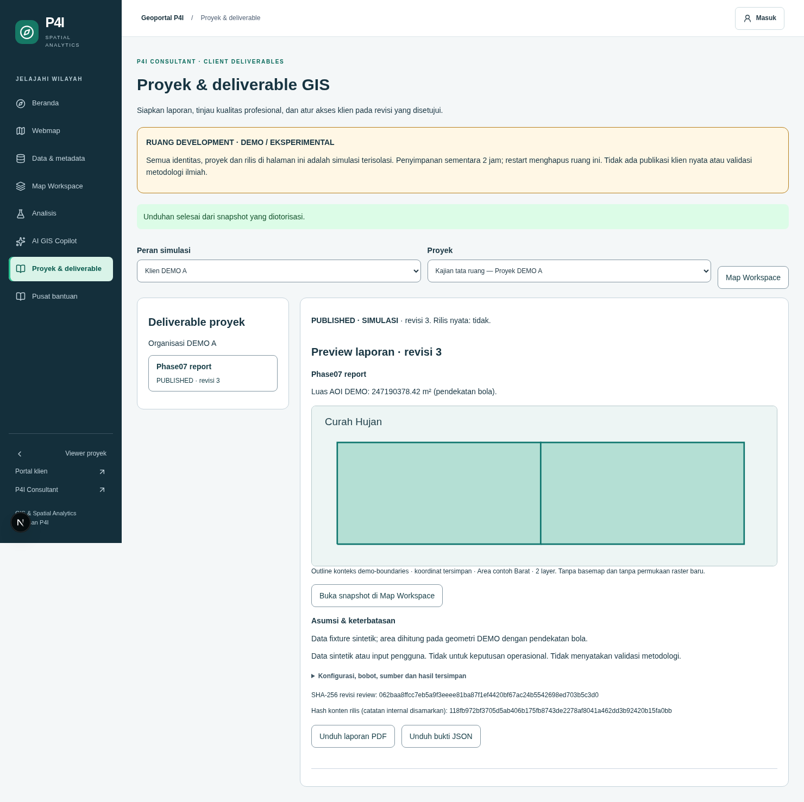
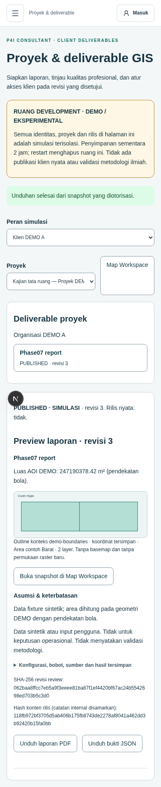

# GIS consulting projects and client deliverables — Phase 07

Phase 07 continues the actual Phase 06 head `0481801` on
`feat/consulting-workflow-phase07`. Phase 06 PR #2 is still open/draft, so this change
stacks on `feat/ai-gis-analysis-phase06`; it does not assume earlier phases merged.

## Product boundary

P4I Consultant analysts can prepare a GIS report, attach an owned Phase 06 analysis,
revise it, submit it for independent professional review, and simulate releasing the
approved revision to an entitled DEMO client. The existing geoportal, MapRecipe,
AHP/WLC, raster provider, Copilot, exports, project/client portal, admin dashboard and
Supabase audit/entitlement boundaries remain available.

**Client-deliverable review is distinct from the postponed scientific methodology
validation module.** Review checks completeness, intended interpretation, authorized
release and professional quality. It does not rank methodologies, establish scientific
superiority, imply professional qualifications from an admin role, or mark an analysis
method scientifically VALIDATED. Configurations/results remain experimental where applicable.

No real client is published by this implementation or its QA. All available release
operations are development simulations with `official: false`.

## Domain relationships

`ConsultingProject` extends the existing `ProjectSummary` contract, including its
`spatial_projects` identity and access tier. The development adapter has two explicitly
synthetic project records; it does not create a parallel live project table.

- `ClientDeliverable.projectId` references that project identity. It owns ordered
  revisions, review evidence, simulated publication records and an optimistic version.
- `DeliverableRevision` captures content, MapRecipe/configuration, weights, assumptions,
  limitations, internal analyst notes, source metadata, origin, date and evidence hash.
- `AnalysisRun` references the actual Phase 06 compute job/hash/state/configuration version.
- `AnalysisResult` stores its validated provider-returned result, not submitted measurements.
- `DeliverableReview` binds a human reviewer decision, checklist/comments and the exact
  revision/hash. Decisions are APPROVE, REQUEST_CHANGES or REJECT.
- `DeliverablePublication` references the approved review and immutable revision/hash,
  publisher/date, DEVELOPMENT_SIMULATION mode and `official: false`.
- `WorkflowAuditEvent` records the actor, project, revision, action and timestamp.

There is no second GIS or compute engine. The async `ConsultingRepository` interface
supports future persistence; the current adapter isolates each development browser session.

## Workflow

| Status | Allowed next step |
| --- | --- |
| DRAFT | Save a new immutable draft revision, attach a known job, or submit for review |
| ANALYSIS_RUNNING | Refresh the same/authorized job snapshot; review is blocked until work terminates |
| READY_FOR_REVIEW | Assigned independent reviewer approves, requests changes or rejects |
| CHANGES_REQUESTED | Author must create a new DRAFT revision before resubmission |
| APPROVED | Assigned publisher simulates release, or author creates a new DRAFT revision |
| PUBLISHED | Keep the published evidence; an author can start a new DRAFT revision |

Rejected reports use CHANGES_REQUESTED with a distinct REJECT decision; their evidence
is retained and revision remains possible. Approval requires all four professional checks,
a nonempty reviewer comment, the exact current hash, and a reviewer other than the
revision author. An author cannot edit a submitted revision in place. Approved/published
content, decisions and releases remain immutable. Compare-and-swap rejects stale actions.

Edits always create a new revision. When only narrative/notes change, the same verified
analysis snapshot is retained if MapRecipe and source snapshots are unchanged. Changes to
those snapshots clear the verified run/result link until a newly authorized job is attached.
A new draft never replaces the client's previously published revision. Client list/detail
and downloads return the latest released revision only, excluding future drafts/history.

## Workspace and client workflow

Open **Proyek & deliverable** at `/spatial/consulting`. Entry links also exist in the
Map Workspace export panel, completed compute cards, and the existing `/portal` page.

1. In Map Workspace, prepare a map/configuration and optionally run a Phase 06 operation.
   Use the deliverable link to keep the current in-memory recipe as the starting snapshot.
2. Choose a synthetic project as **Analis DEMO**. Fill title, summary, assumptions,
   limitations and internal notes. **Siapkan draft dengan Copilot DEMO** invokes the
   existing controlled planner's `prepareClientDeliverableDraft` tool. It prepares text
   from the existing recipe/results, without mutation, approval or publication.
3. Save the draft. Attach the actual compute job ID from the same user/session. Server
   retrieval rechecks Phase 06 ownership and project binding. Invented jobs, other-session
   jobs, other-project jobs and client-supplied measurement payloads are rejected.
4. A queued/running authorized job records ANALYSIS_RUNNING; refreshing its completed
   snapshot records actual results and returns to DRAFT. Failed/cancelled jobs return to
   DRAFT without fabricated outputs. Attachment does not submit new paid computation.
5. Inspect sources, map/legend, configuration, parameters, raw statistics and notes.
   **Buka snapshot di Map Workspace** uses the existing renderer and history store.
   The report preview renders saved provider DEMO outlines/result coordinates as a bounded
   schematic; it is explicitly not a new basemap or generated raster surface.
6. Submit for review. Switch to **Reviewer DEMO (ditugaskan)**, open the report, request
   revision or complete the four checks/comment and approve the exact revision.
7. Switch to **Publisher DEMO (ditugaskan)** and explicitly simulate release. Approval
   does not itself publish. No published records or reviewer approvals are preseeded.
8. **Klien DEMO A** sees only project A and its released reports; **Klien DEMO B** cannot
   access them. Unreleased documents are omitted rather than exposed as downloadable drafts.
   **Admin DEMO** has no implicit project review/publication grant.

Persona selection is deliberately limited to an isolated synthetic development room.
It is not an authentication or role-impersonation endpoint for real projects. It is absent
from the AI tool registry and cannot access real Supabase projects, users or entitlements.
No real user qualifications or reviewer approvals are fabricated.

## Report exports and evidence

`/api/consulting/download` generates actual PDF bytes using the repository's existing
jsPDF dependency. It includes P4I branding, project/client identity, revision and status,
reviewed evidence hash, dates, analyst summary, assumptions/limitations, saved map outline
and result coordinates, legend, AOI, configuration/weights/version/period and dataset
provenance when available. Actual linked compute results are included. No external image
URL, HTML renderer, credential or user code is executed to produce the report.

Map figures are explicitly schematic: saved provider DEMO outline/coordinates, without
basemap imagery or a fabricated raster prediction surface. The full existing GIS map
and its PNG/PDF exports remain available through Map Workspace.

Client exports redact internal analyst notes and omit private review comments, draft
revision history and unreleased updates. The original content hash identifies the
internal reviewed evidence; a separate `releasedContentHash` identifies the redacted
release DTO. Those are different hash scopes. Published client data retains only the
metadata/results that the reviewer explicitly authorized for release. Review is not
scientific endorsement. All report headers remain DEMO / EXPERIMENTAL / SIMULATION.

Downloads reauthorize every request, enforce project/client access and allowed revision,
use server-generated safe filenames, attachment disposition, private/no-store caching,
nosniff and a restrictive content policy. Arbitrary paths, user URLs and unknown formats
are not download sources. PDF/JSON can be downloaded by authorized staff; clients receive
only their published snapshot, even after the author begins a later draft.

## Provider and production boundary

- `lib/consulting/contracts.ts`: provider-portable domain and repository contracts.
- `lib/consulting/validation.ts`: bounded report input, existing MapRecipe/configuration
  validation, same-project dataset checks and server-derived source metadata.
- `lib/server/consulting/service.ts`: explicit project capability checks, state machine,
  revision hashing, independent human review and simulated publication.
- `lib/server/consulting/development.ts`: process-local, isolated synthetic room repository.
- `lib/server/consulting/report.ts`: deterministic PDF generation from authorized snapshots.
- `components/consulting`: analyst/reviewer/client UI and bounded read-only report schematic.

The existing live database has no approved deliverable storage or reviewer/publisher
assignment provider. Therefore these APIs fail closed outside development with
`GIS_DEMO_MODE=true`; no live persistence or production client publication is claimed.
The development room uses an opaque server-issued HttpOnly SameSite=Strict cookie, a
fixed two-hour expiry, at most 32 rooms, 32 deliverables/room, 20 revisions/document,
2 MiB of stored document JSON/room and 2,000 audit events/room. Restart/expiry removes it.
Current workflow audits are local evidence, separate from the preserved production
Supabase audit log API. No database migration/table or schema change was executed.

Before production integration, an adapter must resolve actual projects via the existing
project repository and combine B2B entitlement with explicit per-project author/reviewer/
publisher grants. `super_admin` must not implicitly acquire professional reviewer authority.
Use verified server auth identities; never expose the synthetic persona switch to live data.
Durable implementations must atomically compare-and-swap document versions together with
append-only revision/review/publication/audit evidence, reauthorize downloads and releases,
protect object storage, define retention/revocation and scope, and connect an independently
authorized official publication provider. No current API can produce `official: true`.

## Routes and verification

| Route | Purpose |
| --- | --- |
| `/spatial/consulting` | Shared analyst/review/client workspace with explicit development personas |
| `GET /api/consulting` | Entitled project/report list or authorized `?id=` detail |
| `POST /api/consulting` | Persona simulation, draft/revise, attachAnalysis, submit, review, simulated publish |
| `GET /api/consulting/download?id=…&format=pdf\|json` | Safe authorized report download; staff may select a historical revision |

Phase 06 baseline: lint/typecheck/build and 209 tests/30 files pass. Phase 07 adds 17
workflow/security/HTTP/PDF/Copilot tests. Browser QA covers the complete consulting
workflow, real Phase 06 attachment, revision request/approval, client isolation,
redacted PDF/JSON download, immutable published history, independent room isolation,
responsive layouts and WCAG AA checks. Production refusal is checked with the DEMO flag
still enabled. Authenticated live-client logins and real database persistence are not
exercised because this phase intentionally uses synthetic rooms.

Final totals, evidence and PR are recorded in [implementation-report.md](implementation-report.md)
and [evidence/phase-07](evidence/phase-07).

