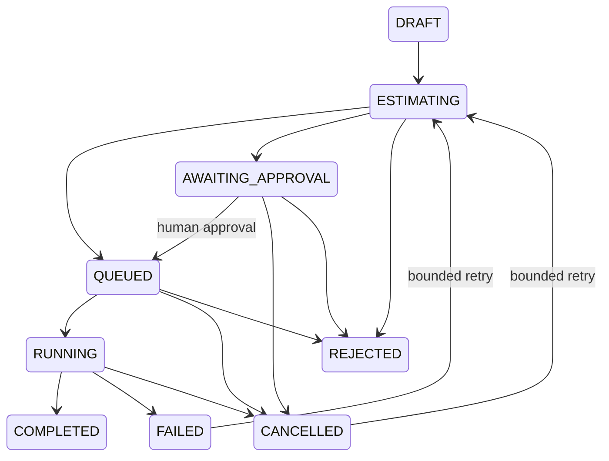

# Commercial compute governance — Phase 06 development boundary

> Phase 09 update (15 October 2026): Legacy GEE execution is now blocked at route/service/initializer boundaries. Process-local API budgets add containment but are not durable tenant quotas or actual provider billing. See [current integration readiness](real-gis-integration-readiness.md). Earlier descriptions below are historical where superseded.

P4I uses Controlled Autonomous Option B. Authorized low-risk local calculations can
run automatically. Potentially substantial or unknown external cost requires independent
human approval and an available, authorized backend. Persistent/sensitive changes retain
separate authorization. Methodology validation and scientific ranking are out of scope.

## Cost classes

| Class | Current application |
| --- | --- |
| READ_ONLY | Catalog/metadata/summary and bounded native pixel reads |
| REVERSIBLE_MAP_ACTION | Existing map actions and in-session configuration drafts |
| LOW_COST_ANALYSIS | Supported local calculation within the automatic resource ceiling |
| APPROVAL_REQUIRED_ANALYSIS | Local scan beyond automatic ceiling; unavailable external computation with UNKNOWN cost |
| PERSISTENT_SENSITIVE_ACTION | Explicit local configuration save or unavailable publication; compute approval does not authorize these |

`GIS_TOOL_REGISTRY.costClass` is a static classification/default. The compute service's
server-derived estimate is authoritative for each job; a registry entry never bypasses
dynamic approval. `LOCAL_NO_EXTERNAL_CHARGE` means this adapter invokes no paid external
provider. It does not price hosting or imply universally free compute. `UNKNOWN` has no
invented amount/currency. The present implementation refuses external execution entirely;
a future priced adapter must add an explicit monetary ceiling and billing integration.

## Enforced development limits

- Automatic scan: at most **1,024** native grid cells.
- Hard cap: **4,096** cells / conservative provider-sampling reservations per job.
- AOI: at most **2,000,000,000 m²** using the existing spherical approximation.
- Execution: **5,000 ms**, one active job per owner, one compute action per AI plan.
- Job input: existing 64 KiB HTTP body and strict Phase 04 configuration validators.
- Job output: bounded 50,000-character job DTO within existing 64 KiB tool/256 KiB
  Copilot response envelopes; at most eight bounded result annotations in MapRecipe.
- Storage: **32 jobs per owner**, **128 jobs per process**, **30-minute TTL**;
  development-session registry capped at 256 sessions. No durable/quota claim.
- Approval: **5-minute expiry**, one consumption per attempt. Retry requires a new
  approval where applicable, with at most **three attempts** total.

Raster estimates reserve the full known native grid, not a guessed AOI fraction.
Point operations reserve one sample. Usage records include actual adapter invocation
count, elapsed duration, attempt, terminal state and reserved resource ceiling. They
are **not provider billing records** or claimed measurements of per-cell provider usage.
Existing local scans enforce their own 4,096-cell cap, yield regularly to the event loop,
and propagate AbortSignal through checked sampling. No arbitrary client budgets or
array/file uploads are accepted by the compute endpoint.

## State and approval security

Transitions are validated:

A canonical SHA-256 digest binds the trusted owner, project, validated operation,
configuration/source snapshot, starting recipe, idempotency key and exact estimate.
The internal approval additionally binds the resource ceiling and expiry, and is
consumed before adapter invocation. No approval tool is exposed to the AI registry.
The human endpoint checks same-origin browser authority, accepts no replacement args,
and rechecks the trusted owner, current catalog metadata, dataset/project ACL and
estimate on every read or mutation, including actual execution. Modified arguments,
another user/project, expired approval or reused approval cannot authorize a run.

Signed-in ownership uses the existing verified server identity and B2B entitlement
resolver. Anonymous **development only** ownership uses a random server-issued opaque
HttpOnly, SameSite=Strict session cookie; unknown cookie values are not trusted. Owner
IDs and approval capabilities are not returned in public job DTOs. Origin validation
uses the browser Host authority because Next can normalize its internal request URL;
it does not trust arbitrary `x-forwarded-host`. Hosting proxies must preserve a correct
public Host and apply their own trusted forwarding configuration.

Idempotent exact submissions return the existing job; reusing a key with changed inputs
fails. Synchronous state/approval transition prevents duplicate invocation within this
one process, including concurrent/replayed execute. Cancellation aborts cooperative
local work and discards late results. Failure messages hide backend exception details.
Changing the map while a job completes prevents automatic application; explicit review
can still apply its exact completed snapshot. Map commit is reversible and separate
from computation; a failed response cannot undo work already performed by a provider.

## Requirements before commercial external compute

The current process-local repository is a **development adapter**, not a production
queue. The production endpoint is disabled. No real model/GEE credentials, paid calls,
migrations, speculative tables or deployment were performed.

A production implementation needs:

1. Durable provider-portable job/approval/usage storage with tenant isolation, encryption,
   retention and auditable human authorization; transactional state transitions and
   idempotency that survive crashes and multiple web/worker instances.
2. A durable queue and independent workers with leases, recovery, timeout enforcement,
   bounded retries, cancellation acknowledgement and result storage. Do not rely on
   Hostinger managed Node request handlers for long-running work.
3. Provider-specific cost/usage estimates and explicit monetary/resource ceilings;
   UNKNOWN never defaults to zero. Enforce budget reservations and per-user/project
   distributed quotas before submission and meter reconciled actual usage afterward.
4. Reauthorization at dequeue and before accessing results, versioned catalog/AOI/data
   resolution and approved configuration snapshots. Expired/revoked approval fails closed.
5. Windowed server-side raster processing, explicit CRS/alignment/units/NoData semantics,
   bounded validated results, provider cancellation and data-license/provenance support.
6. Independent authorization for persistent publication, project writes or destructive
   actions. A compute approval cannot grant a role, access other projects or authorize
   database writes. Scientific methodology review remains a separate postponed product decision.

Until those are implemented, all exposed compute jobs are deterministic local DEMO or
user-parameter calculations. Flood/data/model adapters, automatic scenario comparison,
buffer/vector-overlay execution and commercial monetary estimates remain unavailable.
