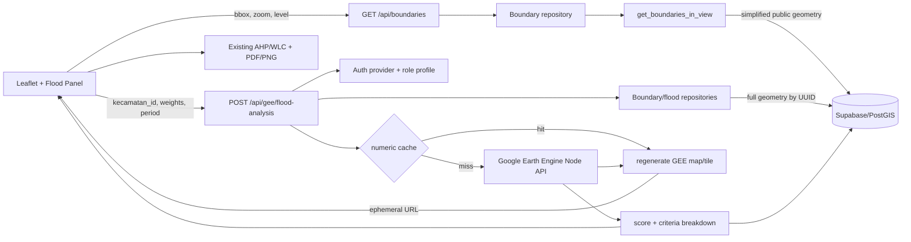

# P4I Flood Risk Analysis v1

> Phase 12 update (16 October 2026): The SDK is no longer installed in the application.
> The legacy service now uses a provider-neutral unavailable adapter; old SDK/graph/cache code
> is preserved in [non-runtime reference](reference/earth-engine-phase11.md). The endpoint
> still refuses real analysis. See [current isolation and activation requirements](PHASE_12_RESIDUAL_DEPENDENCY_RESOLUTION.md).

> Phase 09 update (15 October 2026): The legacy real GEE route, service and initializer now fail closed before external computation. Credentials do not enable execution. Governed commercial integration is pending; model thresholds remain experimental. See [current integration readiness](real-gis-integration-readiness.md). Earlier descriptions below are historical where superseded.

Modul ini memperluas P4I Spatial Analytics yang sudah ada; bukan aplikasi peta kedua. Migration, import boundary, konfigurasi Google Cloud/Earth Engine, dan deployment tetap dilakukan manusia setelah review.

## Snapshot audit sebelum perubahan

Audit dilakukan pada 16 September 2026 tanpa membaca atau mencetak nilai `.env.local`.

- Source menggunakan Next.js 16.3.1 App Router, React 19, Supabase/PostGIS, Leaflet, Zustand, SWR, AHP/WLC, portal klien, entitlement, lead capture, dashboard admin, audit trail, dan export PDF/PNG.
- Direktori yang diberikan bukan working tree Git: `git status` gagal karena `.git` tidak tersedia. Tidak dibuat branch atau commit.
- `npm run lint` memiliki 46 error dan 14 warning sebelum perubahan.
- Typecheck gagal karena tag JSX `motion.div` pada `TeamCarousel` tidak ditutup.
- Build gagal karena JSX tersebut dan unduhan Google Fonts diblokir lingkungan.
- Endpoint project dan metrics belum memiliki authorization wajib; `/portal` tidak diproteksi; tombol hapus tampil berdasarkan cookie untuk role non-admin; helper super-admin diduplikasi.

## Arsitektur dan data flow



- Browser tidak mengirim geometri analisis. Server mengambil geometri penuh berdasarkan UUID dari PostGIS.
- Browser hanya menerima geometri public yang disederhanakan dan dibatasi viewport melalui API;
  adapter Supabase server-side yang memanggil RPC.
- Earth Engine dan credential hanya berada di `lib/server` dan Node.js runtime.
- Numeric cache dan tile dipisah. URL tile tidak disimpan di database dan dibuat ulang pada tiap request analisis.

## Database

Migration baru adalah `supabase_migrations/006_flood_analysis.sql` dan tidak dijalankan otomatis.

### `administrative_boundaries`

- UUID, kode wilayah, level `provinsi|kota|kecamatan`, self-reference parent, nama, source/version, dan `MultiPolygon EPSG:4326`.
- Valid/non-empty constraint, GiST geometry index, serta index kode/level/parent.
- Unique `(source, source_version, level, kode_wilayah)` mencegah import ganda.
- `is_public` menentukan boundary yang boleh keluar dari RPC.
- Migration 006 tidak memberi direct table grant dan semula mengizinkan `anon`/`authenticated`
  mengeksekusi RPC bbox. Setelah aplikasi baru terpasang, migration 007 mencabut akses RPC browser;
  hanya service role di repository yang memanggilnya. Filter public/level, simplifikasi, dan batas
  1.500 fitur tetap dipertahankan sebagai defense in depth.

### `flood_analysis_results`

Menyimpan cache key, kecamatan, model/dataset version, periode, bobot canonical, breakdown, score 0–100, classification, computed time, dan expiry. Tile URL/token tidak disimpan. Write tidak dibuka ke browser; API memakai service role server-side.

### Import staging

`administrative_boundaries_import_staging` menerima hasil validasi. RPC promotion memproses provinsi → kota → kecamatan, menjalankan `ST_MakeValid`, mengambil polygon, dan memastikan `MultiPolygon`.

## Kontrak API dan cache

`POST /api/gee/flood-analysis` membutuhkan sesi `super_admin`, `managerial_analyst`, atau `b2b_client`.

```json
{
  "kecamatan_id": "uuid",
  "weights": {
    "rainfall": 0.35,
    "slope": 0.25,
    "soil": 0.20,
    "land_cover": 0.20
  },
  "period": { "start": "2025-01-01", "end": "2025-12-31" }
}
```

- Hanya empat key bobot tersebut diterima; nilai harus finite, non-negatif, total 1 dalam tolerance `1e-6`.
- Bobot default di-canonicalize sebelum cache lookup. Omitted dan explicit default menghasilkan identity sama.
- Periode ISO, start ≤ end, maksimal 366 hari. End date inklusif di kontrak dan dikonversi menjadi exclusive end untuk GEE.
- Boundary harus UUID level kecamatan. Route timeout 55 detik dan request concurrent identik dalam satu process memakai satu in-flight promise.
- Cache identity memuat kecamatan, bobot urut/canonical, model version, dataset version (termasuk version soil dan boundary), serta periode.
- Numeric result berlaku tujuh hari. URL tile ditandai 45 menit dan selalu diregenerasi bahkan saat numeric cache hit.

Response memuat score, classification, raw/normalized/susceptibility/weight/contribution per kriteria, weights/model/dataset/period, status cache, expiry numerik, serta URL dan expiry tile baru.

## Dataset dan model ilmiah sementara

| Kriteria | Dataset v1 | Perlakuan |
|---|---|---|
| Curah hujan | UCSB-CHG CHIRPS Daily | Akumulasi periode lalu threshold tetap |
| Slope | USGS SRTMGL1_003 | Derajat; area datar diberi susceptibility lebih tinggi |
| Soil | Private P4I GEE image asset | Kode kategorikal di-remap eksplisit |
| Land cover | ESA WorldCover v200 | Kode kelas `Map` di-remap eksplisit |

Nilai di `config/floodRiskModel.ts` adalah **TEMPORARY defaults**, bukan fakta ilmiah final. Tidak digunakan min-max per kecamatan sehingga constant raster tidak menghasilkan pembagian `max-min` dan score dapat dibandingkan bila model, version, serta periode sama.

`TODO(P4I-GIS-VALIDATION)`:

- Finalisasi legenda/band soil dan tabel susceptibility soil/WorldCover.
- Kalibrasi threshold curah hujan terhadap durasi dan kondisi Indonesia.
- Validasi slope untuk genangan datar versus banjir bandang.
- Tentukan resolusi, no-data mask, dan treatment coastal water.
- Ganti abstraction SRTM dengan DEMNAS tervalidasi bila tersedia.
- Kalibrasi bobot/batas kelas dengan observasi kejadian dan tinggi genangan independen.

## Environment variables

### New map workspace integration

`/spatial/viewer` records provisional AHP configuration in a validated MapRecipe and reuses the
existing flood panel/API. Synthetic AOIs never set authoritative `activeBoundaryId` or trigger GEE.
Copilot can assemble thematic layers but cannot manufacture flood scores. Missing WLC criteria
in the original viewer now render neutrally instead of using feature-name-derived fallbacks;
aggregate flood AOI scores are not assigned to unrelated polygons. See [raster/pixel contracts](raster-pixel-analysis.md)
and [map builder](map-builder-architecture.md). Thresholds remain `TODO(P4I-GIS-VALIDATION)`.
No database migrations or real-data imports were run for this workspace implementation.

Jangan prefix credential dengan `NEXT_PUBLIC_` dan jangan commit nilainya.

| Variable | Kegunaan |
|---|---|
| `NEXT_PUBLIC_SUPABASE_URL` | URL Supabase untuk client/server |
| `NEXT_PUBLIC_SUPABASE_ANON_KEY` | Anon key public untuk auth browser |
| `DATABASE_PROVIDER` | Optional; default `supabase` |
| `AUTH_PROVIDER` | Optional; default `supabase` |
| `SUPABASE_SERVICE_ROLE_KEY` | Server-only database/RLS bypass |
| `GEE_PROJECT_ID` | GCP project terdaftar Earth Engine |
| `GEE_SERVICE_ACCOUNT_JSON` | JSON service account multiline |
| `GEE_SERVICE_ACCOUNT_JSON_BASE64` | Alternatif base64; gunakan salah satu format JSON |
| `GEE_SOIL_ASSET_ID` | Full asset ID raster kelas soil P4I |
| `GEE_SOIL_BAND` | Band soil; default `soil_class` |
| `GEE_SOIL_DATASET_VERSION` | Version immutable/logis untuk invalidasi cache |
| `GEE_DEM_ASSET_ID` | Optional DEM override; default SRTM |
| `GEE_DEM_BAND` | Optional DEM band; default `elevation` |
| `GEE_DEM_DATASET_VERSION` | Version DEM untuk cache identity |

## Setup Earth Engine

1. Buat/pilih GCP project, aktifkan Earth Engine API, dan daftarkan project untuk Earth Engine.
2. Buat service account dengan hak minimum untuk compute dan read asset.
3. Upload raster soil yang memiliki CRS, extent, no-data, dan legenda tervalidasi ke GEE Assets; catat asset ID, band, version, checksum.
4. Beri service account read access ke soil asset.
5. Simpan JSON key di environment/secret manager Hostinger. Bila multiline tidak didukung, base64-kan seluruh JSON dan gunakan variable `_BASE64`.
6. Tes satu kecamatan kecil di staging tanpa mencetak credential.

Referensi resmi: [Earth Engine npm](https://developers.google.com/earth-engine/guides/npm_install) dan [service accounts](https://developers.google.com/earth-engine/guides/service_account).

## Import boundary P4I/RBI

`scripts/import-boundaries.mjs` selalu dry-run kecuali diberi dua konfirmasi dan hanya menulis staging, tidak pernah mempromosikan. ZIP Shapefile harus menyertakan `.prj`; GeoJSON harus RFC 7946/EPSG:4326. Verifikasi CRS/extent dengan `ogrinfo` sebelum staging.

| Canonical | Contoh field SHP | Catatan |
|---|---|---|
| `kode_wilayah` | `KODE_PROV`, `KODE_KAB`, `KODE_KEC` | Unik per level/source/version |
| `nama` | `WADMPR`, `WADMKK`, `WADMKC` | Sesuaikan schema aktual |
| `parent_kode_wilayah` | kode provinsi/kabupaten | Kosong hanya untuk provinsi |
| `level` | parameter CLI | Tidak dipercaya dari atribut bebas |
| `source`/`source_version` | parameter CLI | Gunakan identitas/version immutable |

Dry-run:

```powershell
npm run import:boundaries -- --input=D:\data\kecamatan.zip --level=kecamatan --source=P4I-RBI --source-version=2026-validated --code-field=KODE_KEC --name-field=WADMKC --parent-code-field=KODE_KAB
```

Staging setelah dry-run direview:

```powershell
npm run import:boundaries -- --input=D:\data\kecamatan.zip --level=kecamatan --source=P4I-RBI --source-version=2026-validated --code-field=KODE_KEC --name-field=WADMKC --parent-code-field=KODE_KAB --execute --confirm=STAGE_BOUNDARIES
```

Import/promote provinsi dahulu, lalu kota, lalu kecamatan. Review count, null, duplicate, validity, bbox, dan spot-check. Panggil `promote_administrative_boundary_import(batch_uuid)` secara eksplisit dari administrative workflow. Child tanpa parent tidak dipromosikan. Jangan hapus staging sampai QA selesai.

## Migration, rollback, dan deployment

Migration staging (`006_flood_analysis.sql` lalu `007_security_hardening.sql`; keduanya tidak
dijalankan oleh aplikasi):

1. Backup target dan review SQL.
2. Jalankan migration pada Supabase non-production.
3. Smoke-test grant sebagai anon/authenticated/admin/service role. Setelah 007, browser roles tidak
   boleh memanggil RPC boundary atau membaca view GeoJSON langsung; endpoint HTTP publik harus tetap
   berfungsi.
4. Import subset boundary; tes bbox RPC, selection, analysis, cache hit, refresh tile, dan PDF.
5. Jadwalkan production hanya dengan persetujuan pemilik data.

Rollback aplikasi adalah deploy versi sebelumnya dan nonaktifkan endpoint/panel. Rollback database manual setelah export data: revoke RPC, drop functions dan tabel dalam urutan dependency bila disetujui. Jangan drop PostGIS/pgcrypto atau shared `set_updated_at`. Tidak ada destructive rollback otomatis.

Deployment utama adalah Next.js Node server, bukan FastAPI/Python:

1. Gunakan Node.js 22 pada persistent Hostinger Node process; jalankan `npm ci`.
2. Set semua environment pada build/runtime Hostinger.
3. Jalankan test, lint, typecheck, dan build di CI/staging.
4. Jalankan `npm start`; pastikan HTTPS/cookie dan request timeout >60 detik.
5. Pantau latency/error/quota GEE dan pertumbuhan cache tanpa log secret.
6. Multi-instance memerlukan distributed lock bila in-flight dedupe global dibutuhkan.

## Security notes

- Authorization berada di route; `proxy.ts` hanya redirect tambahan.
- Project POST hanya admin, project DELETE hanya super-admin, metrics hanya admin.
- Users/entitlements memakai role-check terpusat dan payload allowlist.
- Cookie aplikasi dibuat server-side, `HttpOnly`, `SameSite=Lax`, serta `Secure` di production.
- Delete UI hanya tampil untuk super-admin; server tetap enforcement utama.
- `/portal` dan `/admin` dilindungi proxy; akun disabled ditolak.
- Upload memvalidasi tipe/ukuran/jumlah fitur/access tier/struktur GeoJSON server-side.
- Tooltip memakai DOM `textContent`, bukan HTML dari atribut data.
- Credential GEE/service role tidak dikirim ke browser. Ephemeral tile URL diperlakukan seperti bearer URL jangka pendek.
- Migration 007 memperbaiki search path/grant audit trigger tanpa menghapus tabel/data existing dan
  memindahkan audit read ke endpoint super-admin.
- Semua persistence flood/boundary kini melalui repository contract; coupling RPC/PostgREST berada di
  adapter Supabase.
- Next.js dipatch dari 16.3.1 ke 16.3.5 setelah `npm audit` menemukan advisory RCE pada versi awal.
- Audit dependency production tersisa empat temuan moderate dalam dependency chain resmi `@google/earthengine → googleapis → googleapis-common → uuid`. Npm hanya menawarkan downgrade major Earth Engine sebagai "fix", sehingga tidak diterapkan. Pantau release resmi Earth Engine dan upgrade ketika upstream memperbarui chain tersebut.
