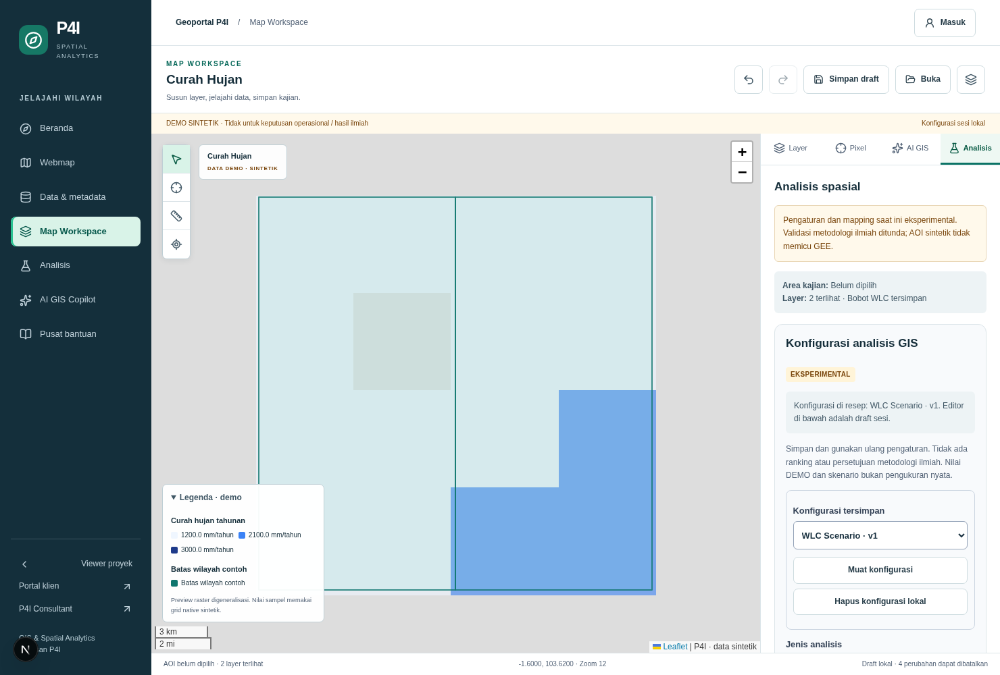
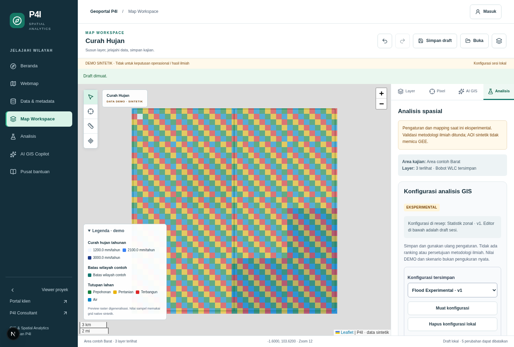
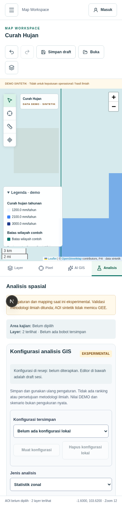

# GIS Analysis Configuration — Phase 04

Phase 04 manages reusable analysis settings in the existing Map Workspace. It does not grade,
rank or approve scientific methodologies. **Scientific methodology validation, expert approval,
VALIDATED/UNDER_REVIEW workflows and scientific method ranking are OUT OF SCOPE.**
No such status is needed to save, load, apply or execute an available configuration.

## Verified foundation

Implementation continues Phase 03 head 8f7243c, including Phase 01 stabilization (35f9848),
Phase 02 geoportal (45c15fd/4d40a8e) and Phase 03 raster (1d7e395). The initial working tree was
clean. Baseline Node 22.23.3 lint/typecheck, 123 tests/22 files and production build passed.
Remote main remained dfe412c; the feature branch preserves actual completed parent phases rather
than assuming they were merged. No existing MapRecipe, Leaflet/SpatialMap, raster provider, AHP
mathematics, flood service, auth/entitlement or database adapter was rebuilt.

## Model and validation

`lib/gis/analysisContracts.ts` supplies one GISAnalysisConfiguration model, reused by recipes,
the editor, repository and future AI tools. Schema 1 contains:

- id/name/description, analysisType, numeric configuration revision version;
- inputDatasetIds and criteria with stable ID/label, optional dataset/band link;
- discriminated parameters, weights and classificationRules;
- selectedAOI identity, native spatialResolution or null for mixed grids, analysisPeriod;
- sourceMetadata snapshots (source/provider/license/version/provenance and full bounded raster
  metadata: CRS/grid/resolution/encoding/unit/NoData/classes/period);
- createdAt/updatedAt UTC ISO timestamps, notes, experimental:true.

Use `parseAnalysisConfiguration` from `lib/gis/analysisConfiguration.ts`. It reuses current GIS
runtime validators, raster operation/coordinate parsers, flood weight/period validators and AHP
utilities, without adding dependencies. It rejects unknown fields/types/IDs/bands, malformed
weights/matrices, invalid dates/schema versions, mismatched source snapshots, unsupported CRS,
invalid classification mappings and payloads larger than 64 KiB. Snapshot validation is structural,
independent of JSON object key order. Dataset metadata changes require explicit refresh/reselection;
there is no silent substitution of new versions or arbitrary source URLs/code.

All configurations are explicitly experimental in this phase; that label cannot be removed by an
AI proposal or imported object. It conveys current product/data scope, not a quality grade.
Default AHP weights are computed with the existing calculator (exact thirds rather than .333).
Accepted old recipes with rounded weights remain unchanged; their runtime weights are normalized to 1. Old recipes do not contain a recoverable AHP matrix, so their imported weights are treated as direct preferences.
CR remains the existing mathematical consistency indicator. A high CR can be saved/applied;
malformed numeric input cannot. Existing legacy map consistency display behavior remains.

## Supported configuration types

| Type | Parameters and current computation |
| --- | --- |
| ahp-smce | Three reciprocal pairwise preferences in [1/9,9]. Existing calculateAHP derives bencana/kesuburan/kepadatan weights and CR; apply restores matrix/bobots in the existing store and recipe. No suitability measurements are invented. |
| wlc | Direct nonnegative weights totaling 1; optional input scenario scores 1–5 and Boolean constraint 0/1. Shares the existing SpatialMap formula `(6-risk)*wRisk + fertility*wFertility + density*wDensity`, multiplied by constraint. Missing scores give no result. Preview is a user-input scenario, not a spatial observation. |
| flood-susceptibility | Four rainfall/slope/soil/land_cover criteria, weights, current FLOOD_MODEL_VERSION, period, sources/bands/native units/resolutions and experimental mappings. Configuration-only: real dataset/mapping selection is not connected to GEE execution. |
| raster-reclassification | Stored x/y/CRS coordinate and half-open interval classes. Uses the existing local provider classify operation for one point. |
| zonal-statistics | Server-resolved fixture AOI, native-cell-centers method, selected band; continuous aggregates or category histogram with NoData excluded. |
| raster-normalization | Stored coordinate and explicit min/max; one continuous point, clamp 0–1; class-code normalization rejected. |
| raster-arithmetic | Stored coordinate, allowlisted add/subtract/multiply/divide, constant and unit. Uses existing point engine; category arithmetic rejected, incompatible additive units rejected, zero division masked. |
| clip / mask | Fixture AOI with cell-center rule, or inside/outside keep rule. Existing native window/count descriptor; artifact:null, no GeoTIFF. |

Buffer and vector overlay have no implemented engine/development adapter. They are listed as
limitations and cannot be selected, created through AI tools or executed. Other future types
must enter the capability registry with an actual adapter and runtime tests.

## Flood mapping semantics

Defaults come from the existing flood foundation, not newly invented official thresholds.
Continuous mappings use `upper-bounds` with maxInclusive (`<=`); last null means +infinity in a
JSON-safe form. Category mappings use class-code identity. Outputs are susceptibility 0–1.
Rainfall uses the foundation's mm/tahun declaration and slope derajat; categorical soil/land-cover
bands require category metadata. A daily_mean rainfall band is rejected for these annual mappings.

The editor can change mappings, preview them and save notes/source/version/period. These are
experimental parameters, with different native grids explicitly recorded. No automatic grid
harmonization occurs. The configuration review action explains the missing adapter and performs
no remote call. The legacy authorized flood API/UI remains available and unchanged in its
execution behavior; it does not accept arbitrary saved dataset/classification overrides. Connecting
custom flood configurations needs a separate adapter plus complete source/unit/temporal contracts.
No expert-review workflow is introduced as a blocker.

## Workspace workflow

1. Open Analisis in `/spatial/viewer` or `/spatial/analysis`. The configuration panel is part of the
   existing workspace, alongside original raster tools, AHP, Copilot, Flood and exports.
2. Choose type; a new draft is created. Name it, select catalog datasets/bands and adjust applicable
   parameters. Dataset status, sources, units, periods and resolutions remain readable.
3. For AHP, edit ratios or capture the existing matrix and inspect computed weights/CR. For WLC,
   edit percentages and optional explicit scenario scores. Reset restores current defaults.
4. Preview/edit classification data JSON where applicable. Malformed input disables save/apply
   with a readable explanation. No free-form expression evaluation is supported.
5. Save named configurations locally; load, duplicate or delete. Unsaved editor drafts survive
   panel changes. Stored revisions survive page reload. Import/export configuration JSON is separate
   from MapRecipe JSON and never automatically executes an import.
6. Apply preferences to the recipe/store, or explicitly run a local raster configuration. Flood and
   unavailable capabilities return an honest preparation state. A stored config alone is not proof
   of execution. Editing a pending draft aborts its request; late responses cannot overwrite a
   changed recipe. Errors do not apply the configuration.
7. Existing recipe undo/redo restores applied config snapshots and AHP/WLC settings. Original
   unconfigured recipes still load. Editing a layer/AOI does not rewrite a saved configuration;
   applying it restores the recorded settings. The panel distinguishes current draft from recipe.

MapRecipe schema 1 adds optional analysisConfiguration and analysis.weightMethod. Old recipes keep
working. AHP/WLC attached configurations must agree with recipe weights/method/CR. `manual-wlc`
marks CR as not applicable; numeric zero is retained for old schema compatibility, not reported as
an AHP calculation. The existing weight-save button captures a complete configuration snapshot.
JSON recipe persistence includes it; PDF now includes name/type/revision, parameters, classifications,
inputs, period/resolution and notes. Processing summaries remain transient rather than scientific
exported products. AHP mathematics remains unchanged; the old WLC formula is extracted and shared.

## Local repository and versions

`analysisRepository.ts` defines the local adapter for AnalysisConfigurationRepository and injects
Storage (browser localStorage or memory). Key p4i-analysis-configurations-v1 is separate from the
existing p4i-map-draft-v1. No Supabase tables/migrations or server writes are introduced.

The library permits 30 configs and a bounded 512-Ki-character envelope; each config has a 64-KiB
UTF-8 limit. Defaults start at revision 1; saving an existing ID increments revision while retaining
createdAt. Import can retain a historical revision; duplication creates a new ID/revision 1. Stale
save/delete revisions are rejected after re-reading storage. Corrupt/future-schema libraries and
quota/access failures are surfaced and never silently overwritten. Optimistic checks reduce stale
writes, but localStorage has no cross-tab transaction/CAS guarantee. Browser deletion is local;
the current draft/applied recipe can still be used or duplicated.

There is no account sync, shared library or production persistence. The domain/repository boundary
is provider-neutral; future network storage requires an authorized asynchronous service adapter,
not a client-side Supabase shortcut. Current local repository methods are synchronous.

## AI readiness

`analysisTools.ts` supplies typed list/select/create-draft/propose-changes/prepare-analysis contracts,
re-exported at the existing server AI boundary. They validate catalog IDs, metadata, permissions,
weights, parameters and experimental labeling. Proposals/drafts do not mutate the repository or
execute anything. Preparation yields validated existing-engine requests or a capability limitation.
Every future server integration must derive its own trusted authorization context before dispatch.

The present deterministic natural-language Copilot does not call these configuration tools yet.
It displays the active configuration as context. A future AI provider can use the tested contracts
with a client-supplied, validated local library or future authorized repository. There is no external
LLM setup, invented dataset ID, automatic unavailable analysis or billable execution in this phase.

## Verification and evidence

Node 22.23.3: lint, typecheck, **154 tests/25 files**, production build passed; 31 new tests retain
all 123 prior tests. New tests cover defaults/serialization, weights/matrices/CR, version/date/type
handling, mappings/metadata consistency, library CRUD/conflicts/corruption/limits, AHP/WLC formula,
recipe compatibility/history/access, provider execution and AI-facing validation/non-mutation.

Chromium covers direct analysis-route hydration/catalog readiness, named versions, high-CR save/apply, draft persistence, WLC scenarios, reset/invalid
weights, duplicate/delete/load, actual JSON/PDF downloads, page reload, classification errors,
provider reclassification/native zonal/category results, pending-request cancellation, flood
configuration-only behavior and corrupt-storage preservation. Eight Axe WCAG A/AA audits cover
four configuration types at 1480/390 px with zero violations, no horizontal overflow or page errors.
These are tested states, not full accessibility certification. Phase 02 flows pass at five widths;
Phase 03 pixel/raster/export/accessibility flows also pass. No GEE API calls occurred in new QA.

[Browser flow log](evidence/phase-04/browser.log), [audit summary](evidence/phase-04/browser-summary.json),
[unit tests](evidence/phase-04/tests.log), [lint](evidence/phase-04/lint.log),
[typecheck](evidence/phase-04/typecheck.log), [build](evidence/phase-04/build.log),
[Phase 02 regression](evidence/phase-04/phase-02-regression.log),
[Phase 03 regression](evidence/phase-04/phase-03-regression.log),
[production fixture refusal](evidence/phase-04/production-isolation.json) and
[client-bundle marker scan](evidence/phase-04/client-bundle-scan.json). Production catalog was unavailable;
pixel/process returned 503 even with the demo flag enabled. No server credential markers were
found in built client JavaScript; no secret values were printed or recorded.

QA script: scripts/qa/phase-04-configuration.mjs. Set P4I_PLAYWRIGHT_MODULE to an installed external
playwright-core module, P4I_CHROMIUM to Chromium, P4I_AXE_SCRIPT to axe-core/axe.min.js,
P4I_QA_ARTIFACTS to an output directory, and optionally P4I_QA_BASE_URL. Start a single development
server with GIS_DEMO_MODE=true. No QA packages were added to app manifests/lockfile.

## Local vs real-data limits

Configuration CRUD and numeric preference/scenario math are local. Raster execution uses small,
explicitly DEMO Phase 03 fixtures; production refuses them. Real raster adapters, authoritative AOIs,
remote configurable flood mappings, cross-grid/CRS harmonization, full raster WLC/algebra and
clip/mask files are pending. AHP/WLC dataset links provide provenance; they do not convert raw
rainfall/soil/land-cover measurements into legacy suitability scores. No fabricated observed values.
Spherical distance/area and unweighted native statistics retain their Phase 03 limitations.

Real B2B/login, actual GEE/flood/data computations and production deployment were not exercised.
Existing access checks, project viewer and AHP/Flood/Copilot/PDF/PNG features remain. No deployment,
Supabase migration, paid GEE computation, secret configuration or exposure. Review uses the feature
branch and prepared PR; no automatic merge. See [PR content](phase-04-pr.md) for publication status.

Implementation a2ad07b was pushed to feat/gis-analysis-config-phase04. Actual PR creation failed
with GitHub GraphQL Forbidden; no PR was opened. Prepared content and a stacked comparison link
are available in the PR document. Remote main was not changed.
