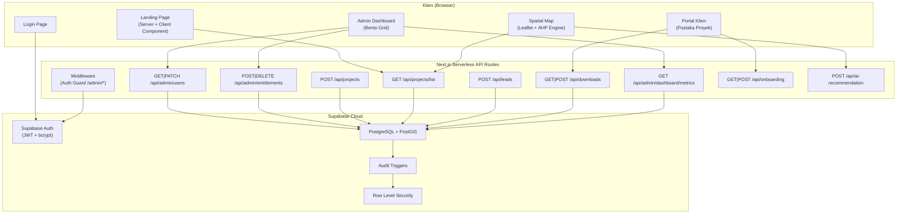
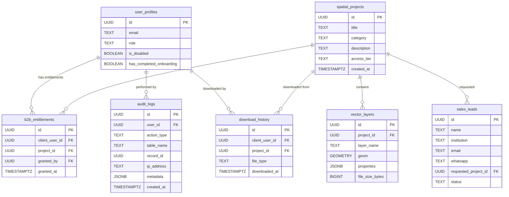
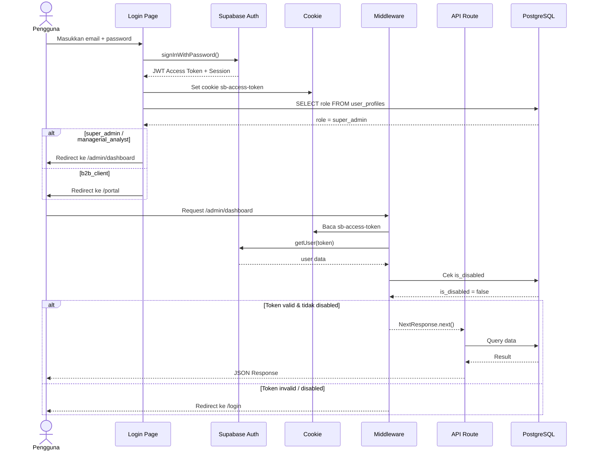
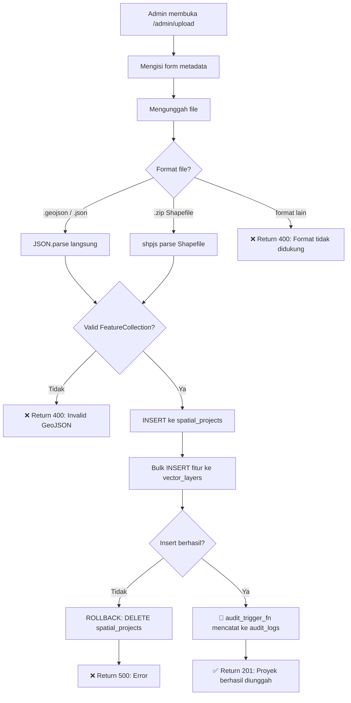

# LAPORAN ANALISIS SISTEM LENGKAP — P4I SPATIAL ANALYTICS

> Dokumen ini dihasilkan melalui proses rekayasa balik (*reverse-engineering*) menyeluruh terhadap seluruh berkas sumber di repositori `d:\p4i-webgis`. Setiap klaim didukung oleh referensi berkas konkret.

---

## 1. Identitas Produk & Model Bisnis (The Why)

### Nama & Definisi Sistem
**P4I Spatial Analytics** — Platform Web-GIS (*Geographic Information System*) berbasis peramban yang menggabungkan visualisasi peta interaktif dengan mesin sistem pakar **AHP (Analytic Hierarchy Process)** untuk evaluasi kesesuaian wilayah.

Referensi: [app/page.tsx](file:///d:/p4i-webgis/app/page.tsx) (Landing Page), [utils/ahpCalculator.ts](file:///d:/p4i-webgis/utils/ahpCalculator.ts) (Mesin AHP), [components/SpatialMap.tsx](file:///d:/p4i-webgis/components/SpatialMap.tsx) (Peta GIS).

### Model Bisnis & Aliran Nilai
**SaaS B2B / B2G (Business-to-Government)** dengan model *Freemium Gated Content*:
- **Proyek Public (Gratis):** Data spasial terbuka yang bisa diakses siapa saja tanpa login untuk menarik minat (*lead generation*).
- **Proyek Restricted (PRO/Berbayar):** Data spasial eksklusif hanya bisa diakses oleh klien B2B/Pemerintah yang telah diberikan *entitlement* oleh Super Admin.
- **Mekanisme Monetisasi:** Tidak ada *payment gateway* terintegrasi dalam kode. Aliran pendapatan bersifat **offline/manual** — calon klien mengisi formulir *Lead Capture* (nama, instansi, email, WhatsApp), lalu tim sales P4I menghubungi secara langsung untuk negosiasi kontrak.

Referensi: [supabase_migrations/tugas3_user_management.sql](file:///d:/p4i-webgis/supabase_migrations/tugas3_user_management.sql) (tabel `b2b_entitlements`), [app/api/leads/route.ts](file:///d:/p4i-webgis/app/api/leads/route.ts) (Lead Capture API), [components/FloatingPanel.tsx](file:///d:/p4i-webgis/components/FloatingPanel.tsx#L194-L243) (Modal Lead Form).

### Target Pengguna & Masalah yang Diselesaikan
| Segmen Pengguna | Masalah yang Diselesaikan |
|---|---|
| **Perusahaan Pengembang (Developer)** | Membutuhkan evaluasi kelayakan lahan secara cepat sebelum investasi pembangunan. |
| **Instansi Pemerintah (Dinas Tata Ruang)** | Memerlukan alat bantu keputusan spasial berbasis metode ilmiah (AHP/WLC) untuk perizinan tata ruang. |
| **Konsultan Lingkungan** | Analisis risiko bencana, kesuburan tanah, dan kepadatan penduduk secara tumpang-tindih (*overlay*). |

### Proposisi Nilai Inti
1. **True AHP Engine di Browser:** Kalkulasi matriks perbandingan berpasangan Saaty 3×3 berjalan langsung di klien (*client-side*), bukan sekadar visualisasi statis. Konsistensi logika divalidasi melalui *Consistency Ratio* (CR ≤ 10%).
2. **Live WLC Choropleth:** Poligon GeoJSON pada peta bereaksi instan terhadap perubahan bobot AHP tanpa memuat ulang halaman.
3. **Ekspor Laporan PDF/Gambar:** Hasil analisis spasial dapat diekspor langsung ke format PDF beresolusi tinggi.

---

## 2. Inventaris Aktor, Autentikasi, & Tata Kelola Akses (AuthN & AuthZ)

### Mekanisme Autentikasi (AuthN)
**Supabase Auth (Email + Password)** dengan pengelolaan sesi berbasis **JWT Access Token** yang disimpan dalam *cookie* peramban secara manual.

| Aspek | Implementasi | Berkas Referensi |
|---|---|---|
| Metode Login | `supabase.auth.signInWithPassword()` | [app/login/page.tsx:20](file:///d:/p4i-webgis/app/login/page.tsx#L20) |
| Penyimpanan Token | Cookie manual: `sb-access-token` | [app/login/page.tsx:31](file:///d:/p4i-webgis/app/login/page.tsx#L31) |
| Verifikasi Token | `supabase.auth.getUser(token)` | [middleware.ts:20](file:///d:/p4i-webgis/middleware.ts#L20) |
| Middleware Guard | Next.js Middleware, hanya melindungi rute `/admin/*` | [middleware.ts:51-53](file:///d:/p4i-webgis/middleware.ts#L51-L53) |

### Model Kontrol Akses (AuthZ)
**RBAC (Role-Based Access Control)** — *Ad-hoc* di level API Route, bukan menggunakan pustaka RBAC terdedikasi.

Setiap API Route admin memiliki fungsi `verifySuperAdmin()` yang secara manual:
1. Mengekstrak token dari cookie.
2. Memanggil `supabase.auth.getUser(token)`.
3. Mengecek kolom `role` di tabel `user_profiles`.

Referensi: [app/api/admin/users/route.ts:6-28](file:///d:/p4i-webgis/app/api/admin/users/route.ts#L6-L28)

### Taksonomi Peran (*Roles*)

| Peran | Hierarki | Wewenang Utama |
|---|---|---|
| **Guest (Anonim)** | Level 0 | Melihat Landing Page, Peta Spasial (proyek public), mengisi Lead Form. |
| **b2b_client** | Level 1 | Semua hak Guest + login ke Portal Klien + akses proyek *restricted* yang di-assign + melihat riwayat unduhan sendiri. |
| **managerial_analyst** | Level 2 | Semua hak b2b_client + login ke Admin Dashboard (namun **tidak bisa** mengelola pengguna). |
| **super_admin** | Level 3 | Akses penuh: kelola pengguna (ubah role, nonaktifkan akun), kelola entitlement B2B, upload/hapus proyek, baca audit log. |

Referensi: [app/login/page.tsx:40-44](file:///d:/p4i-webgis/app/login/page.tsx#L40-L44), [app/admin/users/page.tsx:79-81](file:///d:/p4i-webgis/app/admin/users/page.tsx#L79-L81).

### Matriks Hak Akses (CRUD Matrix)

| Entitas / Aktor | Guest | b2b_client | managerial_analyst | super_admin |
|---|---|---|---|---|
| **spatial_projects** | R (public) | R (public + entitled) | R (semua) | CRUD |
| **vector_layers** | R (via peta public) | R (via peta) | R (via peta) | CR (via upload), D (cascade) |
| **user_profiles** | — | R (profil sendiri) | R (profil sendiri) | RU (semua user) |
| **b2b_entitlements** | — | — | — | CRD |
| **audit_logs** | — | — | — | R |
| **sales_leads** | C (via form) | C | C | R (implisit via DB) |
| **download_history** | — | CR (milik sendiri) | CR | R (implisit) |

### Tata Kelola Data Pribadi (PII) & Kepatuhan

**Data PII yang dikumpulkan:**

| Data | Sumber Pengumpulan | Lokasi Penyimpanan |
|---|---|---|
| Email | Login / Lead Form | Supabase `auth.users` + `user_profiles` + `sales_leads` |
| Nama Lengkap | Lead Form | `sales_leads.name` |
| Institusi/Perusahaan | Lead Form | `sales_leads.institution` |
| Nomor WhatsApp | Lead Form | `sales_leads.whatsapp` |
| Password | Login | Supabase Auth (di-hash otomatis oleh Supabase menggunakan bcrypt) |

> [!IMPORTANT]
> **Kredensial aman:** Kata sandi dikelola sepenuhnya oleh Supabase Auth yang menggunakan hashing bcrypt secara internal. Tidak ada penyimpanan kata sandi mentah (*plaintext*) di dalam kode aplikasi.

> [!CAUTION]
> **TEMUAN KRITIS:** Berkas [.env.local](file:///d:/p4i-webgis/.env.local) mengandung `SUPABASE_SERVICE_ROLE_KEY` dalam bentuk mentah (*plaintext*). Kunci ini memiliki hak bypass RLS penuh. Jika berkas ini ter-*commit* ke repositori Git publik, maka **seluruh database terekspos sepenuhnya**. Pastikan `.env.local` terdaftar di `.gitignore` (sudah terdaftar ✓).

---

## 3. Arsitektur Teknis & Tech Stack (The Engine)

### Frontend Layer

| Aspek | Teknologi | Referensi |
|---|---|---|
| Framework | **Next.js 16.3.1** (App Router) | [package.json:21](file:///d:/p4i-webgis/package.json#L21) |
| Bahasa | **TypeScript** | [tsconfig.json](file:///d:/p4i-webgis/tsconfig.json) |
| UI Framework | **TailwindCSS v4** | [package.json:40](file:///d:/p4i-webgis/package.json#L40) |
| Ikon | **Lucide React** v1.34.0 | [package.json:20](file:///d:/p4i-webgis/package.json#L20) |
| Animasi | **Framer Motion** v13 | [package.json:16](file:///d:/p4i-webgis/package.json#L16) |
| State Management | **Zustand** (store tunggal) | [store/useMapStore.ts](file:///d:/p4i-webgis/store/useMapStore.ts) |
| Data Fetching | **SWR** (stale-while-revalidate) | [package.json:29](file:///d:/p4i-webgis/package.json#L29) |
| Peta GIS | **Leaflet** + **React-Leaflet** | [package.json:19](file:///d:/p4i-webgis/package.json#L19), [package.json:26](file:///d:/p4i-webgis/package.json#L26) |
| Grafik | **Recharts** | [package.json:27](file:///d:/p4i-webgis/package.json#L27) |
| Ekspor PDF | **jsPDF** + **html2canvas** + **dom-to-image-more** | [package.json:17-18](file:///d:/p4i-webgis/package.json#L17-L18) |
| 3D Globe | **react-globe.gl** + **Three.js** (tidak aktif digunakan di landing page saat ini) | [package.json:24](file:///d:/p4i-webgis/package.json#L24) |
| Onboarding | **React Joyride** | [package.json:25](file:///d:/p4i-webgis/package.json#L25) |
| Rendering | **CSR dominan** — Seluruh halaman interaktif menggunakan `'use client'` directive. Landing Page adalah Server Component yang mengimpor Client Components. | Semua `page.tsx` |

### Backend & API Layer

| Aspek | Teknologi |
|---|---|
| Runtime | **Node.js** (Vercel Serverless Functions) |
| Framework Server | **Next.js API Routes** (App Router `route.ts`) |
| Pola Arsitektur | **Monolitik modular** — Semua API dalam satu repositori, dipisahkan per domain (`admin/`, `projects/`, `leads/`) |
| Protokol | **RESTful HTTP** (JSON) |
| Parsing File | **shpjs** (Shapefile → GeoJSON converter) |

**Inventaris API Endpoints:**

| Endpoint | Method | Perlindungan | Fungsi |
|---|---|---|---|
| `/api/projects` | POST | **Tidak ada** ⚠️ | Upload proyek spasial baru |
| `/api/projects` | DELETE | **Tidak ada** ⚠️ | Hapus proyek berdasarkan ID |
| `/api/projects/list` | GET | Tidak (public) / Token (filtered) | Daftar proyek dengan filter role-based |
| `/api/admin/users` | GET, PATCH | `verifySuperAdmin()` | Kelola pengguna |
| `/api/admin/entitlements` | POST, DELETE | `verifySuperAdmin()` | Kelola akses B2B |
| `/api/admin/dashboard/metrics` | GET | **Tidak ada** ⚠️ | Metrik dashboard |
| `/api/leads` | POST | Tidak (publik by design) | Tangkap sales lead |
| `/api/downloads` | GET, POST | Token validasi | Riwayat unduhan |
| `/api/onboarding` | GET, POST | Token validasi | Status onboarding |
| `/api/ai-recommendation` | POST | **Tidak ada** ⚠️ | Rekomendasi AI (masih mock) |

### Data & Persistence Layer

| Aspek | Teknologi |
|---|---|
| Database | **Supabase (PostgreSQL)** dengan ekstensi **PostGIS** (data geometri) |
| ORM/Query Builder | **Supabase JS Client** (direct query builder, bukan ORM) |
| Migrasi | SQL manual di folder `supabase_migrations/` |
| Caching | Tidak ada caching layer eksplisit (Redis/Memcached). SWR di client-side sebagai *stale-while-revalidate*. |

**Tabel Database Terdeteksi (dari migrasi SQL):**

| Tabel | Kolom Kunci | RLS |
|---|---|---|
| `user_profiles` | `id`, `email`, `role`, `is_disabled`, `has_completed_onboarding` | ✅ |
| `spatial_projects` | `id`, `title`, `category`, `description`, `access_tier`, `created_at` | ✅ (implicit) |
| `vector_layers` | `id`, `project_id`, `layer_name`, `geom` (PostGIS), `properties` (JSONB), `file_size_bytes` | ✅ (implicit) |
| `b2b_entitlements` | `id`, `client_user_id`, `project_id`, `granted_by`, `granted_at` | ✅ |
| `audit_logs` | `id`, `user_id`, `action_type`, `table_name`, `record_id`, `ip_address`, `metadata` (JSONB) | ✅ |
| `sales_leads` | `id`, `name`, `institution`, `email`, `whatsapp`, `requested_project_id`, `status` | ✅ |
| `download_history` | `id`, `client_user_id`, `project_id`, `file_type`, `downloaded_at` | ✅ |

### Infrastruktur & Layanan Eksternal

| Layanan | Fungsi | Referensi |
|---|---|---|
| **Supabase** | Auth + Database + RLS + Storage | [.env.local](file:///d:/p4i-webgis/.env.local) |
| **Vercel** (target deploy) | Hosting + Serverless Functions | Next.js App Router convention |
| **Pixabay/Mixkit CDN** | Video latar belakang Landing Page | [EarthScrollHero.tsx](file:///d:/p4i-webgis/components/EarthScrollHero.tsx) |
| **Pravatar** | Avatar placeholder anggota tim | [TeamCarousel.tsx](file:///d:/p4i-webgis/components/TeamCarousel.tsx) |

> [!NOTE]
> Tidak ada payment gateway, email transaksional (SendGrid/Resend), atau layanan analitik (GA4/Plausible) yang terdeteksi dalam konfigurasi maupun dependensi.

---

## 4. Daftar Lengkap Use Case & Alur Bisnis

### Daftar Modul & Fitur

```
📦 P4I Spatial Analytics
├── 🌐 Modul Landing Page (Marketing/Etalase)
│   ├── Hero Cinematic (Earth Scroll Animation)
│   ├── Fitur Showcase (Bespoke Cards)
│   ├── Ekosistem P4I
│   ├── Team Carousel (Infinite + Pop-up Bio)
│   └── Footer
│
├── 🗺️ Modul Peta Spasial (Core Engine)
│   ├── Leaflet Map + GeoJSON Renderer
│   ├── Panel Proyek (Daftar + Pilih)
│   ├── AHP Expert System (Matriks Saaty 3x3)
│   ├── WLC Choropleth Coloring
│   ├── Ekspor PDF (jsPDF + html2canvas)
│   ├── Ekspor Gambar (dom-to-image-more)
│   └── AI Spatial Recommender (Mock)
│
├── 🔐 Modul Autentikasi
│   ├── Login (Email + Password)
│   ├── Middleware Guard (/admin/*)
│   └── Cookie-based Session
│
├── 👤 Modul Portal Klien
│   ├── Pustaka Proyek (Role-filtered)
│   ├── Riwayat Unduhan
│   ├── Onboarding Tour (React Joyride)
│   └── Lead Capture (Formulir Akses PRO)
│
├── 🛡️ Modul Admin Dashboard
│   ├── Overview Metrics (KPI Cards)
│   ├── Activity Feed (Audit Log)
│   ├── Manajemen Pengguna (CRUD Role + Status)
│   ├── Manajemen Entitlement B2B
│   └── Upload Proyek Spasial (GeoJSON/Shapefile)
│
└── 📊 Modul Audit Trail
    ├── Trigger PostgreSQL (AFTER INSERT/UPDATE/DELETE)
    └── Tabel audit_logs (Security Definer)
```

### Katalog Use Case per Aktor

**Guest (Anonim):**
- Guest dapat melihat Landing Page dan mempelajari fitur P4I.
- Guest dapat membuka Peta Spasial dan melihat proyek bertier `public`.
- Guest dapat mengisi formulir Lead Capture untuk meminta akses proyek `restricted`.

**b2b_client (Klien Korporat):**
- Klien dapat login dengan email/password untuk mengakses Portal.
- Klien dapat melihat proyek `public` + proyek `restricted` yang telah di-*assign* kepadanya.
- Klien dapat mengekspor hasil analisis ke PDF atau Gambar.
- Klien dapat melihat riwayat unduhan pribadinya.
- Klien dapat menjalankan simulasi AHP pada proyek yang diakses.

**managerial_analyst:**
- Analis dapat mengakses Admin Dashboard untuk memonitor metrik.
- Analis dapat melihat semua proyek tanpa batasan.

**super_admin:**
- Admin dapat mengunggah proyek spasial baru (GeoJSON/Shapefile `.zip`).
- Admin dapat menghapus proyek spasial beserta seluruh layer-nya.
- Admin dapat mengubah role pengguna (`b2b_client` ↔ `managerial_analyst` ↔ `super_admin`).
- Admin dapat menonaktifkan/mengaktifkan kembali akun pengguna.
- Admin dapat memberikan (*grant*) atau mencabut (*revoke*) entitlement proyek ke klien B2B.
- Admin dapat membaca log audit.

### Alur Bisnis Kritis

**Alur 1: User Onboarding → Akses Proyek Restricted**
1. Pengunjung anonim membuka `/spatial` dan melihat proyek bertanda 🔒 PRO.
2. Klik proyek PRO → Modal Lead Capture muncul.
3. Pengunjung mengisi nama, instansi, email, WhatsApp → `POST /api/leads`.
4. Tim sales P4I menghubungi secara offline.
5. Admin login → buat akun pengguna baru di Supabase Auth.
6. Admin assign `role = b2b_client` via `/admin/users`.
7. Admin grant entitlement proyek via `/api/admin/entitlements`.
8. Klien login → proyek PRO kini muncul di daftar proyek mereka.

**Alur 2: Upload & Distribusi Data Spasial**
1. Admin login → navigasi ke `/admin/upload`.
2. Isi metadata proyek (judul, kategori, deskripsi, tier akses).
3. Unggah file GeoJSON atau Shapefile (.zip).
4. Server mem-parse file → `shpjs` mengonversi Shapefile ke GeoJSON.
5. Insert ke `spatial_projects` → bulk insert fitur ke `vector_layers`.
6. Trigger `audit_trigger_fn()` mencatat operasi ke `audit_logs`.
7. Proyek langsung tersedia di peta.

---

## 5. Visualisasi Arsitektur & Alur (Mermaid.js)

### Diagram Arsitektur Sistem



### Diagram Relasi Entitas (ERD)



### Diagram Alur Autentikasi (Sequence Diagram)



### Diagram Alur Bisnis Utama (Upload Proyek)



---

## 6. Audit Risiko Keamanan, Performa, & Jebakan Implementasi

### 🔴 TEMUAN KRITIS

> [!CAUTION]
> **SEC-01: Endpoint API Tanpa Proteksi Autentikasi**
> 
> Beberapa endpoint API **sama sekali tidak memverifikasi identitas pemanggil**:
> - `POST /api/projects` — Siapa pun bisa mengunggah proyek tanpa login.
> - `DELETE /api/projects?id=...` — Siapa pun bisa menghapus proyek apa pun hanya dengan mengetahui UUID-nya.
> - `GET /api/admin/dashboard/metrics` — Data metrik internal terekspos tanpa autentikasi.
> - `POST /api/ai-recommendation` — Endpoint AI terbuka.
> 
> **Referensi:** [app/api/projects/route.ts](file:///d:/p4i-webgis/app/api/projects/route.ts) (tidak ada pengecekan token), [app/api/admin/dashboard/metrics/route.ts](file:///d:/p4i-webgis/app/api/admin/dashboard/metrics/route.ts) (tidak ada guard).
> 
> **Dampak:** Aktor jahat (*malicious actor*) dapat menghapus seluruh proyek spasial dalam database hanya dengan `curl` sederhana.

> [!CAUTION]
> **SEC-02: Broken Access Control (IDOR) pada DELETE /api/projects**
> 
> Endpoint `DELETE /api/projects?id=<UUID>` tidak memverifikasi:
> 1. Apakah pemanggil sudah login.
> 2. Apakah pemanggil adalah admin/pemilik proyek.
> 3. Hanya mengandalkan parameter `id` dari query string.
> 
> **Referensi:** [app/api/projects/route.ts:106-129](file:///d:/p4i-webgis/app/api/projects/route.ts#L106-L129)

> [!CAUTION]
> **SEC-03: Service Role Key Hardcoded di .env.local**
> 
> File `.env.local` mengandung `SUPABASE_SERVICE_ROLE_KEY` berupa JWT full-access. Kunci ini **HARUS** diperlakukan setara dengan password root database.
> - ✅ `.env.local` sudah terdaftar di `.gitignore`.
> - ⚠️ Namun jika developer tidak sengaja melakukan `git add -f .env.local`, kunci ini akan terekspos.

### 🟡 TEMUAN SEDANG

> [!WARNING]
> **SEC-04: Ilusi Keamanan Sisi Klien (Client-Side Fallacy)**
> 
> Tombol hapus proyek (🗑️) di [FloatingPanel.tsx:163-169](file:///d:/p4i-webgis/components/FloatingPanel.tsx#L163-L169) tersedia untuk **semua pengguna**, termasuk Guest anonim. Meskipun ini hanya masalah UI (tombol seharusnya disembunyikan untuk non-admin), backend-nya pun juga tidak memproteksi endpoint DELETE. Ini adalah **Double Failure**: keduanya terbuka di UI dan API.

> [!WARNING]
> **SEC-05: Middleware Hanya Melindungi /admin/***
> 
> [middleware.ts:51-53](file:///d:/p4i-webgis/middleware.ts#L51-L53) — Matcher hanya `['/admin/:path*']`. API Routes di bawah `/api/projects` dan `/api/ai-recommendation` **tidak dilindungi oleh middleware**. Perlindungan API seharusnya dilakukan di masing-masing handler.

> [!WARNING]
> **SEC-06: Duplikasi Logika verifySuperAdmin()**
> 
> Fungsi `verifySuperAdmin()` yang identik diduplikasi di 2 file:
> - [app/api/admin/users/route.ts:6-28](file:///d:/p4i-webgis/app/api/admin/users/route.ts#L6-L28)
> - [app/api/admin/entitlements/route.ts:5-17](file:///d:/p4i-webgis/app/api/admin/entitlements/route.ts#L5-L17)
> 
> Jika ada perubahan logika auth, developer harus mengingat untuk memperbarui kedua file. Ini adalah sumber bug yang menunggu terjadi.

### 🟡 Kebersihan Kode & Utang Teknis

| ID | Temuan | Berkas | Dampak |
|---|---|---|---|
| TD-01 | Fungsi `fetchProjects` di `AdminUsersPage` me-return array kosong — kode mati. | [app/admin/users/page.tsx:12-17](file:///d:/p4i-webgis/app/admin/users/page.tsx#L12-L17) | Rendah (dead code) |
| TD-02 | AI Recommender masih *mock response* — tidak terkoneksi ke LLM sesungguhnya. | [app/api/ai-recommendation/route.ts:40-48](file:///d:/p4i-webgis/app/api/ai-recommendation/route.ts#L40-L48) | Rendah (fitur belum jadi) |
| TD-03 | Komponen hero lama (`GlobeHero.tsx`, `HeroAnalyticsVisual.tsx`, `HeroChoroplethVisual.tsx`, `HeroNetworkVisual.tsx`, `HeroSimulatorVisual.tsx`) tidak digunakan namun masih ada di kode. | [components/](file:///d:/p4i-webgis/components) | Rendah (dead weight di bundle) |
| TD-04 | Dependensi `react-globe.gl` dan `three` (total ~250KB gzipped) terinstal namun tidak digunakan di halaman mana pun saat ini. | [package.json:24,30](file:///d:/p4i-webgis/package.json#L24) | Sedang (bundle size) |
| TD-05 | Video latar belakang Bumi di Landing Page bergantung pada URL CDN eksternal yang bisa berubah/mati sewaktu-waktu (sudah terjadi dengan Pixabay). | [EarthScrollHero.tsx](file:///d:/p4i-webgis/components/EarthScrollHero.tsx) | Sedang (reliability) |
| TD-06 | Cookie `sb-access-token` diset secara manual via `document.cookie` alih-alih menggunakan `@supabase/ssr` yang direkomendasikan oleh Supabase. | [app/login/page.tsx:31](file:///d:/p4i-webgis/app/login/page.tsx#L31) | Sedang (best practice) |
| TD-07 | Tidak ada validasi/sanitasi input pada sisi server untuk `POST /api/leads` selain pengecekan field kosong (potensi XSS via data yang tersimpan di DB). | [app/api/leads/route.ts](file:///d:/p4i-webgis/app/api/leads/route.ts) | Sedang |

---

## 7. Rekomendasi Checklist Audit Eksternal

| Dimensi | Pertanyaan Kunci | Alat Bantu |
|---|---|---|
| **Keamanan Web** | Apakah ada endpoint terbuka yang bisa dieksploitasi? | **OWASP ZAP**, **Burp Suite Community** (scan otomatis seluruh API route) |
| **Keamanan Kode** | Apakah ada *secret* yang bocor ke repositori publik? | **Gitleaks**, **TruffleHog** (scan commit history) |
| **Keamanan Database** | Apakah RLS Policy sudah ketat dan tidak ada bypass? | **Supabase Dashboard → SQL Editor** (manual test RLS per role) |
| **Performa Frontend** | Berapa skor Lighthouse? Bundle size terlalu besar? | **Google Lighthouse**, **WebPageTest**, **next/bundle-analyzer** |
| **Performa API** | Apakah ada N+1 query atau response time lambat? | **Supabase Dashboard → Logs**, **Vercel Analytics** |
| **SEO** | Apakah meta tag dan heading structure sudah benar? | **Google Search Console**, **Screaming Frog SEO Spider** |
| **Aksesibilitas** | Apakah UI dapat diakses oleh pengguna disabilitas? | **axe DevTools**, **WAVE Accessibility Checker** |
| **Analitik** | Apakah perilaku pengguna dilacak untuk perbaikan UX? | **Google Analytics 4** atau **Plausible Analytics** (belum diimplementasi) |
| **Uptime & Monitoring** | Apakah ada peringatan jika server/database mati? | **UptimeRobot**, **Better Stack**, **Vercel Status** |
| **CI/CD & Testing** | Apakah ada unit test atau E2E test? | **Vitest** (unit), **Playwright** (E2E) — belum ada satu pun test di repo |

---

> [!IMPORTANT]
> **Ringkasan Prioritas Tindakan:**
> 1. 🔴 **SEGERA:** Tambahkan proteksi autentikasi pada `POST/DELETE /api/projects` dan `GET /api/admin/dashboard/metrics`.
> 2. 🔴 **SEGERA:** Sembunyikan tombol hapus proyek dari UI untuk non-admin.
> 3. 🟡 **PENTING:** Abstraksi fungsi `verifySuperAdmin()` ke satu utilitas bersama.
> 4. 🟡 **PENTING:** Hapus dependensi dan komponen mati (`react-globe.gl`, `three`, file Hero lama) untuk mengurangi bundle size.
> 5. 🟢 **BAGUS:** Migrasi pengelolaan cookie ke `@supabase/ssr` untuk standar keamanan yang lebih baik.
> 6. 🟢 **BAGUS:** Implementasi E2E testing dengan Playwright untuk alur bisnis kritis.
