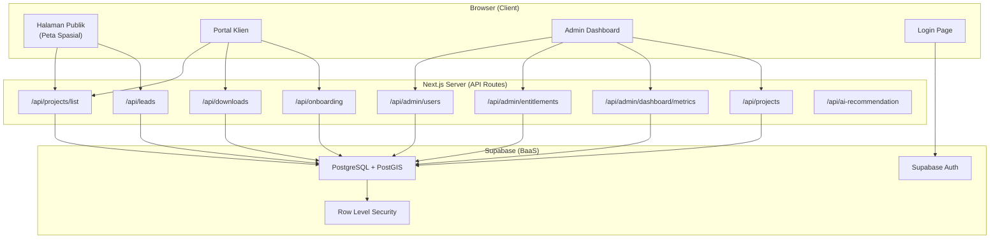
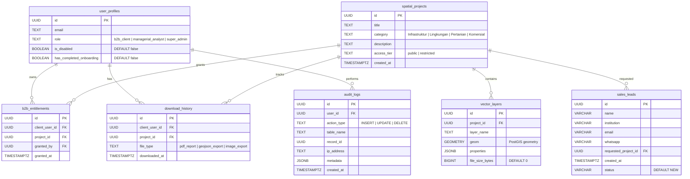
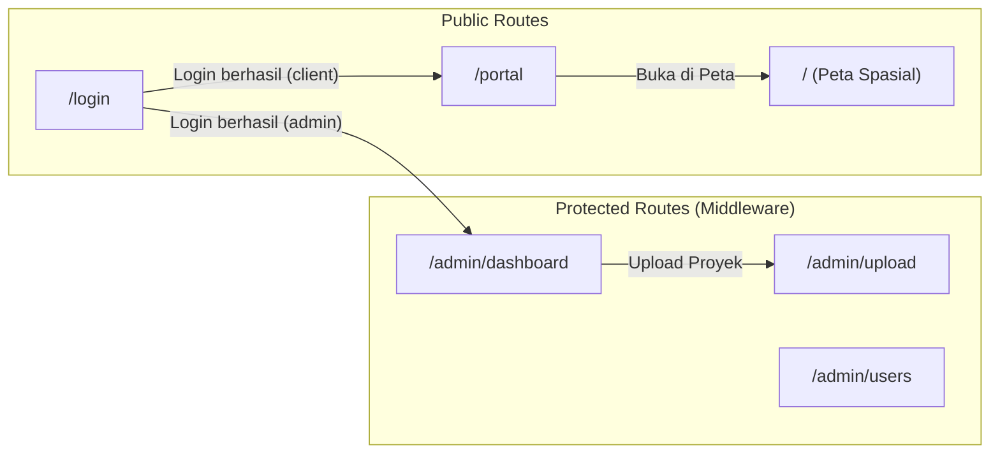
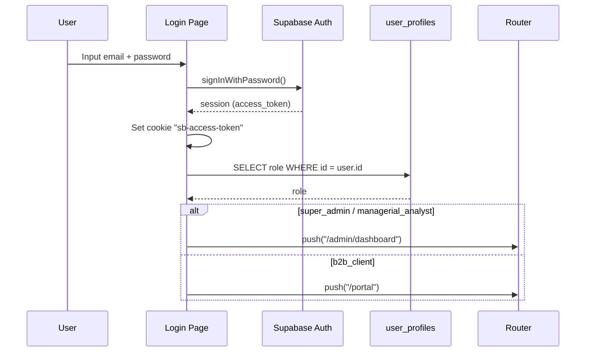
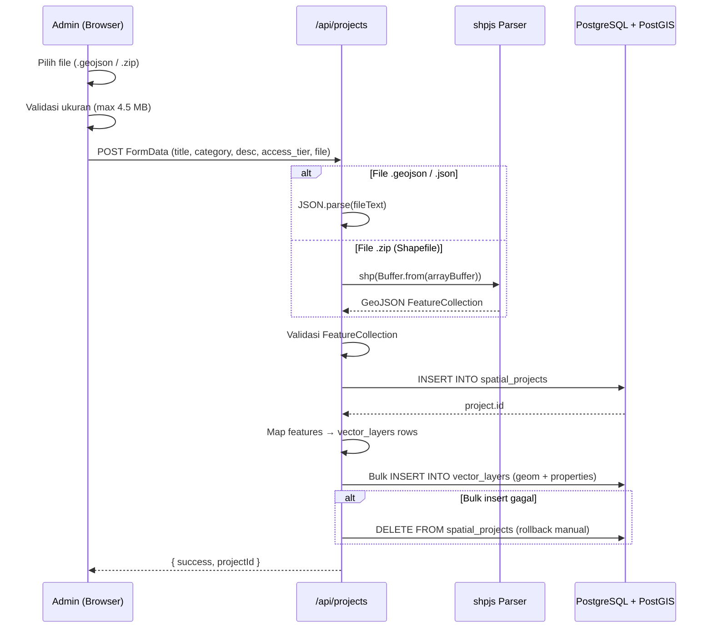
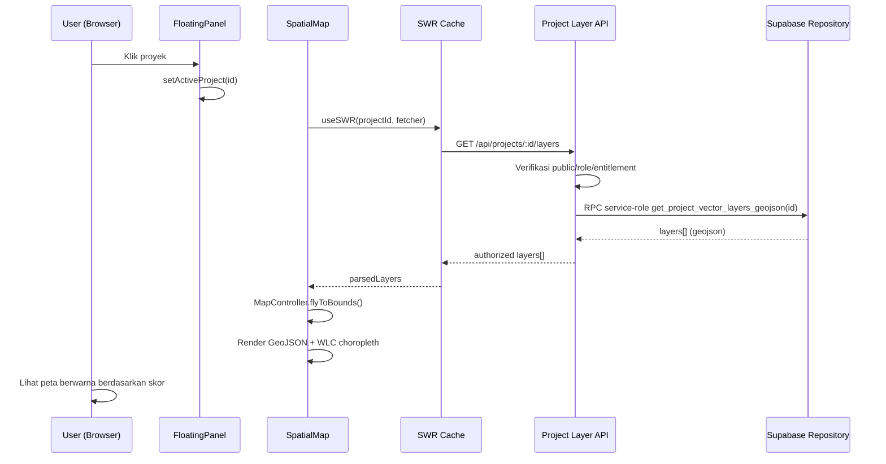

# 📊 Laporan Komprehensif Sistem Website P4I WebGIS

> **Dokumen Teknis — Analisis Lengkap Sistem**
> Tanggal: 28 Agustus 2026 | Versi Codebase: `0.1.0`

---

## 1. Ringkasan Eksekutif

**P4I Spatial Analytics** (atau **P4I WebGIS**) adalah sebuah platform **Web-based Geographic Information System (WebGIS)** berbasis teknologi modern yang dibangun untuk mendukung analisis tata ruang, evaluasi kelayakan wilayah, dan pengambilan keputusan spasial. Sistem ini memiliki model bisnis **B2B (Business-to-Business)** dengan pembagian akses data menjadi tier *Public* dan *Restricted (PRO)*.

### Fitur Inti Sistem
| # | Fitur | Deskripsi |
|---|-------|-----------|
| 1 | **Peta Interaktif Spasial** | Visualisasi data vektor (GeoJSON/Shapefile) di atas basemap OpenStreetMap |
| 2 | **Simulator Bobot AHP/SMCE** | Analisis Multi-Criteria Evaluation dengan slider bobot real-time |
| 3 | **Choropleth Dinamis** | Pewarnaan wilayah otomatis berdasarkan skor kelayakan (WLC) |
| 4 | **Upload Data Spasial** | Unggah file GeoJSON dan Shapefile (.zip), parsing otomatis ke PostGIS |
| 5 | **Ekspor PDF Eksekutif** | Cetak laporan analisis lengkap dengan peta, chart, dan bobot AHP |
| 6 | **Ekspor Citra Resolusi Tinggi** | Tangkap peta sebagai PNG 2x untuk publikasi |
| 7 | **Manajemen Pengguna & RBAC** | 3 role: Super Admin, Managerial Analyst, B2B Client |
| 8 | **Sistem Entitlement B2B** | Pemberian akses proyek restricted per-klien |
| 9 | **Lead Generation (CRM)** | Formulir pengajuan akses untuk pengguna publik |
| 10 | **Portal Klien** | Dashboard pribadi dengan pustaka proyek dan riwayat unduhan |
| 11 | **Audit Trail Database-Level** | Trigger PostgreSQL otomatis mencatat semua INSERT/UPDATE/DELETE |
| 12 | **Onboarding Tour Interaktif** | Panduan langkah-demi-langkah untuk pengguna baru |
| 13 | **Ecosystem Switcher** | Navigasi lintas-produk P4I (Spatial, Journal OJS, Academy) |
| 14 | **AI Recommendation Engine** | Endpoint rekomendasi bisnis berbasis metrik spasial (mock/PoC) |
| 15 | **Executive Dashboard** | Metrik real-time: klien aktif, proyek, storage, dan feed aktivitas |

---

## 2. Technology Stack

### 2.1 Frontend

| Teknologi | Versi | Peran |
|-----------|-------|-------|
| **Next.js** | `16.3.1` | Framework React full-stack (App Router) |
| **React** | `19.2.8` | Library UI deklaratif |
| **TypeScript** | `^5` | Superset JavaScript dengan tipe statis |
| **Tailwind CSS** | `v4` | Utility-first CSS framework |
| **Leaflet** | `^1.9.4` | Library peta interaktif open-source |
| **React-Leaflet** | `^5.0.0` | Binding React untuk Leaflet |
| **Recharts** | `^3.10.1` | Library charting (Donut/Pie chart bobot AHP) |
| **Zustand** | `^5.0.15` | State management ringan (global store) |
| **SWR** | `^2.5.1` | Data fetching & caching (stale-while-revalidate) |
| **Lucide React** | `^1.34.0` | Library ikon SVG modern |
| **React Joyride** | `^3.2.0` | Library onboarding/tour interaktif |
| **Geist Font** | (Google Fonts) | Font modern sans-serif & monospace |

### 2.2 Backend / Server-side

| Teknologi | Peran |
|-----------|-------|
| **Next.js API Routes** | RESTful API serverless handlers |
| **Supabase** | Backend-as-a-Service (BaaS) — Auth, DB, Storage |
| **PostgreSQL** + **PostGIS** | Database relasional + ekstensi geospasial |
| **shpjs** (`^6.2.0`) | Parser Shapefile (.zip → GeoJSON) di server-side |

### 2.3 Utilitas Ekspor

| Teknologi | Versi | Peran |
|-----------|-------|-------|
| **jsPDF** | `^4.2.1` | Pembuatan dokumen PDF di client-side |
| **html2canvas** | `^1.4.1` | Screenshot HTML → Canvas (tangkap peta) |
| **dom-to-image-more** | `^3.10.2` | Render DOM → PNG resolusi tinggi (chart & peta) |

### 2.4 Dev Tools

| Teknologi | Peran |
|-----------|-------|
| **ESLint** (`^9`) + eslint-config-next | Linting kode |
| **PostCSS** | Prosesor CSS pipeline untuk Tailwind |
| **TypeScript Compiler** | Type checking & code intelligence |

### 2.5 Environment Variables

```
NEXT_PUBLIC_SUPABASE_URL       → URL instance Supabase
NEXT_PUBLIC_SUPABASE_ANON_KEY  → Kunci publik (anon) Supabase
SUPABASE_SERVICE_ROLE_KEY      → Kunci service role (bypass RLS, hanya backend)
```

---

## 3. Arsitektur Sistem



### Pola Arsitektur

| Aspek | Implementasi |
|-------|-------------|
| **Rendering** | Client-Side Rendering (CSR) untuk peta; Server Components untuk layout |
| **Data Fetching** | SWR hooks (client) + Supabase JS SDK (direct query untuk beberapa komponen) |
| **State Management** | Zustand store global (`useMapStore`) |
| **Auth Pattern** | Cookie-based JWT (`sb-access-token`) + Supabase `getUser(token)` |
| **API Auth** | Manual token parsing dari cookie header |
| **Admin Auth** | `verifySuperAdmin()` helper — verifikasi role via `user_profiles` |
| **Dynamic Import** | Leaflet/React-Leaflet di-import dengan `ssr: false` (menghindari window error) |

---

## 4. Struktur Direktori & Inventaris File

```
d:\p4i-webgis\
├── app/
│   ├── layout.tsx                    ← Root layout (Geist font, metadata)
│   ├── page.tsx                      ← Halaman utama: Peta + FloatingPanel
│   ├── globals.css                   ← Tailwind + Leaflet CSS imports
│   ├── favicon.ico
│   ├── login/
│   │   └── page.tsx                  ← Halaman login (email + password)
│   ├── portal/
│   │   └── page.tsx                  ← Portal klien B2B
│   ├── admin/
│   │   ├── dashboard/
│   │   │   └── page.tsx              ← Executive Dashboard admin
│   │   ├── upload/
│   │   │   └── page.tsx              ← Form upload proyek spasial
│   │   └── users/
│   │       └── page.tsx              ← Manajemen pengguna (tabel CRUD)
│   └── api/
│       ├── projects/
│       │   ├── route.ts              ← POST (upload) + DELETE proyek
│       │   └── list/
│       │       └── route.ts          ← GET daftar proyek (role-aware)
│       ├── admin/
│       │   ├── users/
│       │   │   └── route.ts          ← GET + PATCH user profiles
│       │   ├── entitlements/
│       │   │   └── route.ts          ← POST + DELETE entitlements B2B
│       │   └── dashboard/
│       │       └── metrics/
│       │           └── route.ts      ← GET metrik dashboard agregat
│       ├── leads/
│       │   └── route.ts              ← POST sales lead baru
│       ├── downloads/
│       │   └── route.ts              ← GET + POST riwayat unduhan
│       ├── onboarding/
│       │   └── route.ts              ← GET + POST status onboarding
│       └── ai-recommendation/
│           └── route.ts              ← POST rekomendasi AI (mock)
├── components/
│   ├── SpatialMap.tsx                ← Komponen peta utama (Leaflet + GeoJSON + WLC)
│   ├── Map.tsx                       ← Komponen peta legacy/alternatif
│   ├── FloatingPanel.tsx             ← Panel kontrol samping (proyek, AHP, export)
│   ├── AhpSimulatorPanel.tsx         ← Simulator bobot AHP (slider + pie chart)
│   ├── GlobalNavFAB.tsx              ← FAB navigasi (Portal/Admin)
│   ├── EcosystemSwitcher.tsx         ← Dropdown navigasi ekosistem P4I
│   ├── ExportPdfButton.tsx           ← Ekspor PDF laporan eksekutif
│   ├── ExportImageButton.tsx         ← Ekspor citra peta PNG resolusi tinggi
│   ├── MapLoadingOverlay.tsx         ← Overlay loading saat memuat data spasial
│   ├── dashboard/
│   │   ├── OverviewMetrics.tsx       ← Kartu metrik: klien, proyek, storage
│   │   └── ActivityFeed.tsx          ← Feed audit log real-time
│   └── portal/
│       ├── ProjectLibrary.tsx        ← Grid pustaka proyek klien
│       ├── DownloadHistory.tsx       ← Riwayat unduhan klien
│       └── OnboardingTour.tsx        ← Tour interaktif (react-joyride)
├── lib/
│   ├── supabase.ts                   ← Client Supabase (anon key, client-side)
│   └── supabaseAdmin.ts             ← Client Supabase (service role, server-only)
├── store/
│   └── useMapStore.ts                ← Zustand store (project, panel, center, AHP weights)
├── utils/
│   └── spatialInteractions.ts        ← Fungsi styling & tooltip GeoJSON feature
├── supabase_migrations/
│   ├── tugas3_user_management.sql    ← DDL: user_profiles, b2b_entitlements, audit_logs
│   ├── tugas4_sales_leads.sql        ← DDL: sales_leads
│   ├── fase5_modul1_audit_logs.sql   ← DDL: audit trail + trigger functions
│   ├── fase5_modul2_storage.sql      ← DDL: kolom file_size_bytes
│   └── fase5_modul3_portal.sql       ← DDL: onboarding flag + download_history
├── public/                           ← Aset statis (SVG icons)
├── middleware.ts                     ← Auth guard untuk /admin/* routes
├── next.config.ts                    ← Konfigurasi Next.js
├── tsconfig.json                     ← Konfigurasi TypeScript
├── package.json                      ← Dependensi & scripts
└── metodologi_lampiran.md            ← Dokumentasi metodologi & DDL
```

### Statistik Codebase

| Metrik | Jumlah |
|--------|--------|
| **Total file source code** | ~35 file |
| **Halaman (Pages)** | 5 halaman |
| **API Routes** | 10 endpoint |
| **Komponen React** | 15 komponen |
| **SQL Migrations** | 5 file |
| **Library Dependencies** | 17 produksi + 7 dev |

---

## 5. Skema Database (Supabase / PostgreSQL + PostGIS)

### 5.1 Entity Relationship Diagram



### 5.2 Daftar Tabel

| # | Tabel | Deskripsi | RLS |
|---|-------|-----------|-----|
| 1 | `user_profiles` | Profil & role pengguna | ✅ |
| 2 | `spatial_projects` | Proyek spasial induk | - |
| 3 | `vector_layers` | Layer vektor (PostGIS geometry + properties) | - |
| 4 | `b2b_entitlements` | Izin akses proyek restricted per-klien | ✅ |
| 5 | `sales_leads` | Calon klien yang mengajukan akses | ✅ |
| 6 | `audit_logs` | Log audit otomatis (trigger-based) | ✅ |
| 7 | `download_history` | Riwayat ekspor/unduh per-user | ✅ |

### 5.3 Database View / Materialized View

| View | Deskripsi |
|------|-----------|
| `vw_vector_layers_geojson` | Materialized view legacy; tidak lagi dipakai runtime dan akses browser dicabut oleh migration 007 |
| `vw_spatial_projects` | Proyek dengan geometry sebagai GeoJSON |

### 5.4 Database Triggers

| Trigger | Tabel Target | Fungsi |
|---------|-------------|--------|
| `trg_audit_spatial_projects` | `spatial_projects` | Otomatis insert ke `audit_logs` |
| `trg_audit_vector_layers` | `vector_layers` | Otomatis insert ke `audit_logs` |
| `trg_audit_user_profiles` | `user_profiles` | Otomatis insert ke `audit_logs` |
| `trg_audit_b2b_entitlements` | `b2b_entitlements` | Otomatis insert ke `audit_logs` |

> Semua trigger menggunakan fungsi `audit_trigger_fn()` yang bersifat **SECURITY DEFINER** untuk bypass RLS saat inserting audit records.

### 5.5 Indeks Database

| Indeks | Tabel | Kolom | Tipe |
|--------|-------|-------|------|
| `spatial_projects_geom_idx` | `spatial_projects` | `geom` | GiST (spatial) |
| `idx_audit_logs_created_at` | `audit_logs` | `created_at DESC` | B-tree |
| `idx_audit_logs_user_id` | `audit_logs` | `user_id` | B-tree |

---

## 6. API Endpoints

### 6.1 Endpoint Publik

| Method | Path | Deskripsi | Auth |
|--------|------|-----------|------|
| `GET` | `/api/projects/list` | Daftar proyek (role-aware filtering) | Opsional |
| `POST` | `/api/leads` | Submit formulir lead generation | ❌ |
| `POST` | `/api/ai-recommendation` | Rekomendasi AI dari metrik spasial (mock) | ❌ |

### 6.2 Endpoint Terautentikasi (User)

| Method | Path | Deskripsi | Auth |
|--------|------|-----------|------|
| `GET` | `/api/downloads` | Riwayat unduhan user yang login | ✅ Cookie |
| `POST` | `/api/downloads` | Catat log unduhan baru | ✅ Cookie |
| `GET` | `/api/onboarding` | Cek status onboarding user | ✅ Cookie |
| `POST` | `/api/onboarding` | Tandai onboarding selesai | ✅ Cookie |

### 6.3 Endpoint Admin (Super Admin Only)

| Method | Path | Deskripsi | Auth |
|--------|------|-----------|------|
| `POST` | `/api/projects` | Upload proyek + parsing GeoJSON/Shapefile | ✅ (implicit) |
| `DELETE` | `/api/projects?id=` | Hapus proyek + cascade | ✅ (implicit) |
| `GET` | `/api/admin/users` | Daftar semua user profiles | ✅ Super Admin |
| `PATCH` | `/api/admin/users` | Update role atau status user | ✅ Super Admin |
| `POST` | `/api/admin/entitlements` | Berikan akses proyek ke klien B2B | ✅ Super Admin |
| `DELETE` | `/api/admin/entitlements` | Cabut akses proyek klien B2B | ✅ Super Admin |
| `GET` | `/api/admin/dashboard/metrics` | Metrik agregat dashboard | ❌ (no auth check) |

---

## 7. Halaman & Routing

### 7.1 Peta Routing



### 7.2 Detail Halaman

| Route | Tipe | Deskripsi |
|-------|------|-----------|
| `/` | Client Component | Peta interaktif fullscreen + floating panel + AHP simulator |
| `/login` | Client Component | Form login (email/password), redirect berdasarkan role |
| `/portal` | Server Component | Portal klien B2B: pustaka proyek + riwayat unduhan |
| `/admin/dashboard` | Server Component | Executive dashboard: metrik, activity feed, embed user management |
| `/admin/upload` | Client Component | Form upload proyek spasial (GeoJSON/Shapefile) |
| `/admin/users` | Client Component | Tabel manajemen pengguna (role, status, aksi) |

### 7.3 Middleware (Auth Guard)

```typescript
// Melindungi semua route /admin/*
matcher: ['/admin/:path*']
```

**Alur middleware:**
1. Baca cookie `sb-access-token`
2. Validasi token via `supabase.auth.getUser(token)`
3. Cek `is_disabled` di `user_profiles` (via service role)
4. Jika disabled → redirect ke `/login?error=disabled` + hapus cookie
5. Jika valid → `NextResponse.next()`
6. Jika invalid/expired → redirect ke `/login`

---

## 8. Komponen React — Inventaris Detail

### 8.1 Komponen Peta & Visualisasi

| Komponen | File | Deskripsi |
|----------|------|-----------|
| [SpatialMap](file:///d:/p4i-webgis/components/SpatialMap.tsx) | `SpatialMap.tsx` | Peta utama: MapContainer + TileLayer + GeoJSON choropleth + MapController (flyToBounds) |
| [Map](file:///d:/p4i-webgis/components/Map.tsx) | `Map.tsx` | Komponen peta legacy (tanpa project switching) |
| [MapLoadingOverlay](file:///d:/p4i-webgis/components/MapLoadingOverlay.tsx) | `MapLoadingOverlay.tsx` | Overlay blur + spinner saat loading data spasial |

### 8.2 Komponen Panel & Navigasi

| Komponen | File | Deskripsi |
|----------|------|-----------|
| [FloatingPanel](file:///d:/p4i-webgis/components/FloatingPanel.tsx) | `FloatingPanel.tsx` | Panel utama: daftar proyek, delete, modal akses restricted, form lead |
| [AhpSimulatorPanel](file:///d:/p4i-webgis/components/AhpSimulatorPanel.tsx) | `AhpSimulatorPanel.tsx` | Simulator bobot AHP dengan 3 slider + donut chart Recharts |
| [GlobalNavFAB](file:///d:/p4i-webgis/components/GlobalNavFAB.tsx) | `GlobalNavFAB.tsx` | FAB navigasi (Portal Klien / Dasbor Admin) — hanya untuk user login |
| [EcosystemSwitcher](file:///d:/p4i-webgis/components/EcosystemSwitcher.tsx) | `EcosystemSwitcher.tsx` | Dropdown ekosistem P4I: Spatial, Journal, Academy |

### 8.3 Komponen Ekspor

| Komponen | File | Deskripsi |
|----------|------|-----------|
| [ExportPdfButton](file:///d:/p4i-webgis/components/ExportPdfButton.tsx) | `ExportPdfButton.tsx` | Ekspor PDF A4 landscape: header, bobot AHP, chart, screenshot peta, footer |
| [ExportImageButton](file:///d:/p4i-webgis/components/ExportImageButton.tsx) | `ExportImageButton.tsx` | Ekspor PNG 2x resolusi dari Leaflet container |

### 8.4 Komponen Dashboard Admin

| Komponen | File | Deskripsi |
|----------|------|-----------|
| [OverviewMetrics](file:///d:/p4i-webgis/components/dashboard/OverviewMetrics.tsx) | `OverviewMetrics.tsx` | Kartu metrik: Klien B2B Aktif, Total Proyek, Kapasitas Storage |
| [ActivityFeed](file:///d:/p4i-webgis/components/dashboard/ActivityFeed.tsx) | `ActivityFeed.tsx` | Feed audit log real-time (30 detik refresh) dari tabel `audit_logs` |

### 8.5 Komponen Portal Klien

| Komponen | File | Deskripsi |
|----------|------|-----------|
| [ProjectLibrary](file:///d:/p4i-webgis/components/portal/ProjectLibrary.tsx) | `ProjectLibrary.tsx` | Grid card proyek yang bisa dibuka di peta spasial |
| [DownloadHistory](file:///d:/p4i-webgis/components/portal/DownloadHistory.tsx) | `DownloadHistory.tsx` | Daftar riwayat unduhan (PDF / gambar) per-user |
| [OnboardingTour](file:///d:/p4i-webgis/components/portal/OnboardingTour.tsx) | `OnboardingTour.tsx` | Tour interaktif 3 langkah menggunakan react-joyride |

---

## 9. State Management (Zustand)

File: [useMapStore.ts](file:///d:/p4i-webgis/store/useMapStore.ts)

| State | Tipe | Default | Deskripsi |
|-------|------|---------|-----------|
| `activeProjectId` | `string \| null` | `null` | ID proyek yang sedang ditampilkan di peta |
| `isPanelOpen` | `boolean` | `true` | Status buka/tutup floating panel |
| `mapCenter` | `[number, number]` | `[-0.7893, 113.9213]` | Pusat peta (koordinat Indonesia) |
| `ahpWeights` | `AhpWeights` | `{ bencana: 0.33, kesuburan: 0.34, kepadatan: 0.33 }` | Bobot AHP untuk kalkulasi WLC |

| Action | Deskripsi |
|--------|-----------|
| `setActiveProject(id)` | Set proyek aktif (trigger SWR fetch layer) |
| `togglePanel()` | Toggle panel buka/tutup |
| `setMapCenter(center)` | Set pusat koordinat peta |
| `setAhpWeights(weights)` | Update bobot AHP (slider) |

---

## 10. Sistem Autentikasi & Otorisasi

### 10.1 Alur Login



### 10.2 Role-Based Access Control (RBAC)

| Role | Akses Peta | Portal Klien | Admin Dashboard | Upload | Manajemen User | Entitlements |
|------|-----------|-------------|----------------|--------|---------------|-------------|
| **Public (Guest)** | ✅ (public only) | ❌ | ❌ | ❌ | ❌ | ❌ |
| **B2B Client** | ✅ (public + entitled) | ✅ | ❌ | ❌ | ❌ | ❌ |
| **Managerial Analyst** | ✅ (semua) | ✅ | ✅ (view) | ✅ | ❌ | ❌ |
| **Super Admin** | ✅ (semua) | ✅ | ✅ | ✅ | ✅ | ✅ |

### 10.3 Mekanisme Auth

| Aspek | Implementasi |
|-------|-------------|
| **Auth Provider** | Supabase Auth (email/password) |
| **Token Storage** | Cookie browser (`sb-access-token`) |
| **Token Format** | JWT (access_token dari Supabase) |
| **Middleware Protection** | Route `/admin/*` dilindungi oleh [middleware.ts](file:///d:/p4i-webgis/middleware.ts) |
| **API Protection** | Helper `verifySuperAdmin()` di API admin routes |
| **Disabled Account** | Dicek via `is_disabled` di middleware |

---

## 11. Fitur Analisis Spasial

### 11.1 AHP / SMCE (Spatial Multi-Criteria Evaluation)

**Algoritma**: Weighted Linear Combination (WLC)

```
Skor = (Skor_Bencana × W_bencana) + (Skor_Kesuburan × W_kesuburan) + (Skor_Kepadatan × W_kepadatan)
```

| Parameter | Label | Default Weight | Warna Slider |
|-----------|-------|---------------|-------------|
| `bencana` | W_d (Bencana) | 33% | 🔴 Merah |
| `kesuburan` | W_f (Kesuburan) | 34% | 🟢 Hijau |
| `kepadatan` | W_p (Kepadatan) | 33% | 🔵 Biru |

**Constraint**: Total bobot harus = 100% (toleransi ±5%)

**Normalisasi otomatis**: Saat satu slider digeser, dua slider lainnya otomatis menyesuaikan proporsional untuk mempertahankan total = 1.0.

### 11.2 Choropleth Map (Klasifikasi Warna)

| Rentang Skor | Warna | Label Kelayakan |
|-------------|-------|----------------|
| ≥ 4.0 | `#22c55e` (Hijau) | Sangat Layak |
| ≥ 3.0 | `#eab308` (Kuning) | Layak |
| ≥ 2.0 | `#f97316` (Oranye) | Cukup |
| < 2.0 | `#ef4444` (Merah) | Tidak Layak |

### 11.3 Spatial Interactions

File: [spatialInteractions.ts](file:///d:/p4i-webgis/utils/spatialInteractions.ts)

- **Tooltip interaktif**: Menampilkan `layer_name`, `estimasi_roi`, dan `level_risiko` per feature
- **Styling berbasis risiko**: `tinggi` (merah), `sedang` (kuning), `rendah` (hijau)
- **Sticky tooltip**: Mengikuti kursor pada hover

### 11.4 MapController (Fly-to-Bounds)

Saat proyek dipilih, peta otomatis melakukan animasi `flyToBounds()` ke bounding box data GeoJSON dengan padding 50px dan durasi 1.5 detik.

---

## 12. Alur Data End-to-End

### 12.1 Upload Proyek Spasial



### 12.2 Visualisasi Peta



---

## 13. Sistem Ekspor

### 13.1 Ekspor PDF Eksekutif

**Komponen**: [ExportPdfButton.tsx](file:///d:/p4i-webgis/components/ExportPdfButton.tsx)

| Langkah | Proses |
|---------|--------|
| 1 | Tangkap chart AHP via `dom-to-image-more` (skala 2x) |
| 2 | Sembunyikan panel overlay (visibility: hidden) |
| 3 | Tunggu 500ms (render tile peta) |
| 4 | Tangkap peta via `html2canvas` (skala 2x, CORS enabled) |
| 5 | Kembalikan visibilitas panel |
| 6 | Rakitan PDF jsPDF (landscape A4): header, ID proyek, tanggal, bobot AHP, chart, peta, footer |
| 7 | Download `P4I_Analisis_{id}_{timestamp}.pdf` |
| 8 | Log ke `download_history` (jika authenticated) |

### 13.2 Ekspor Citra PNG

**Komponen**: [ExportImageButton.tsx](file:///d:/p4i-webgis/components/ExportImageButton.tsx)

| Langkah | Proses |
|---------|--------|
| 1 | Sembunyikan panel overlay |
| 2 | Tunggu 500ms |
| 3 | Render Leaflet container via `dom-to-image-more` (skala 2x) |
| 4 | Kembalikan visibilitas panel |
| 5 | Trigger download `P4I_Peta_{id}_{timestamp}.png` |
| 6 | Log ke `download_history` (jika authenticated) |

---

## 14. Fitur Lead Generation & B2B

### 14.1 Alur Lead Generation

1. User publik mengklik proyek **🔒 PRO (Restricted)** di floating panel
2. Muncul modal **"Kajian Spasial Khusus Mitra B2B/Pemerintah"**
3. User dapat:
   - Mengisi formulir (Nama, Instansi, Email, WhatsApp) → `POST /api/leads`
   - Atau login ke dashboard → redirect ke `/login`
4. Data tersimpan di tabel `sales_leads` dengan status `NEW`

### 14.2 Sistem Entitlements

- **Super Admin** dapat memberikan atau mencabut akses proyek restricted per-klien B2B
- Endpoint: `POST /api/admin/entitlements` dan `DELETE /api/admin/entitlements`
- Setiap pemberian/pencabutan dicatat di `audit_logs`
- API `/api/projects/list` secara otomatis memfilter proyek berdasarkan entitlement user

---

## 15. Ekosistem P4I (Roadmap)

Komponen [EcosystemSwitcher](file:///d:/p4i-webgis/components/EcosystemSwitcher.tsx) menunjukkan visi platform multi-produk:

| Produk | Status | Deskripsi |
|--------|--------|-----------|
| **P4I Spatial Analytics** | ✅ Aktif | Web-GIS & Tata Ruang (sistem ini) |
| **P4I Journal (OJS)** | 🔜 Coming Soon | Publikasi & Riset Akademik |
| **P4I Academy** | 🔜 Coming Soon | Sistem Pembelajaran & Kursus |

Konsep: **"Satu Akun, Seluruh Layanan"** — single sign-on across P4I ecosystem.

---

## 16. Catatan Teknis & Limitasi

### 16.1 Limitasi Saat Ini

| # | Area | Catatan |
|---|------|---------|
| 1 | **Upload file** | Batas 4.5 MB (Vercel Serverless body limit). Perlu migrasi ke Supabase Storage direct upload untuk file besar |
| 2 | **AI Recommendation** | Masih berupa **mock response** (hardcoded JSON). Belum terhubung ke LLM sungguhan |
| 3 | **AHP Scores** | Data skor bencana/kesuburan/kepadatan menggunakan **fallback simulasi** (hardcoded 3/4/2). Belum membaca atribut nyata dari DB |
| 4 | **Dashboard Metrics API** | Endpoint `/api/admin/dashboard/metrics` tidak memiliki auth check |
| 5 | **Delete proyek** | Tombol delete tersedia untuk semua pengguna di FloatingPanel (termasuk guest) |
| 6 | **Map.tsx** | Komponen peta legacy/duplikat yang tidak lagi digunakan oleh routing aktif |
| 7 | **Sales Lead Notification** | `TODO: Kirim notifikasi email/webhook ke tim sales` belum diimplementasi |
| 8 | **Portal route** | Route `/portal` tidak dilindungi middleware (bisa diakses tanpa login) |

### 16.2 Patterns & Best Practices yang Digunakan

| Pattern | Implementasi |
|---------|-------------|
| Dynamic Import + SSR:false | Leaflet (browser-only library) |
| SWR stale-while-revalidate | Data fetching real-time dengan cache |
| Zustand global store | State management minimal tanpa boilerplate |
| Supabase dual-client | Anon key (client) + Service Role (server) |
| Manual rollback | Delete project jika bulk insert vector_layers gagal |
| Database-level audit | PostgreSQL trigger functions (SECURITY DEFINER) |
| RLS policies | Data isolation per-user (download_history, audit_logs) |
| Cookie-based auth | JWT disimpan di cookie, dibaca di middleware + API routes |
| Glassmorphism UI | `backdrop-blur-md`, `bg-white/80`, rounded corners |

---

## 17. Ringkasan Jumlah Kode Per Bagian

| Bagian | File | Total Lines (approx.) |
|--------|------|-----------------------|
| **Pages** (app/) | 5 file `.tsx` + 1 layout | ~370 baris |
| **API Routes** | 10 file `.ts` | ~580 baris |
| **Components** | 15 file `.tsx` | ~1,400 baris |
| **Lib/Store/Utils** | 4 file `.ts` | ~90 baris |
| **SQL Migrations** | 5 file `.sql` | ~160 baris |
| **Config** | 5 file | ~100 baris |
| **TOTAL** | **~40 file** | **~2,700 baris** |

---

> [!NOTE]
> Dokumen ini dihasilkan dari analisis statis seluruh source code di repositori `d:\p4i-webgis` per tanggal 28 Agustus 2026. Data mencakup semua file yang ada di luar `node_modules` dan `.next`.
