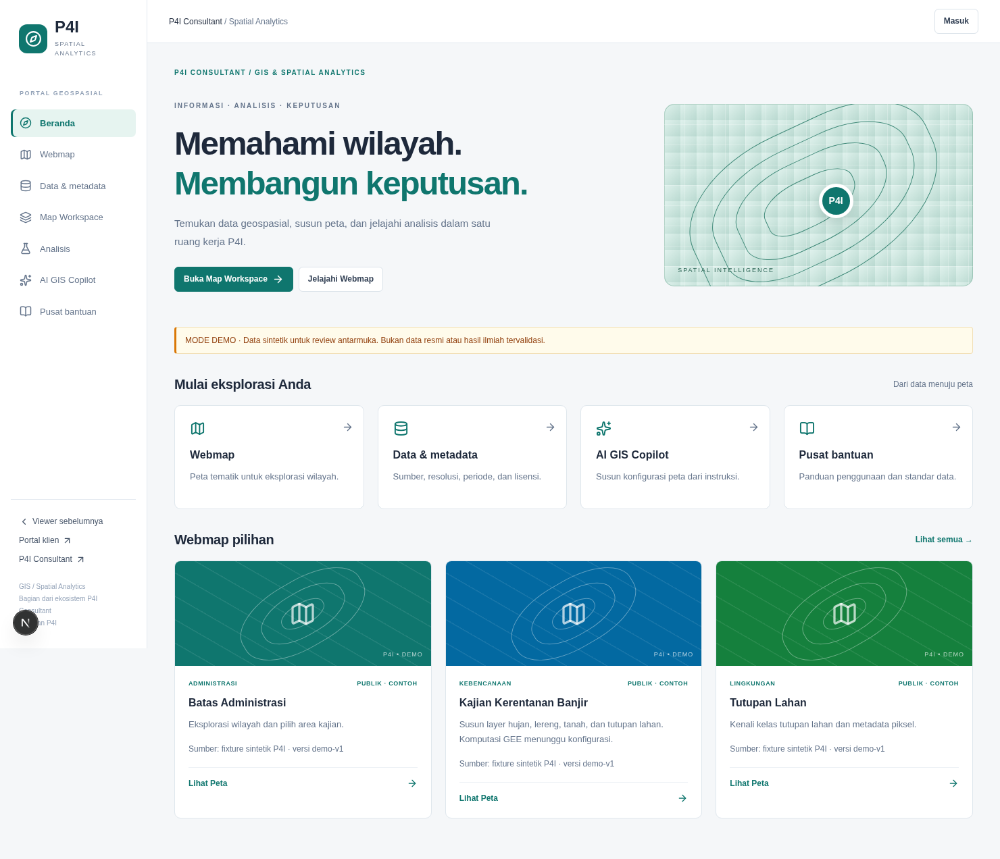
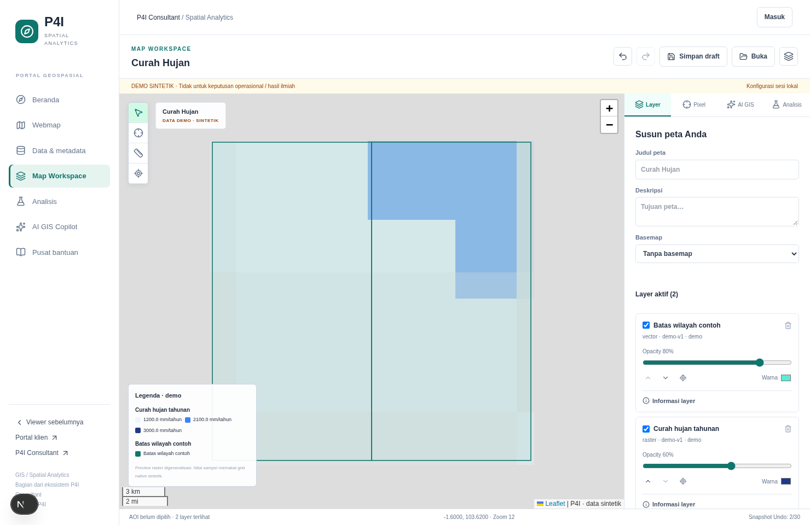
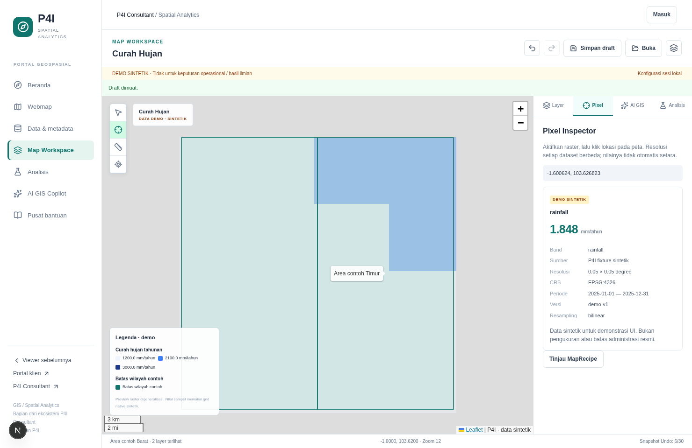
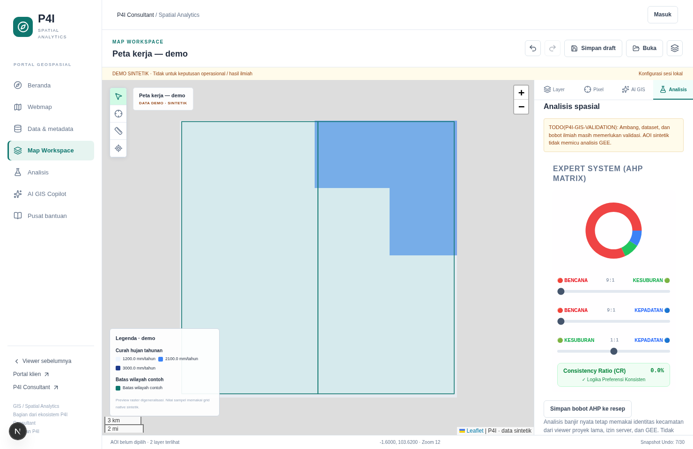
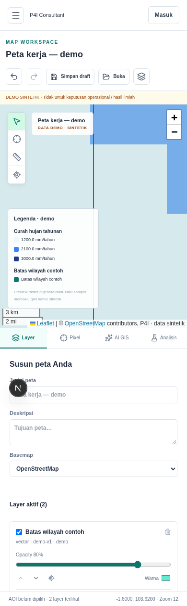

# P4I WebGIS — Phase 01: audit dan stabilisasi

Tanggal audit: 12 Oktober 2026 (Asia/Jakarta). Branch: `feat/phase-01-stabilization`.
Pekerjaan lokal siap direview. Integrasi data nyata dan sinkronisasi PR masih memiliki
blocker yang dirinci di bawah; laporan ini tidak menyatakan aplikasi siap produksi.

## 1. Identitas dan rekonsiliasi

- Checkout aktual: `/workspace/p4i-webgis`; origin: `https://github.com/HannR002/p4i-webgis.git`.
- HEAD awal dan remote `main`: `dfe412c81c1254707cbd16083791dc009cf90643`.
- Riwayat yang tersedia: `dfe412c` (staging/deployment preparation), `9c4be54` (secure baseline).
- `git ls-remote --heads origin` berhasil dan hanya menemukan `main` pada SHA tersebut.
- Branch lokal awal `feat/ai-gis-map-workspace` berisi 8 file tracked yang berubah dan 49 file baru;
  implementasi sebelumnya belum menjadi commit atau branch remote. Tidak ada patch yang diterapkan ulang.
- Semua perubahan tersebut dipertahankan di branch stabilisasi baru, tanpa reset atau rewrite history.
- `gh repo view ... --json nameWithOwner,isPrivate,defaultBranchRef` gagal dengan
  `Post https://api.github.com/graphql: Forbidden`. Status private/public dan kemampuan PR belum dapat diverifikasi.
  Nilai `private: true` di package.json bukan bukti bahwa repositori GitHub private.
- Deliverable pengganti PR: commit lokal pada branch fitur, patch terhadap `dfe412c`, Git bundle,
  [deskripsi PR](phase-01-pr.md), daftar file dan bukti browser. Tidak ada push atau merge.

## 2. Inventaris fitur dari kode aktual

Status di bawah membedakan fungsi antarmuka yang diuji dengan integrasi eksternalnya.

| Area | Klasifikasi | Bukti aktual dan batasan |
| --- | --- | --- |
| Portal Home/Webmap/Data/Help | Implemented and working; Demo/mock only untuk isi katalog | Tujuh route portal merespons 200, navigasi desktop/mobile dan pencarian/filter diuji. Lima dataset dan enam Webmap merupakan definisi contoh. |
| Map Viewer / Builder | Implemented and working untuk sesi demo; Partially integrated untuk data nyata | Inisialisasi Leaflet, tambah/hapus/toggle/style/order/opacity, AOI, save/load/reset dan JSON diuji di browser. `/spatial` lama tetap ada. List proyek staging 200, tetapi request layer proyek nyata 500/PGRST202. |
| MapRecipe / Undo / Redo | Implemented and working | Validasi input, izin dataset, regenerasi legenda, AOI kanonis, history terbatas, undo/redo dan atomic plan diuji. Penyimpanan hanya localStorage/file JSON. Sinkronisasi peta ke DB: Missing. |
| Pixel Inspector | Demo/mock only | Sampling grid native sintetik, unit/metadata, NoData, pembatalan request dan error UI diuji. Adapter sampling raster nyata: External dependency pending. |
| AI GIS Copilot | Demo/mock only | Parser keyword deterministik, rencana, apply/undo, penolakan instruksi kode dan respons terlambat diuji. Provider LLM/paid calls: belum aktif; AI scientific computation: Missing. |
| AHP / WLC | Implemented and working untuk editor AHP; Partially integrated untuk WLC | Tiga slider kini tampil tanpa memilih proyek lama. Browser membuktikan CR tidak konsisten memblokir simpan, kemudian rasio konsisten menyimpan bobot 0.81818/0.09091/0.09091. Formula WLC legacy dibaca; evaluasi ilmiah terhadap data nyata belum dilakukan. |
| Flood Analysis | Partially integrated; External dependency pending | UI/API/model/GEE adapter/cache ada; tes input/route/model memakai mock. Komputasi GEE dan cache DB end-to-end belum diuji. GEE staging belum tersedia menurut pengguna. Demo tidak menampilkan tile, skor atau panel hasil banjir legacy. |
| PDF / PNG | Implemented and working pada fixture | Browser menghasilkan file PNG/PDF asli; PDF diperiksa teks metadata/provenance. Rasio aspek peta diperbaiki. Grafik AHP live yang dapat berbeda dari bobot tersimpan tidak ikut PDF MapRecipe. Ekspor basemap eksternal bergantung CORS. |
| Authentication / RBAC | Implemented and working untuk keputusan izin yang diuji; Implemented but untested untuk login akun nyata | Identitas memakai verifikasi token provider + `user_profiles.role`; tes role/access/disabled-profile lulus. API sensitif tanpa token 401; portal/admin redirect ke login. Login sukses, refresh/logout akun nyata belum diuji. |
| Client Portal / entitlements | Partially integrated | Route, repository dan keputusan entitlement ada; guest redirect dan unit keputusan restricted-project diuji. Pengalaman B2B berakun dan grant/revoke staging tidak dijalankan. |
| Admin / audit | Implemented but untested untuk workflow berakun | Kode route/admin guard, repository audit dan hardening SQL diperiksa; akses anonim ditolak. CRUD admin, trigger/audit DB dan perubahan entitlement tidak dijalankan. |
| Provider abstraction | Implemented and working untuk kontrak yang diuji; Missing untuk adapter tambahan | Supabase SDK hanya di adapter auth/database; UI/API menggunakan kontrak. GIS/AI demo memiliki provider terpisah. PostgreSQL non-Supabase, real raster/LLM, storage backend dan operasi raster lanjutan belum diimplementasikan. |

## 3. Temuan yang diperbaiki

1. **Copilot menimpa edit saat request berjalan.** Browser menunda `/api/gis/actions`, menekan Undo,
   lalu melepaskan respons: sebelum perbaikan hasil AI mengganti sesi baru. Store sekarang membandingkan
   snapshot sesi sebelum menerima respons; perubahan pengguna tetap utuh dan pesan meminta rencana baru.
2. **Pixel Inspector terus loading setelah layer dimatikan.** Direproduksi dengan respons pixel tertunda.
   Status/error sekarang terkait snapshot layer dan request lama dibatalkan; sample lama tidak ditampilkan.
3. **Urutan layer hanya berubah di recipe.** React Leaflet 5 `Pane` mengaplikasikan style sekali saat mount.
   Efek kini memperbarui z-index pane Leaflet; browser memverifikasi 460 → 461 → 460 setelah naik/Undo.
4. **Panel AHP tersembunyi pada workspace baru.** Guard lama mensyaratkan proyek/AOI dari store legacy.
   Mode standalone menampilkan editor di workspace, tanpa memalsukan identitas AOI atau mengambil skor banjir lama.
5. **State banjir legacy bocor ke demo.** Tile banjir di `SpatialMap`, konteks AHP, dan panel flood kini
   terisolasi dari sesi demo; renderer viewer asli tetap mempertahankan tile nyata.
6. **Viewport Leaflet dapat keluar domain MapRecipe.** Longitude world-wrap dinormalisasi, latitude/zoom
   dibatasi dan nilai non-finite diabaikan; edit setelah pan tidak merusak validasi recipe.
7. **Import recipe melewati pengecekan akses dan metadata.** `replace` memeriksa entitlement, membangun
   ulang legenda dari metadata/style, dan validator menolak AOI fiktif atau demo yang dilabeli administratif resmi.
8. **Kegagalan katalog meninggalkan spinner; kegagalan layer proyek tidak tampil.** Kini ada pesan error
   yang jelas. Error katalog diuji di mobile; kegagalan proyek diuji pada renderer dan RPC staging dikonfirmasi read-only.
9. **PDF mendistorsi peta tinggi dan dapat membawa chart AHP tidak cocok.** Lebar/tinggi sekarang diskalakan
   proporsional; PDF MapRecipe menggunakan bobot recipe tanpa chart live dari store lain.
10. **Endpoint rekomendasi legacy mengirim skor mock 88 tanpa penanda.** Kini hanya development +
    `GIS_DEMO_MODE=true` yang boleh mengembalikan contoh, dengan `demo`, provider dan disclaimer eksplisit;
    production mengembalikan 503 walaupun flag demo diaktifkan.

## 4. Pemeriksaan keamanan

- `resolveIdentityWith` memverifikasi token lalu membaca role melalui `users.findAuthProfile`, yang
  mengambil `role,is_disabled` dari `user_profiles`. Role metadata pengguna tidak dipercaya.
- `resolveProjectLayerAccess` menolak restricted-project untuk guest/B2B tanpa entitlement;
  role admin/analyst dan entitlement diperiksa server-side. Route admin memanggil `requireRole`.
- Supabase `createClient` hanya ditemukan di tiga adapter: browser auth, server auth, server database.
  Service-role dan Earth Engine modules memakai `server-only`.
- Scan 36 bundle JavaScript `.next/static` pada build audit tidak menemukan nama binding service-role,
  binding JSON GEE, atau marker private key. Ini pemeriksaan batas bundle, bukan sertifikasi keamanan menyeluruh.
- GIS request body dibatasi 64 KiB; tools/parameter/divalidasi dengan whitelist, tanpa eval/SQL/shell.
- Pengujian produksi lokal memastikan katalog `unavailable` dan pixel/vector/tile/Copilot/rekomendasi
  legacy mengembalikan 503. Tidak ada fallback fixture menjadi hasil ilmiah nyata.
- Status RLS/trigger di database yang sedang berjalan belum dibuktikan; tes SQL memeriksa berkas migrasi,
  bukan penerapan migrasi. Tidak ada migrasi yang dijalankan.

## 5. Verifikasi independen

Node **22.23.3**, npm **10.9.9**, lockfile tidak diubah dan tidak ada dependency baru.
`npm ci` awal gagal karena cache default `/home/agent/.npm` tidak tersedia;
setelah `npm_config_cache=/workspace/.npm`, instalasi frozen lockfile berhasil (591 packages).
Peringatan deprecation dependency tetap dicatat; tidak ada upgrade paksa.

| Pemeriksaan | Sebelum stabilisasi | Sesudah stabilisasi |
| --- | --- | --- |
| npm run lint | Lulus | Lulus |
| npm run typecheck | Lulus | Lulus |
| npm test | 62 tes / 14 file, lulus | 75 tes / 17 file, lulus |
| npm run build | Lulus, Node 22 | Lulus, Node 22 |
| git diff --check | Bersih | Bersih |

Tidak ada tes yang dinonaktifkan atau dilewati. Tambahan 13 tes mencakup respons stale,
akses/import/viewport/legenda, AOI, isolasi flood, error layer proyek, panel AHP, dan rekomendasi legacy.

Browser nyata: Chromium + Playwright yang sudah tersedia di cloud, desktop 1480×960,
mobile 390×844. Bukan screenshot mockup. Dua skrip QA tersimpan di `scripts/qa/` tanpa menambah dependency.

- Smoke: portal/search/filter, layer opacity, undo/redo, AOI, local draft save/reset/load,
  pixel value/units, Copilot plan/apply/undo, JSON, PNG, PDF, menu mobile dan overflow.
- Regresi: urutan pane nyata, add/remove/style, race Copilot/Pixel, kegagalan sampling,
  invalid recipe import, editor AHP/CR, semua route portal, viewer lama, login dan guest redirects.
- Error test memakai intersepsi respons browser lokal; tidak mengubah sistem eksternal.
- Nol JavaScript `pageerror` pada kedua rangkaian. Tidak ada horizontal overflow pada smoke mobile.
- Route read-only staging: public project list 200 (2 proyek); boundary 500/PGRST202;
  layer proyek publik pertama 500/PGRST202. Tidak ada request mutasi staging.

## 6. Bukti dan cara mengulang

[Bukti smoke](evidence/phase-01/browser-smoke.log),
[bukti regresi](evidence/phase-01/browser-regression.log),
[isolasi production](evidence/phase-01/production-isolation.json).
Log npm lengkap dan ekspor browser ada di `/workspace/artifacts/phase-01`.
Berkas di workspace tidak menjamin fitur unduh lampiran chat; screenshot juga dapat ditampilkan langsung.







Jalankan dev server demo pada port 3000, lalu di terminal terpisah:

```bash
P4I_PLAYWRIGHT_MODULE=/opt/codex/cua_node/lib/node_modules/playwright-core/index.mjs \
P4I_QA_ARTIFACTS=/tmp/p4i-phase-01 node scripts/qa/phase-01-smoke.mjs
P4I_PLAYWRIGHT_MODULE=/opt/codex/cua_node/lib/node_modules/playwright-core/index.mjs \
P4I_QA_ARTIFACTS=/tmp/p4i-phase-01 node scripts/qa/phase-01-regression.mjs
```

Path modul di atas khusus cloud ini. Di mesin lain gunakan Playwright Core yang sudah terpasang
atau set `P4I_PLAYWRIGHT_MODULE` dan `P4I_CHROMIUM` ke lokasi valid. Skrip menargetkan localhost;
bukan runner deployment. Lihat juga [panduan review lokal](local-review.md).

## 7. Blocker dan tindak lanjut

1. **Database staging:** RPC `get_boundaries_in_view` dan `get_project_vector_layers_geojson`
   tidak ditemukan PostgREST (`PGRST202`). Ini bukti schema cache/API, bukan bukti pasti ketiadaan
   fungsi fisik. Inspeksi DDL/schema-cache/privilege perlu tugas database terpisah dan terotorisasi;
   jangan replay migrasi historis secara buta. Lihat `staging-database-runbook.md`.
2. **GEE/data ilmiah:** proyek/aset/kredensial GEE staging, dataset otoritatif, kalibrasi dan validasi
   metode/bobot/ambang belum tersedia/terverifikasi. Tidak ada komputasi GEE yang dijalankan.
3. **Akun uji:** happy path login/RBAC/B2B/admin/audit dengan akun nyata dan data staging yang disetujui
   masih perlu diuji. Pemeriksaan anonim/unit tidak membuktikan alur tersebut.
4. **GitHub:** API Forbidden menghalangi PR langsung dan pemeriksaan visibility. Changeset lokal disiapkan;
   publish branch/PR memerlukan akses yang sesuai. Tidak ada force push/merge/history rewrite.
5. **Kemampuan belum ada:** persistensi map DB, adapter raster/LLM nyata, zonal statistics/clip/buffer/
   weighted raster overlay, dan scientific validation. Ini pekerjaan lanjutan, bukan hasil Phase 01.
6. **Batas QA:** ekspor memakai basemap none; CORS/tile eksternal belum disertifikasi. Hosting Hostinger
   2 CPU/3 GB, pemulihan cloud baru, production deployment dan performa skala nasional belum diuji.

## 8. Konfigurasi cloud

`install_script` dan `start_skill` diperbarui pada draft environment: memilih toolchain Node 22
terverifikasi jika tersedia, memakai cache npm di workspace, serta mencatat branch, hasil tes dan
blocker terbaru. Penyimpanan draft berhasil dan `requires_publish=true`. Tinjau/simpan melalui
pengaturan environment, lalu Publish untuk mengaktifkan snapshot/instruksi; audit ini tidak
mempublikasikannya dan tidak memverifikasi pemulihan pada task baru. Network dan binding secret
dipertahankan.

## 9. Batas tindakan

Tidak ada deployment produksi, perubahan Hostinger, migrasi Supabase, perubahan data eksternal,
pembuatan resource GCP/GEE, panggilan AI berbayar, upload dataset nyata, pengungkapan secret,
Git push atau merge ke main. Seluruh request mutasi QA menuju API demo lokal yang hanya mengubah recipe sesi.


## Complete changeset file list

- `.env.example`
- `app/api/ai-recommendation/route.ts`
- `app/api/gis/actions/route.ts`
- `app/api/gis/catalog/route.ts`
- `app/api/gis/copilot/route.ts`
- `app/api/gis/pixel/route.ts`
- `app/api/gis/tiles/[id]/[z]/[x]/[y]/route.ts`
- `app/api/gis/vector/[id]/route.ts`
- `app/spatial/(portal)/ai/page.tsx`
- `app/spatial/(portal)/analysis/page.tsx`
- `app/spatial/(portal)/data/page.tsx`
- `app/spatial/(portal)/help/page.tsx`
- `app/spatial/(portal)/home/page.tsx`
- `app/spatial/(portal)/layout.tsx`
- `app/spatial/(portal)/viewer/page.tsx`
- `app/spatial/(portal)/webmap/page.tsx`
- `app/spatial/gis.css`
- `app/spatial/page.tsx`
- `components/AhpSimulatorPanel.tsx`
- `components/ExportImageButton.tsx`
- `components/ExportPdfButton.tsx`
- `components/SpatialMap.tsx`
- `components/gis/CopilotPanel.tsx`
- `components/gis/MapWorkspace.tsx`
- `components/gis/PixelInspector.tsx`
- `components/gis/PortalPages.tsx`
- `components/gis/PortalShell.tsx`
- `components/gis/WorkspaceMap.tsx`
- `components/gis/WorkspaceMapContent.tsx`
- `components/gis/useGisCatalog.ts`
- `docs/ai-gis-copilot-architecture.md`
- `docs/backend-provider-architecture.md`
- `docs/evidence/phase-01/ahp-workspace.png`
- `docs/evidence/phase-01/browser-regression.log`
- `docs/evidence/phase-01/browser-smoke.log`
- `docs/evidence/phase-01/copilot-plan.png`
- `docs/evidence/phase-01/map-workspace.png`
- `docs/evidence/phase-01/mobile-catalog-error.png`
- `docs/evidence/phase-01/mobile-workspace.png`
- `docs/evidence/phase-01/pixel-inspector.png`
- `docs/evidence/phase-01/portal-home.png`
- `docs/evidence/phase-01/production-isolation.json`
- `docs/flood-analysis-architecture.md`
- `docs/implementation-report.md`
- `docs/local-review.md`
- `docs/map-builder-architecture.md`
- `docs/phase-01-pr.md`
- `docs/phase-01-stabilization-report.md`
- `docs/portal-information-architecture.md`
- `docs/raster-pixel-analysis.md`
- `lib/gis/catalog.ts`
- `lib/gis/contracts.ts`
- `lib/gis/mode.ts`
- `lib/gis/recipe.ts`
- `lib/gis/validation.ts`
- `lib/server/ai/contracts.ts`
- `lib/server/ai/index.ts`
- `lib/server/ai/providers/demo.ts`
- `lib/server/ai/tools/registry.ts`
- `lib/server/gis/context.ts`
- `lib/server/gis/contracts.ts`
- `lib/server/gis/http.ts`
- `lib/server/gis/index.ts`
- `lib/server/gis/providers/demo.ts`
- `scripts/qa/phase-01-regression.mjs`
- `scripts/qa/phase-01-smoke.mjs`
- `store/useWorkspaceStore.ts`
- `tests/ahpPanel.test.tsx`
- `tests/gisCopilot.test.ts`
- `tests/gisRaster.test.ts`
- `tests/gisRecipe.test.ts`
- `tests/gisRoutes.test.ts`
- `tests/legacyRecommendation.test.ts`
- `tests/spatialMapIsolation.test.tsx`
- `tests/workspaceStore.test.ts`
