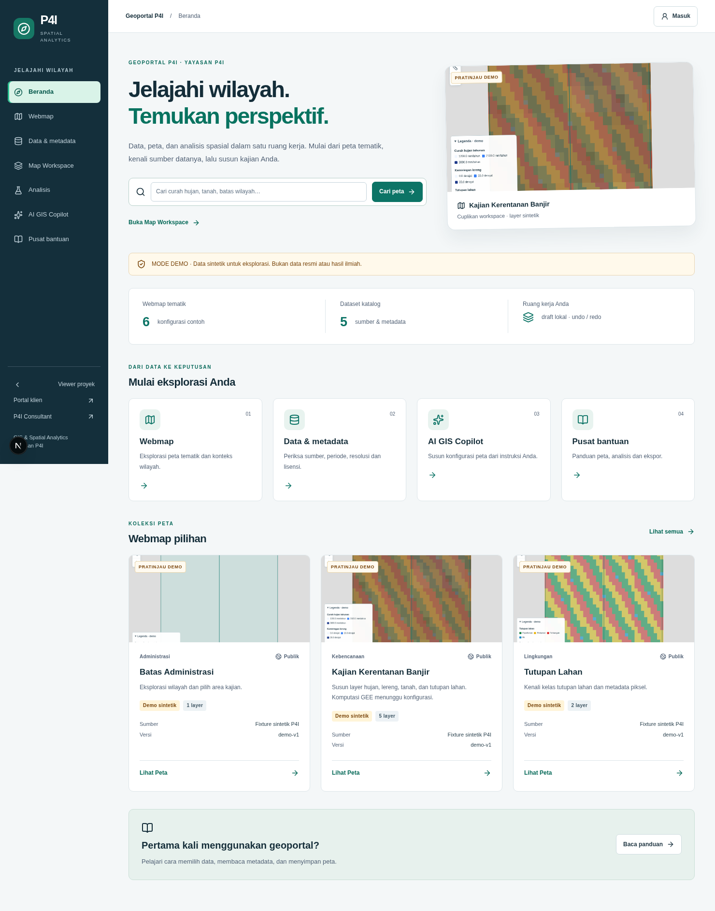
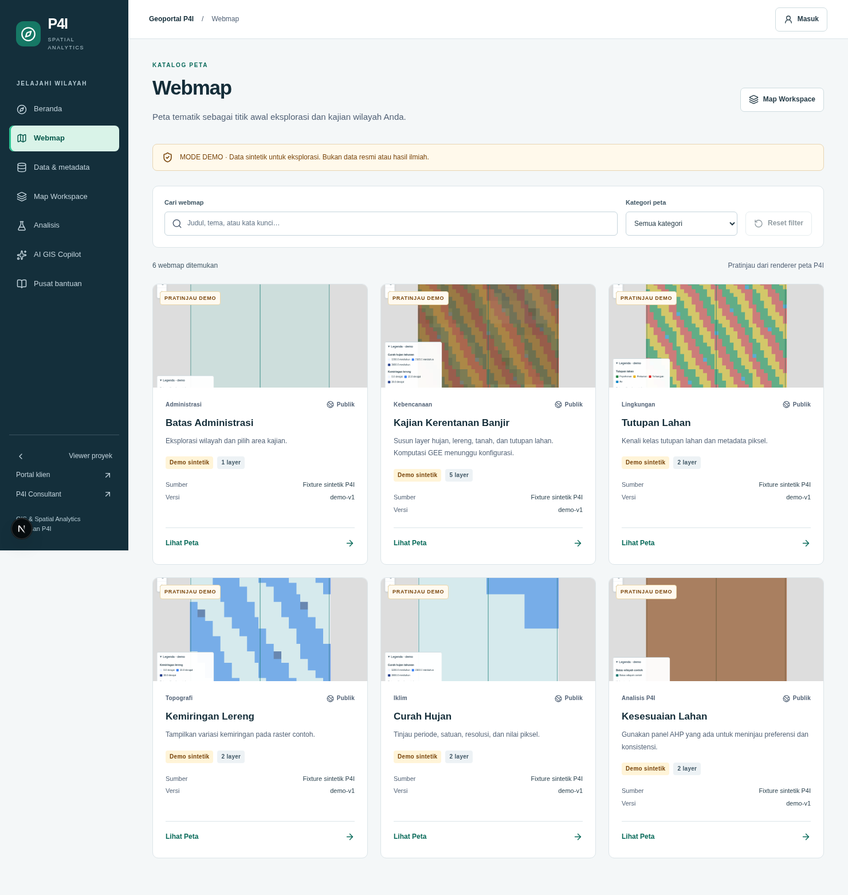
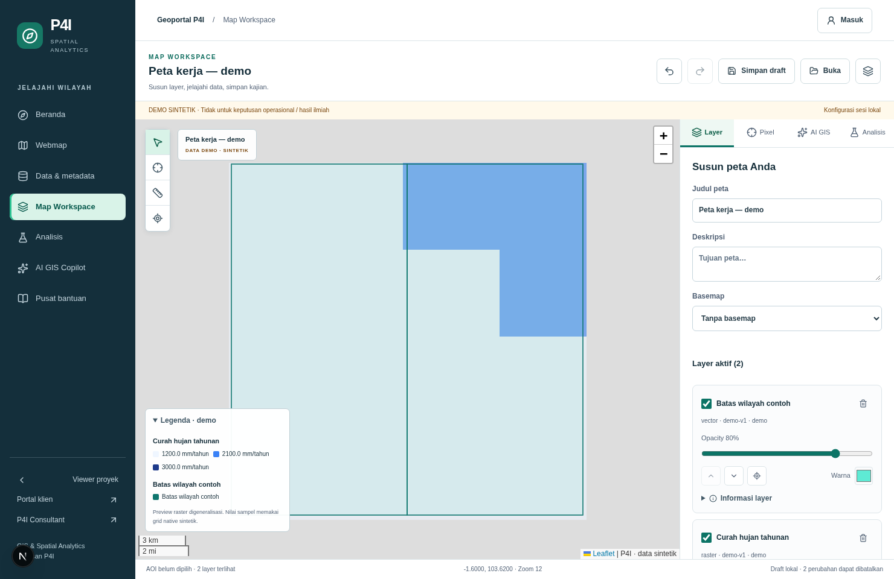
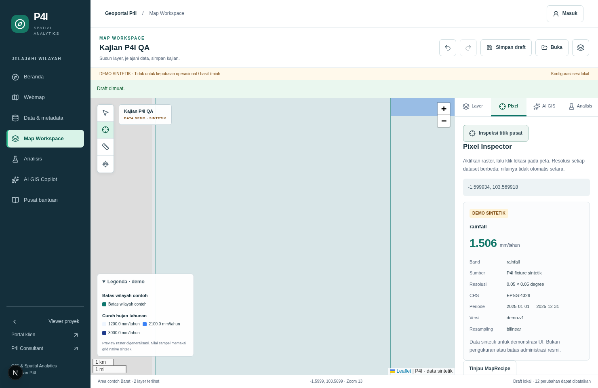
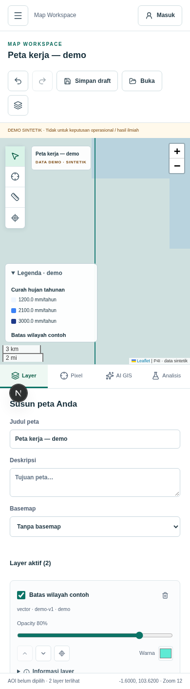

# P4I WebGIS — Phase 02: Professional Geoportal UI/UX

Tanggal: 13 Oktober 2026 (Asia/Jakarta). Branch: `feat/phase-02-geoportal-ux`.
Baseline UI: commit Phase 01 lokal `35f9848`, dengan working tree bersih sebelum pengerjaan.

## Hasil antarmuka

Portal memiliki navigasi, hierarki informasi dan bahasa visual yang konsisten: sidebar P4I,
breadcrumb halaman, tipografi, warna teal, kartu metadata dan pola status yang sama di tujuh route.
Home menghubungkan pencarian dengan katalog Webmap, menampilkan koleksi tematik dan panduan memulai.
Halaman bantuan kini dapat dicari, dengan accordion native dan panduan keyboard/draft.

Katalog Webmap menyediakan pencarian, filter kategori, jumlah hasil, reset dan keadaan kosong.
Setiap kartu mencantumkan akses, status demo/tersedia/belum tersedia, layer, sumber dan versi.
Enam gambar preview merupakan **screenshot aktual `SpatialMap`/Leaflet**, diambil dari workspace
menggunakan konfigurasi tematik masing-masing; bukan mockup atau aset INA/BIG. Watermark demo
selalu terlihat. Kartu yang datasetnya belum aktif tidak menawarkan aksi membuka peta seolah data tersedia.

Katalog Data mendukung pencarian judul/sumber/kata kunci, filter jenis/kategori/status dan reset.
Metadata lengkap dapat dibuka dengan keyboard. Sumber, resolusi, periode, lisensi, CRS, bounds,
NoData dan resampling ditampilkan dari metadata katalog; cakupan resmi tidak dikarang.

Workspace mempertahankan engine dan kemampuan Phase 01: visibility/opacity/style/order,
basemap OSM/none, AOI contoh, legend, AHP/WLC, Pixel Inspector, Copilot, draft, undo/redo,
JSON dan PNG/PDF. Panel dapat disembunyikan; `ResizeObserver` memperbarui ukuran Leaflet
setelah perubahan layout. Legenda menggunakan disclosure native. Title dan description menampilkan
nilai sebenarnya, termasuk penghapusan deskripsi. Kontrol sesi dinonaktifkan selama loading dan
template diinisialisasi sebelum paint agar edit pengguna tidak tertimpa.

Panel analisis menampilkan konteks AOI/layer/bobot tersimpan. Flood nyata tetap berada dalam
viewer proyek dengan mekanisme izin yang sudah ada; tidak dipicu oleh AOI sintetik. Workspace
bermode unavailable menampilkan penjelasan dan tautan viewer proyek, tanpa menyisipkan layer
legacy yang tidak tercantum pada MapRecipe.

Copilot mempertahankan percakapan/rencana saat berpindah panel atau panel ditutup.
Konflik snapshot dari Phase 01 tetap mencegah respons lama menimpa edit baru. Impor JSON
memeriksa snapshot sebelum menerapkan hasil pembacaan file; pemuatan local draft tetap divalidasi,
dengan batas ukuran 64 KiB. Penyimpanan tidak mengubah database.

## Inventaris route

| Route | Fungsi | Verifikasi |
| --- | --- | --- |
| `/spatial/home` | Beranda, pencarian Webmap, koleksi dan jalur bantuan | Browser desktop/mobile, axe |
| `/spatial/webmap?q=...` | Katalog peta tematik, pencarian/kategori dan View Map | Filter/action, empty/reset, unavailable state |
| `/spatial/data` | Katalog data, metadata dan filter jenis/kategori/status | Filter/reset, metadata disclosure, retry error |
| `/spatial/help` | Panduan dicari, accordion, quickstart dan keyboard | Search/Enter, axe |
| `/spatial/viewer?webmap=...` / `?dataset=...` | MapRecipe workspace dan pemilihan layer | Layer/AOI/draft/export, recovery jika ID salah |
| `/spatial/ai` | Workspace dengan panel AI GIS terbuka | Axe; Copilot plan/apply/undo pada smoke |
| `/spatial/analysis` | Workspace dengan konteks dan editor AHP | Axe; AHP recipe dan PDF pada smoke |
| `/spatial` | Viewer proyek lama dan Flood nyata | Route dan guard regression Phase 01 dipertahankan |
| `/login`, `/portal`, `/` | Login/portal klien/P4I Consultant | Tautan shell dipertahankan; session navigation memakai API existing |

Tujuh halaman portal mendapat judul dokumen berbeda agar announcer Next.js membedakan navigasi.
Tidak ada route backend/data baru atau engine peta kedua.

## Aksesibilitas dan responsivitas

- Skip link ke main content, nama kontrol yang jelas, focus-visible, alt text preview dan hierarchy heading.
- Menu mobile memakai native modal dialog. Tab/Shift+Tab berputar di dalam menu; Esc menutup,
  fokus kembali ke tombol pemicu, dan pemilihan tautan menutup menu.
- Panel menggunakan tablist/tab/tabpanel dengan satu tab stop. ArrowLeft/ArrowRight/Home/End
  memilih dan memfokuskan tab; semua hubungan `aria-controls` menunjuk panel yang ada.
- Leaflet tetap mendukung keyboard pan/zoom. Tombol “Inspeksi titik pusat” memberi jalur sampling
  tanpa klik mouse. Accordion bantuan dan legenda menggunakan perilaku keyboard native.
- Contrast masalah pada label/CR AHP ditemukan dan diperbaiki khusus scope geoportal.
- Controls toolbar 40×42 px, tabs mobile ≥48 px tinggi, kontrol layer minimum 32 px;
  `prefers-reduced-motion` dihormati. Tidak ada hijack shortcut browser global.
- Browser memeriksa viewport 320×740, 390×844, 768×1024, 1024×768, 1480×960:
  tidak ada horizontal overflow pada home/webmap/data/help/viewer, dan bounding boxes toolbar,
  label, legend dan zoom tidak berpotongan. Batas area scroll panel juga diuji agar tidak melewati footer. Panel mobile berada di bawah peta dan dapat discroll.

Axe Core memeriksa tujuh halaman pada lebar 1480 dan 390 (14 kombinasi) untuk WCAG 2 A/AA,
WCAG 2.1 AA dan best practices: **nol violations** pada keadaan yang diuji.
Ini bukti otomatis pada scope portal, bukan sertifikasi WCAG seluruh aplikasi atau uji screen reader manual.

## Pengujian

Node **22.23.3**, npm **10.9.9**. Tidak ada perubahan package.json/package-lock atau dependency aplikasi baru.
Axe/Prettier hanya digunakan sebagai helper di luar manifest aplikasi.

| Pemeriksaan | Hasil |
| --- | --- |
| npm run lint | Lulus |
| npm run typecheck | Lulus |
| npm test | **81 tes / 19 file lulus**, tanpa skip/disable |
| npm run build | Lulus, production build Node 22 |
| git diff --check | Bersih |
| Chromium desktop/mobile smoke | Lulus, nol `pageerror` |
| Axe | 14 kombinasi halaman/viewport lulus |
| Production unavailable UI | Desktop/mobile lulus; fixture sampling 503 meskipun flag demo true |

Enam tes UI/presentation baru mencakup filter kombinasi, status Webmap missing/unavailable/demo,
roving tab markup dan tautan/metadata dataset. QA browser tersimpan di `scripts/qa/`:

- `phase-02-smoke.mjs`: Home → pencarian → filter → View Map, title/description, layer controls,
  AOI, local save/load/undo/redo, resize, keyboard tabs/pixel/legend, AHP, Copilot retention/apply/undo,
  invalid import, JSON/PNG/PDF downloads, help accordion, mobile focus/overlay/overflow dan retry error.
- `phase-02-accessibility.mjs`: assert axe dan overflow pada tujuh halaman, desktop/mobile;
  menghasilkan JSON dan screenshot halaman.
- `capture-webmap-previews.mjs`: capture enam thumbnail dari renderer workspace yang sama.
- Skrip Phase 01 diperbarui mengikuti role tab/dialog dan nama View Map yang baru. Regresi race,
  layer order, AHP dan demo isolation kembali lulus.

PDF hasil smoke diperiksa dengan pdftotext: title, description, AOI, saved AHP, sumber,
resolusi dan disclaimer sintetis ada. Scan 37 client JS bundle tidak menemukan nama binding
service-role/GEE JSON atau marker private key; modul server-only tetap utuh.

Contoh replay di cloud setelah dev server demo port 3000 berjalan:

```bash
export P4I_PLAYWRIGHT_MODULE=/opt/codex/cua_node/lib/node_modules/playwright-core/index.mjs
export P4I_QA_ARTIFACTS=/tmp/p4i-phase-02
node scripts/qa/phase-02-smoke.mjs
P4I_AXE_SCRIPT=/workspace/artifacts/phase-02/a11y/node_modules/axe-core/axe.min.js \
  node scripts/qa/phase-02-accessibility.mjs
```

Di mesin lain, set path modul Playwright, Chromium (`P4I_CHROMIUM`) dan Axe sesuai instalasi
lokal. Runner QA bukan deploy command; seluruh mutasi GIS smoke adalah recipe demo lokal.

## Bukti visual

[Smoke log](evidence/phase-02/flows.log), [smoke summary](evidence/phase-02/flows.json),
[axe JSON](evidence/phase-02/accessibility.json), [production UI log](evidence/phase-02/production-qa.log),
[Phase 01 regression log](evidence/phase-02/phase-01-regression.log).
Screenshot dan preview diambil langsung dari aplikasi berjalan. Screenshot mobile menampilkan
peta yang sudah selesai dimuat; panel yang panjang menggunakan scroll internal.







## Git, keterbatasan dan dependensi

Remote authoritative `HannR002/p4i-webgis` telah di-fetch. Saat mulai, remote main tetap
`dfe412c`; Phase 01 `35f9848` hanya ditemukan lokal, walaupun instruksi menyebut sudah merged.
Branch Phase 02 berangkat dari commit lokal yang telah direview itu. Jangan menganggap bahwa
PR ke main hanya memuat UI Phase 02: parent Phase 01 juga masuk sampai sinkronisasi/merge benar terjadi.
Diff khusus Phase 02 dapat diperiksa terhadap `35f9848`.

Commit implementasi `45c15fd` berhasil di-push ke `origin/feat/phase-02-geoportal-ux`.
Percobaan aktual `gh pr create --draft --base main --head feat/phase-02-geoportal-ux`
mengembalikan `Post https://api.github.com/graphql: Forbidden` (exit 1); tidak ada PR yang dibuat.
Gunakan [halaman pembuatan PR yang diberikan GitHub](https://github.com/HannR002/p4i-webgis/pull/new/feat/phase-02-geoportal-ux)
dan [deskripsi siap pakai](phase-02-pr.md). Branch remote dapat direview tanpa PR.
Tidak ada merge otomatis atau force push.

- Data tetap fixture; GEE/LLM nyata, scientific validation dan map persistence DB masih pending.
- Public project list staging tetap 200; boundary request tetap 500/PGRST202 pada regresi.
  RPC/DDL staging tidak diubah. Happy path login akun nyata/B2B/admin dan analisis GEE belum diuji.
- Basemap OSM merupakan opsi existing; export/QA utama memakai none untuk reproducibility tanpa CORS.
  Screenshot sintetis dan legend tidak menyatakan cakupan administrasi resmi.
- URL referensi INA-Geoportal tidak dapat diakses dari cloud ini (proxy CONNECT 403).
  Pola discover/catalog/metadata/viewer/help digunakan secara konseptual; tidak ada aset/branding
  BIG atau layout situs yang disalin, dan review langsung situs referensi tidak diklaim.
- Tidak ada deploy/Hostinger change, migrasi, perubahan data produksi, layanan berbayar,
  upload dataset nyata atau pengungkapan secret.


## Phase 02 changed files (relative to 35f9848)

- `app/spatial/(portal)/ai/page.tsx`
- `app/spatial/(portal)/analysis/page.tsx`
- `app/spatial/(portal)/data/page.tsx`
- `app/spatial/(portal)/help/page.tsx`
- `app/spatial/(portal)/home/page.tsx`
- `app/spatial/(portal)/viewer/page.tsx`
- `app/spatial/(portal)/webmap/page.tsx`
- `app/spatial/gis.css`
- `components/gis/MapWorkspace.tsx`
- `components/gis/PortalPages.tsx`
- `components/gis/PortalShell.tsx`
- `components/gis/WorkspaceMapContent.tsx`
- `components/gis/WorkspaceTabs.tsx`
- `docs/evidence/phase-02/accessibility.json`
- `docs/evidence/phase-02/ai-desktop.png`
- `docs/evidence/phase-02/analysis-desktop.png`
- `docs/evidence/phase-02/data-desktop.png`
- `docs/evidence/phase-02/flows.json`
- `docs/evidence/phase-02/flows.log`
- `docs/evidence/phase-02/help-desktop.png`
- `docs/evidence/phase-02/home-desktop.png`
- `docs/evidence/phase-02/phase-01-regression.log`
- `docs/evidence/phase-02/pixel-desktop.png`
- `docs/evidence/phase-02/production-qa.log`
- `docs/evidence/phase-02/unavailable-390.png`
- `docs/evidence/phase-02/viewer-desktop.png`
- `docs/evidence/phase-02/webmap-desktop.png`
- `docs/evidence/phase-02/workspace-320.png`
- `docs/evidence/phase-02/workspace-390.png`
- `docs/implementation-report.md`
- `docs/local-review.md`
- `docs/phase-02-geoportal-report.md`
- `docs/phase-02-pr.md`
- `lib/gis/presentation.ts`
- `public/gis/previews/administration.png`
- `public/gis/previews/climate.png`
- `public/gis/previews/flood.png`
- `public/gis/previews/landcover.png`
- `public/gis/previews/suitability.png`
- `public/gis/previews/terrain.png`
- `scripts/qa/capture-webmap-previews.mjs`
- `scripts/qa/phase-01-regression.mjs`
- `scripts/qa/phase-01-smoke.mjs`
- `scripts/qa/phase-02-accessibility.mjs`
- `scripts/qa/phase-02-smoke.mjs`
- `tests/gisPortalUi.test.tsx`
- `tests/gisPresentation.test.ts`
