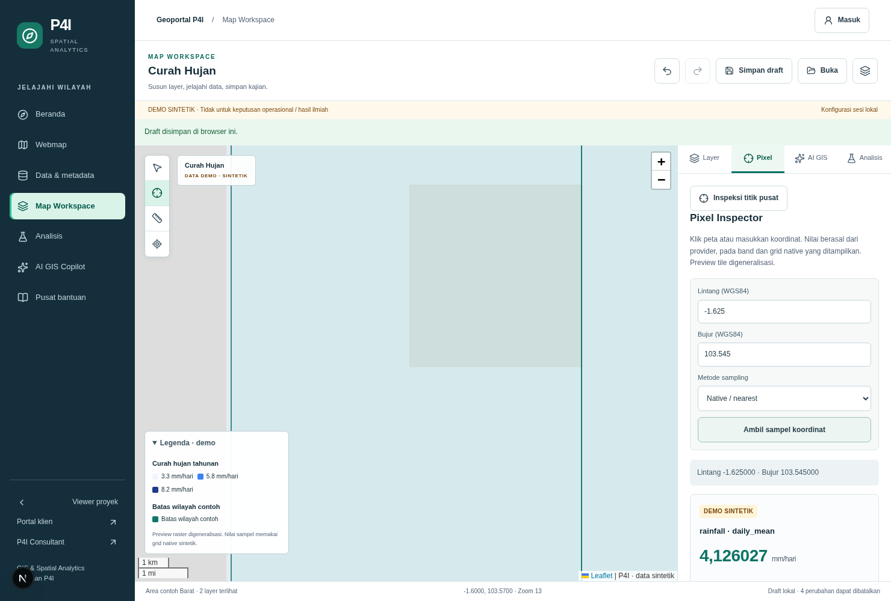
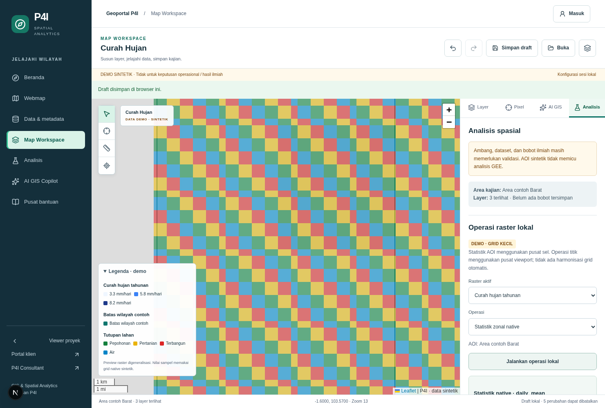
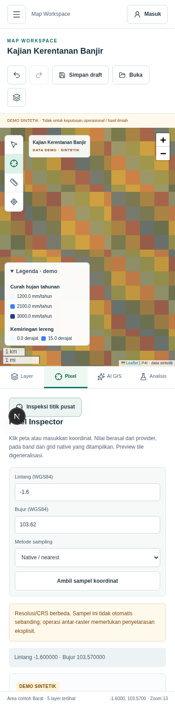
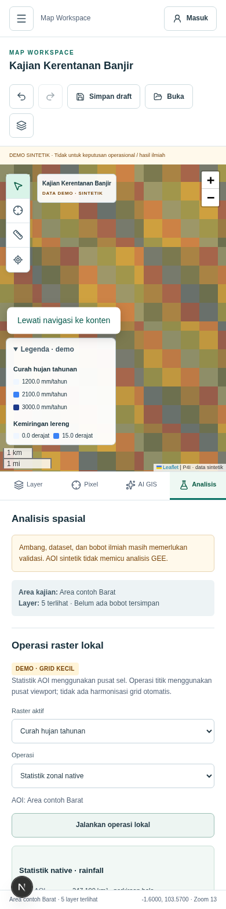

# Phase 03 — Raster engine and Pixel Inspector

Verified 13 October 2026 on Node 22.23.3/npm 10.9.9, Next 16.3.5 and real Chromium.
The working implementation is on `feat/phase-03-raster-engine`; no merge or deployment.

## Result

Raster is now a typed, async provider capability within the existing Leaflet/MapRecipe engine.
Pixel Inspector obtains provider-returned band values rather than deriving measurements from tile
colors. Selected bands use physical scale/offset and integrate with rendering, legends, draft
persistence, undo/redo, JSON and PDF metadata. Existing AHP/WLC, Flood, Copilot and export remain.

New local functions cover coordinate transformation/grid identification, NoData, continuous vs
categorical semantics, classification, normalization, validated point arithmetic/weighted overlay,
native AOI statistics, spherical area/distance and vector selection utilities. Clip/mask computes
a native window/count descriptor, not a file. All fixture outputs remain explicitly DEMO.

The implementation validates both input and output DTOs, checks every dataset operand's permissions
before sampling, propagates masks, rejects implicit cross-grid arithmetic and strips uncontracted
fields. Sampling is bounded by five seconds; local AOI work by 4,096 cells. Demo display tiles are
bounded previews and no nationwide arrays enter browser state.

## Routes and changed areas

| Route/area | Change |
| --- | --- |
| POST /api/gis/pixel | Async provider, selected bands, EPSG:4326/3857 coordinates, explicit nearest/bilinear, validated actual response, cancellation, safe failure states. Legacy lat/lon input retained. |
| POST /api/gis/process | New allowlisted operation endpoint with access checks and validated scalar/statistics/subset DTOs. |
| GET /api/gis/tiles/[id]/[z]/[x]/[y] | Selected-band, bounded demo SVG preview sharing native sampling/color semantics. |
| /spatial/viewer and /spatial/analysis | Same workspace engine; band selector, keyboard/manual inspector, contextual raster tools and readable results. |
| /spatial/home, /spatial/webmap, /spatial/data | Existing portal routes retained; metadata versions and generated previews refreshed for demo-v2. |
| Recipe/export | Optional style.band retains schema-1 compatibility; band units/ranges in legend and PDF encoding/grid/NoData/provenance. |

See [raster architecture](raster-pixel-analysis.md) and [real adapter contract](raster-real-data-adapter-contract.md).

## Verification

| Check | Result |
| --- | --- |
| Lint | Passed, no warnings/errors. |
| Typecheck | Passed. |
| Vitest | **123 tests / 22 files passed**, none skipped/disabled; 42 new tests preserve the existing 81. |
| Production build | Passed on Node 22.23.3. |
| Raster tests | Axis/CRS/cell edges/centers, scale/offset, NoData/zero, categories, interpolation, metadata/rules, units/grid/period, style/recipe roundtrip, access-before-query, provider failure/timeout and sanitized response DTOs. |
| New browser flows | Selected band raw/physical values; masked/outside coverage; manual query; categorical sampling and rejected interpolation; mismatch warning; AOI statistics/area; clip descriptor; zero division mask; category histogram; draft/undo; real JSON/PNG/PDF downloads. |
| Responsive/accessibility | New Pixel/Analysis states at 1480 and 390 px; four Axe WCAG A/AA audits with zero violations, no horizontal overflow/page errors. This is automated state coverage, not a full accessibility certification. |
| Phase 02 regression | Home/catalog/filter/retry, invalid map recovery, layers/AOI/panel resize, keyboard controls, recipe/draft/undo, AHP/Copilot, exports; 320/390/768/1024/1480 px passed. |
| Production isolation | Fresh next start with GIS_DEMO_MODE=true: pixel/process both 503. No fixture production fallback. |
| Client bundle | 38 generated JS files; zero service-role/GEE-secret/private-key markers. No secret values recorded. |

Evidence: [browser log](evidence/phase-03/browser.log), [audit summary](evidence/phase-03/browser-summary.json),
[regression](evidence/phase-03/phase-02-regression.log), [tests](evidence/phase-03/tests.log),
[lint](evidence/phase-03/lint.log), [typecheck](evidence/phase-03/typecheck.log),
[build](evidence/phase-03/build.log), [production](evidence/phase-03/production-isolation.json),
[client scan](evidence/phase-03/client-bundle-scan.json).

Screenshots show the running application, not mockups:

Browser export files were downloaded and inspected outside source control. PDF text includes
daily_mean/mm-hari, scale 1/365, native grid, NoData, demo-v2 and provenance. Processing summaries
are transient and not scientific exported products.

## Review and baseline dependency

Remote main remained `dfe412c81c1254707cbd16083791dc009cf90643` at verification; it did not contain
the assumed approved/merged Phase 02. This branch continues the verified remote Phase 02 head
`4d40a8ef98ffa227656fd293eabeed42987a8975` and preserves its Phase 01 parent. The intended stacked
PR base is `feat/phase-02-geoportal-ux`, isolating Phase 03 for review. Reconcile parent phases
before a later main merge; do not treat this as evidence they were merged.

The prepared [PR description](phase-03-pr.md) records publishing/PR availability. No force push,
automatic merge, deployment, database migration, paid service or production data changes.

## Known limits

- Real GEE/PostGIS/GeoTIFF adapters, catalog/tiles and authoritative sample reference data remain
  pending. Existing staging Supabase availability alone does not provide real raster data.
- Production raster sampling/processing stays unavailable; real credentials and billable work
  were neither configured nor exercised.
- Local AOIs are fixture IDs; coordinates support only EPSG:4326/3857 north-up pixel-area grids.
  Statistics use native centers/unweighted means; area/distance use a spherical approximation.
- Cross-grid resampling, rotated/other-CRS grids, scientific area weighting and full raster algebra
  remain unavailable. Local classification/arithmetic are point operations.
- Clip/mask returns descriptors with artifact:null; no downloadable GeoTIFF/new raster layer.
  Remote processing needs enforced budgets/cancellation or a bounded job design before real use.
- Browser QA used no external basemap for deterministic exports; real account/login and real
  flood/GEE computations were not exercised. Automated audits cover the recorded states only.
- Cloud onboarding provides screenshots, not a public interactive deployment. See
  [local review](local-review.md) to run this feature branch in Antigravity/local browser.

## Reproduce browser QA

Start one development server on localhost:3000 with GIS_DEMO_MODE=true and Node 22. The script
uses external QA-only Playwright/Chromium and Axe; application manifests/lockfile are unchanged.
Set P4I_PLAYWRIGHT_MODULE to an installed playwright-core module, P4I_CHROMIUM to Chromium,
P4I_AXE_SCRIPT to axe-core/axe.min.js and P4I_QA_ARTIFACTS to an output directory, then run
`node scripts/qa/phase-03-raster.mjs`. Run phase-02-smoke.mjs for prior portal regression.
Do not run browser fixtures on production or treat synthetic results as real measurements.
